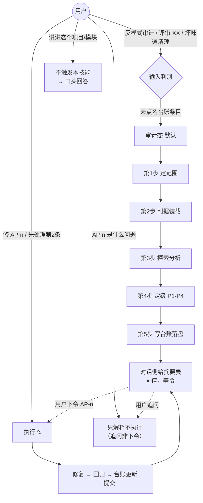
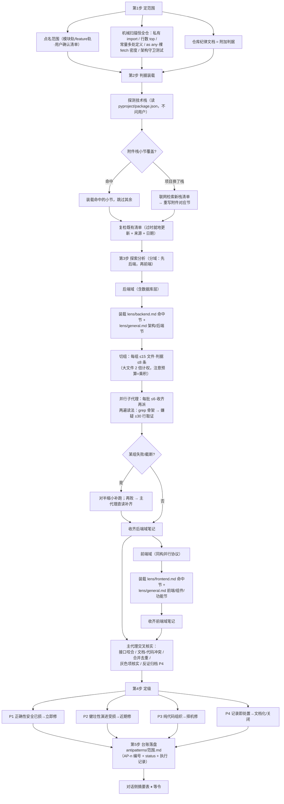
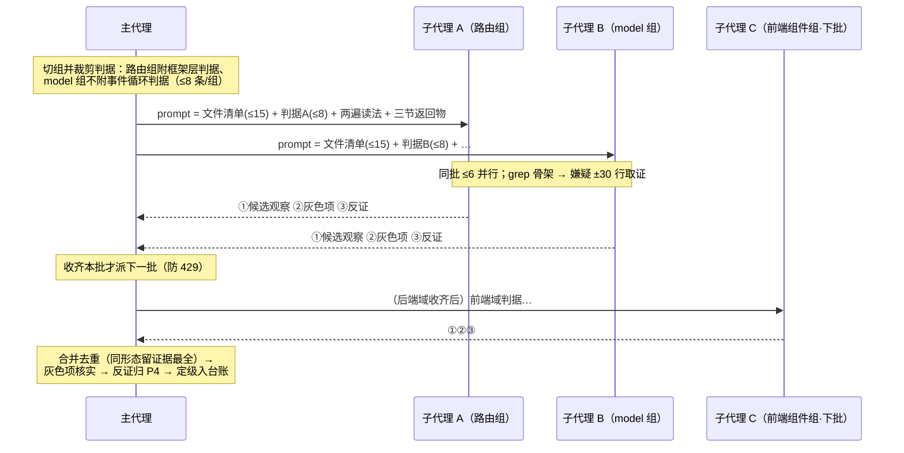
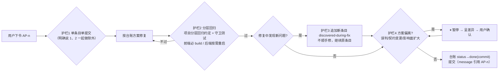
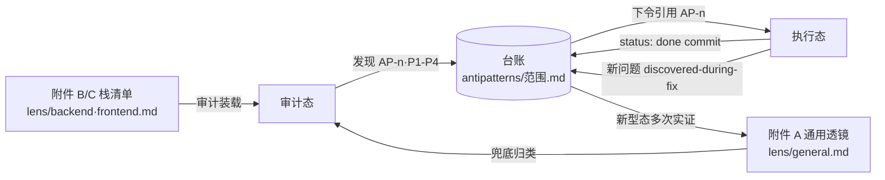

# anti-patterns 技能流程图

> 附件 D（lens/flow.md）。SKILL.md 全流程的 mermaid 可视化——技能维护者用来校验流程改动后图文一致；审计执行时以 SKILL.md 文字为准，本图仅供快速回忆流程骨架。

## 一、两态协议总览

**图 1：两态协议——执行权在用户，审计态产出台账后停等令**

## 二、审计态五步（含判据装载与分域并行）

**图 2：审计态五步——判据分域装载、子代理双重上限并行清查、证据链进台账**

## 三、子代理单组生命周期（第 3 步内部）

**图 3：单组子代理生命周期——判据按组裁剪、批间串行、主代理三职责**

## 四、执行态四护栏

**图 4：执行态四护栏——单条目单提交、分层回归、新问题不扩散、偏离即停**

## 五、台账数据流

**图 5：台账数据流——附件判据 ↔ 审计 ↔ 台账 ↔ 执行的闭环，新型态可晋升回通用透镜**
