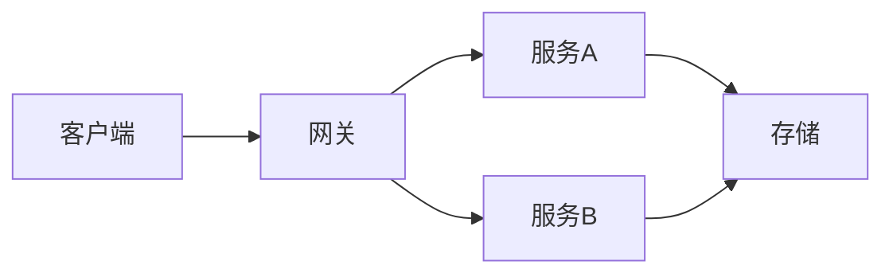

<!-- slide: layout=title -->

# 产品发布汇报

2026 年度旗舰产品发布
产品团队 · 2026-11-01

<!-- slide: layout=section -->

# 第一部分

市场与竞品分析

<!-- slide: layout=title-content anim=bullets:enter.fly-in notes="开场三要点，注意节奏" -->

# 核心亮点

- **快**：性能提升 3 倍
- **稳**：99.99% 可用性
- **省**：成本下降 40%
- <mark>全新交互</mark> 框架

### 补充说明

引擎重构带来的边际收益，详见技术白皮书。

<!-- slide: layout=two-col -->

# 优劣势对比

- 优势一
- 优势二

---

- 劣势一
- 劣势二

<!-- slide: layout=title-content -->

# 季度数据

<!-- block: chart=bar -->

| 季度 | 营收 | 利润 |
|---|---|---|
| Q1 | 120 | 30 |
| Q2 | 180 | 55 |
| Q3 | 260 | 90 |
| Q4 | 310 | 120 |

<!-- slide: layout=title-content -->

# 价格策略

<!-- block: chart=pie -->

| 档位 | 占比 |
|---|---|
| 基础版 | 45 |
| 专业版 | 35 |
| 旗舰版 | 20 |

<!-- slide: layout=title-content -->

# 项目排期

<!-- block: anim=enter.zoom -->

| 阶段 | 周期 | 负责人 |
|---|---|---|
| 设计 | 2 周 | Alice |
| 开发 | 6 周 | Bob |
| 测试 | 2 周 | Carol |

> 排期为初版估算，以周会同步为准。

<!-- slide: layout=title-content -->

# 技术架构（示意）



<!-- slide: layout=title-content -->

# 关键代码

```python
def render(deck):
    for slide in deck.slides:
        place(slide)
```

- 行内示例：`slide_width` 与 <span class="accent">主题角色色</span>

<!-- slide: layout=quote bg=bg-alt -->

> 简单是可靠的先决条件。

—— Edsger Dijkstra

<!-- slide: layout=blank -->

<!-- block: x=5% y=8% w=40% h=20% anim=enter.fly-in direction=left -->
# 自由画布示例

<!-- block: x=5% y=35% w=40% h=55% -->
- 块一
- 块二
- 块三

<!-- block: x=50% y=8% w=45% h=82% align=center -->
右侧自由区域 — 可以放任意块

<!-- block: x=50% y=60% w=45% h=30% anim=emphasize.pulse -->
关键结论放这里

<!-- slide: layout=title-content -->

# 缺图降级示例

<!-- block: fit=contain style=rounded,shadow -->

