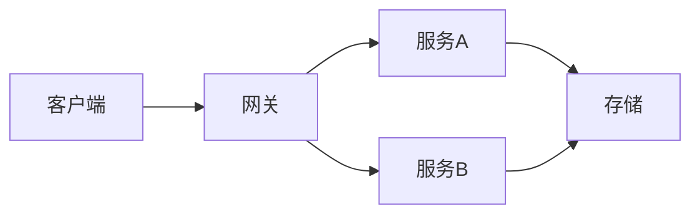

<!-- slide: layout=title -->

# 产品发布汇报

2026 年度旗舰产品发布
产品团队 · 2026-11-01

<!-- slide: layout=section -->

# 第一部分

市场与竞品分析

<!-- slide: layout=title-content anim=bullets:enter.fly-in notes="开场三要点，注意节奏" -->

# 核心亮点

- **快**：性能提升 3 倍
- **稳**：99.99% 可用性
- **省**：成本下降 40%
- <mark>全新交互</mark> 框架

### 补充说明

引擎重构带来的边际收益，详见技术白皮书。

<!-- slide: layout=two-col -->

# 自建 vs 采购：怎么选

**自建**
- 数据全留本地，合规与主权可控
- 源码可读可改，能贴着业务长

---

**采购**
- 部署即用，零研发投入
- 成熟度高，生态与培训现成

<!-- slide: layout=title-content -->

# 季度数据

<!-- block: chart=bar -->

| 季度 | 营收 | 利润 |
|---|---|---|
| Q1 | 120 | 30 |
| Q2 | 180 | 55 |
| Q3 | 260 | 90 |
| Q4 | 310 | 120 |

<!-- slide: layout=title-content -->

# 价格策略

<!-- block: chart=pie -->

| 档位 | 占比 |
|---|---|
| 基础版 | 45 |
| 专业版 | 35 |
| 旗舰版 | 20 |

<!-- slide: layout=title-content -->

# 项目排期

<!-- block: anim=enter.zoom -->

| 阶段 | 周期 | 负责人 |
|---|---|---|
| 设计 | 2 周 | Alice |
| 开发 | 6 周 | Bob |
| 测试 | 2 周 | Carol |

> 排期为初版估算，以周会同步为准。

<!-- slide: layout=title-content -->

# 技术架构（示意）



<!-- slide: layout=title-content -->

# 关键代码

```python
def render(deck):
    for slide in deck.slides:
        place(slide)
```

- 行内示例：`slide_width` 与 <span class="accent">主题角色色</span>

<!-- slide: layout=quote bg=bg-alt -->

> 简单是可靠的先决条件。一个系统真正的复杂度，
> 往往藏在那些为了「以后可能用到」而提前加进来的部分。

—— Edsger W. Dijkstra ·《The Humble Programmer》

<!-- slide: layout=blank -->

<!-- block: x=6% y=8% w=42% h=16% anim=enter.fly-in direction=left -->
# 自由画布

<!-- block: x=6% y=32% w=42% h=30% -->
- 块位置用百分比坐标控制
- 适合海报式、时间轴、拼贴
- 只在 blank 版式下生效

<!-- block: x=6% y=68% w=42% h=24% anim=emphasize.grow -->
**关键结论**：坐标即语义

<!-- block: x=54% y=8% w=40% h=84% align=center -->
### 右侧自由区域

任意块 + 任意坐标，
互不干扰、自动适配。

> blank 是逃生舱，
> 常规页请优先用命名版式。

<!-- slide: layout=stats kicker="09 · 数据" takeaway="增长主要来自口碑，投放只占 12%" source="后台统计 2026-10" -->

# 三个数字看增长

| 数值 | 说明 |
|---|---|
| **3.2 倍** | 同比增长 |
| **86%** | 新用户来自口碑推荐 |
| **12%** | 付费投放占比 |

<!-- slide: layout=timeline kicker="10 · 历程" -->

# 一年三步走到今天

| 日期 | 事件 | 说明 |
|---|---|---|
| 2025-11 | 立项 | 三人小团队，两周出原型 |
| 2026-03 | 内测 | 首批 500 用户，收到 200 条反馈 |
| 2026-10 | 正式发布 | 首月 3.2 万用户 |

<!-- slide: layout=compare vs_label="VS" takeaway="多数团队应该先采购，规模上去再自建" -->

# 自建 vs 采购：怎么选

**自建**

- 数据全留本地，合规可控
- 源码可读可改，贴着业务长

---

**采购**

- 部署即用，零研发投入
- 成熟度高，生态与培训现成

<!-- slide: layout=matrix x_axis="实施成本" y_axis="业务价值" -->

# 四个方向怎么排

|  | 低成本 | 高成本 |
|---|---|---|
| **高价值** | 快速试点验证 | 战略级投入 |
| **低价值** | 顺手做掉 | 明确暂缓 |

<!-- slide: layout=big-number number="3 倍" kicker="12 · 结论" takeaway="机会在明确验收标准的高频任务上" -->

# 效率到底提升了多少

### 同样一个需求，从两天到半天

- 成立的前提：任务边界清晰、有可自动验证的验收标准
- 探索性任务提升有限，实测约 1.3 倍
