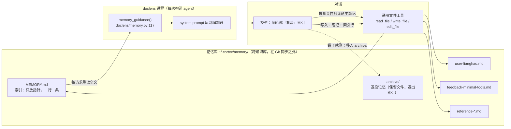
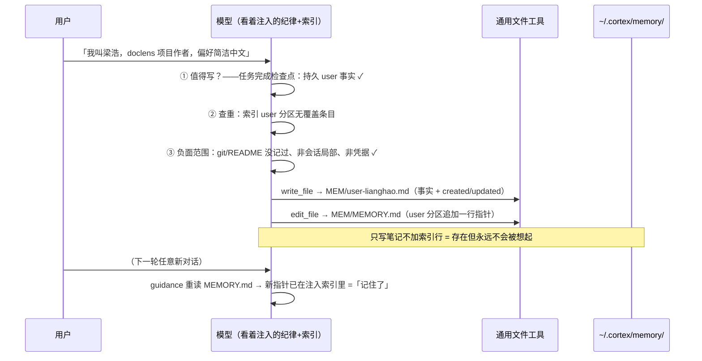

# doclens 长期记忆实现解析

> 写给人类的实现说明：记忆功能是怎么工作的。协议源：[Engramory](https://github.com/tinqiao-oss/engramory)（tinqiao-oss，MIT）——curated file-based long-term memory。设计决策见 `docs/adr/0042-pure-discipline-memory.md`（纯纪律形态）。

## 一图总览



## 核心循环：三件事，没有数据库

记忆 = **文件 + 提示词注入 + 模型自律**。没有向量库、没有专用工具、没有后台服务。

### 1. 存储：一个用户可审计的文件夹

```
~/.cortex/memory/           ← 记忆库根（开发模式；发行版 ~/.doclens/memory）
  MEMORY.md                 ← 索引：只放指针，一行一条记忆
  user-lianghao.md          ← 一条记忆 = 一个文件 = 一个事实
  archive/                  ← 退役记忆（保留文件，退出索引）
```

索引按四类型分区，每行一条指针：

```markdown
## user
- [用户：梁浩](user-lianghao.md) — doclens 项目作者，偏好简洁中文回答

## feedback
- [少加工具优先](feedback-minimal-tools.md) — 新能力默认通用工具+注入达成，专用工具先确认
```

| 类型 | 记什么 | 笔记正文必填 |
|---|---|---|
| `user` | 用户是谁、身份、持久偏好 | — |
| `feedback` | 该怎么工作（可复用纠正）——程序性记忆的脊梁 | `Why:` + `How to apply:` 行首标签 |
| `project` | 项目已定局事实；相对日期转绝对日期，当前状态不存只记「去哪读」 | 同上 |
| `reference` | 外部资源指针（在哪，不抄内容） | — |

frontmatter 是受限的逐行 `key: value` 格式（非完整 YAML）：`name / description / type / created / updated`（日期 YYYY-MM-DD）。

### 2. 注入：每次对话开始时「自动想起」

`memory_guidance()`（`doclens/memory.py`）在**每次构造 agent 时**重读 `MEMORY.md`，把「纪律条款 + 索引全文」拼成一段，追加进 system prompt。模型不需要主动想起加载什么——每轮它都「看着」索引；要细节就用通用 `read_file` 打开指向的笔记。

两个工程性质：

- **前缀缓存稳定**：文件不变则注入内容不变（与 `kb_root_guidance` 同模式），不打爆 LLM 的 system 前缀缓存；
- **写后下一轮生效**：无需重启——下一轮重读的就是新文件。

### 3. 读写与防失控：全靠纪律，没有守卫

这是与原协议最大的差异（ADR-0042）。原版 Engramory 在 Claude Code 上挂 PreToolUse hook，对超限且增长的索引写**机器拒绝**；doclens 是纯纪律：

- **读写走通用工具**（read_file / write_file / edit_file），零新增 memory_* 工具；
- **上限只是纪律提示**：软 150 行 / 20KB（先压缩再增长）、硬 200 行 / 25KB，写在注入段里靠模型遵守；
- **为什么敢**：Claude Code 硬拦是因为它只加载索引前 200 行、超了**静默丢**；doclens 全量注入，超限后果只是每轮多花 token——防线从「防数据丢失」降级为「防 token 失控」。兜底 = MEMORY.md 用户可见可审计，膨胀下一轮即暴露。

## 新记忆条目怎么加进去（写入链路）

写入者就是模型自己，按注入纪律逐步执行。以真实一例（「我叫梁浩，doclens 作者」）：



三个决策点全在纪律里：

1. **何时值得写**——任务完成检查点：收尾时晋升「持久决策/纠正/偏好」；「没什么值得写」也是完整结果。问候、确认类短交流排除，但长度不是判据——一个词的回复若在续接进行中的工作，就继承那个任务。
2. **写前三道闸**——查重（已有覆盖就更新原笔记并 bump `updated:`，不新建近似重复）；负面范围（git/README/知识库已记的不存、会话局部的不存、凭据值永不存只存位置）；类型归属（进哪个分区、要不要必填结构）。
3. **写两个文件缺一不可**——笔记（事实本体）+ 索引行（让下一轮看见它）。

**退役**（一等操作，不是失败态）：错了就删——索引行摘除 + 笔记移入 `archive/`。**压缩**：超软上限时五步——指针化长行 → 合并重复 → 归档冷笔记 → 拆肥笔记 → 重数。

## 压缩时不断片

doclens 的 auto_compact 会把整段对话历史替换成摘要，历史里「还没落盘的记忆线索」会跟着丢。处理：摘要模板（`planify/context/compact.py`）加了一节「**本轮已写入/更新的长期记忆：笔记文件名 + 一句话**」。压缩时模型把这轮记了什么写进摘要，续接方据此不重复写、能纠正错记。（索引本身在 system prompt 里，压缩只动 messages 不动 system——天然保留。）

## 生命周期收口

| 环节 | 机制 |
|---|---|
| 启动 | `CortexAgent.__init__` → `ensure_memory_store()`：建目录、初始化或收养已有索引（只补缺失分区头，不动已有行） |
| 注入 | CLI/TUI（`agent_integration.py`）与 Web（`web_v2/api/chat.py`）双路径拼进 `system_prompt_extra` |
| 关停 | `CORTEX_MEMORY_DISABLE=1`——注入段消失、不建库 |
| 换位置 | `CORTEX_MEMORY_ROOT` 覆盖路径 |
| 测试 | `tests/test_memory.py` 7 项宿主机制测试（建库/收养/注入/关停/摘要节） |

## 一句话总结

**记忆 = 一个 markdown 文件夹；「想起来」= 每轮把索引塞进 system prompt；「记住」= 模型按注入的纪律用普通文件工具写笔记 + 维护索引行；「不忘」= 下轮重读，天然生效。**
