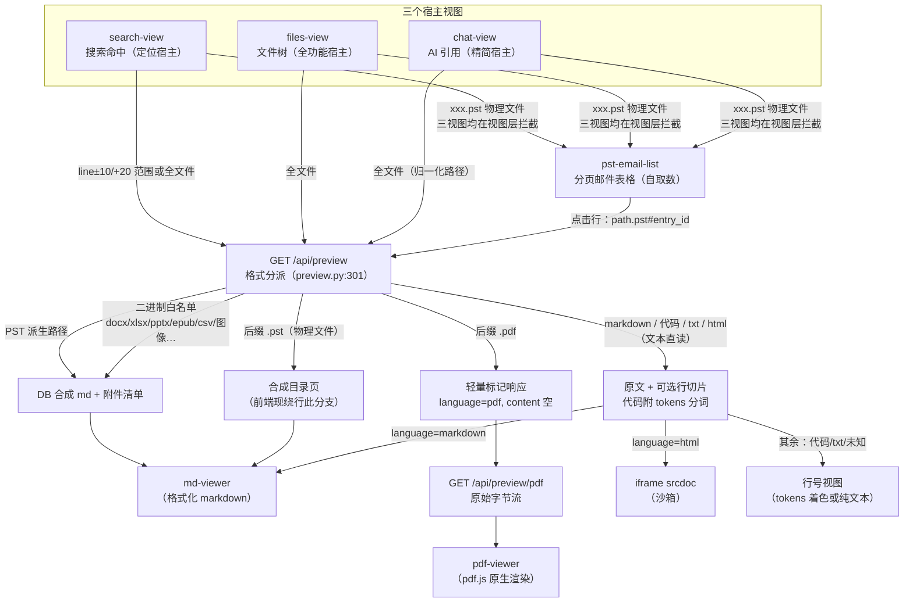
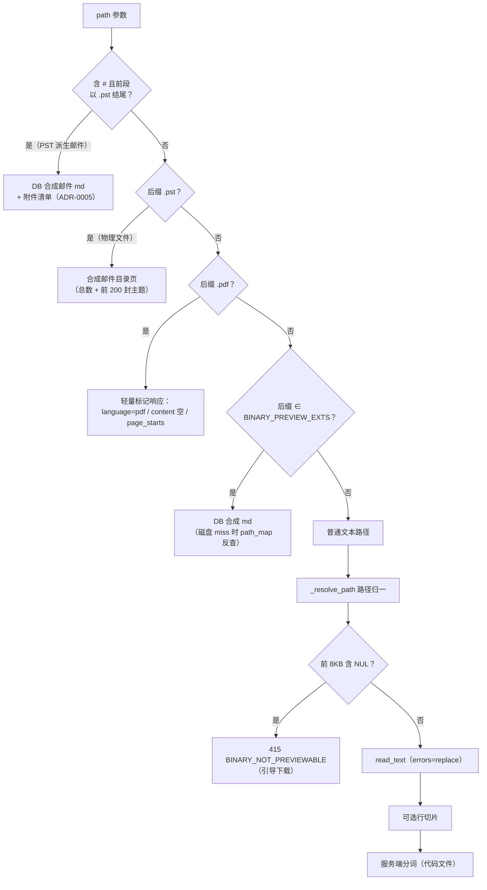
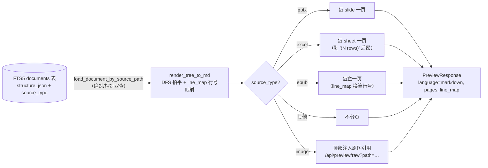
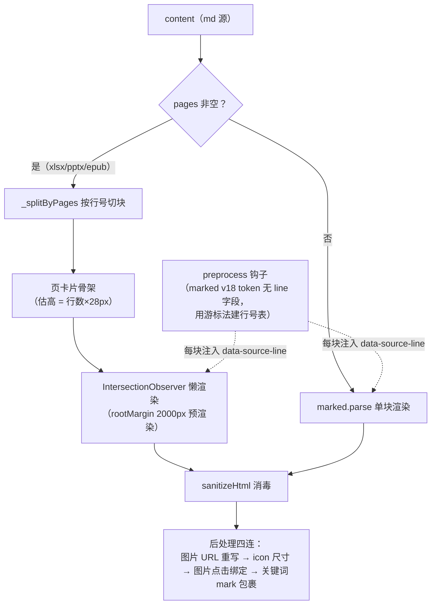
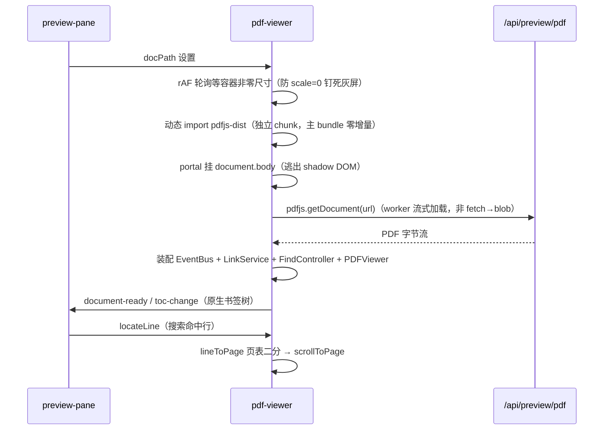
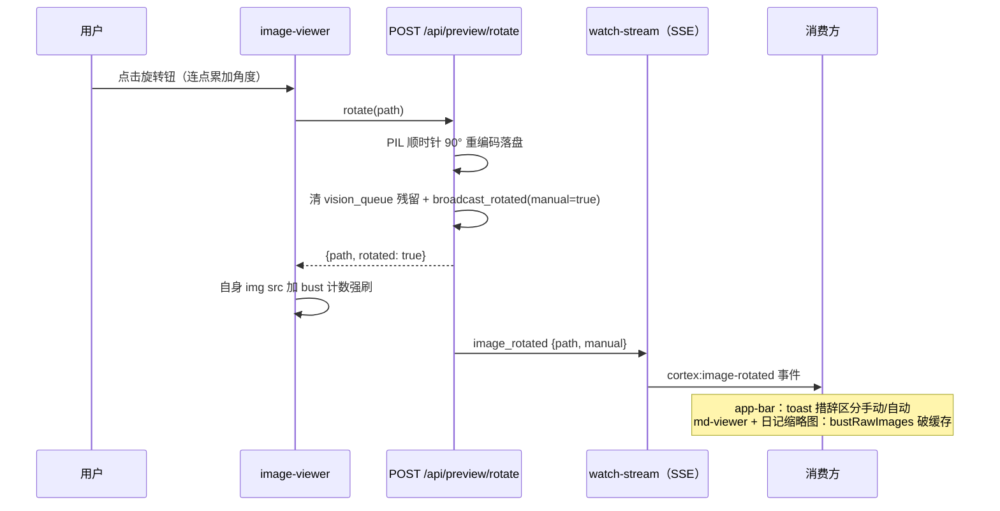

# 所有格式文件的预览功能 深析

> ⚠ 构建产物：由 repo-wiki 技能（分册模式）全量重生成，勿手改。
> 生成日期：2026-10-19｜模式：feature 轨｜feature 主题词：所有格式文件的预览功能

## 1. 范围界定

本分册分析 doclens Web UI 中「预览任意格式文件」这条端到端链路：从三个宿主视图发起请求，经后端 `GET /api/preview` 的格式分派，到前端四种渲染分支（markdown / PDF / HTML / 行号视图）的完整机制。

**发现依据**：以 `preview` 为关键词全仓 grep（命中 100+ 文件后聚焦），配合 `BINARY_PREVIEW_EXTS`、`fetchPreview`、`language=` 等锚点精确化，收敛出以下文件集。

**含**：

| 层 | 文件 |
|---|---|
| 后端 API | `doclens/web_v2/api/preview.py`、`api/pst.py`、`api/vision.py`、`api/_auto_rotate.py` |
| 后端支撑 | `doclens/web_v2/preview_synthesizer.py`、`syntax_tokens.py`、`models/preview.py`、`models/pst.py`、`doclens/image_orienter.py` |
| treesearch 被消费侧 | `treesearch/parsers/image_store.py`、`image_parser.py`、`pst_attachment_store.py` |
| 前端 API 层 | `doclens/web_v2/frontend/src/api/preview.ts`、`api/pst.ts` |
| 前端组件 | `preview-pane.ts`、`md-viewer.ts`、`md-editor.ts`、`pdf-viewer.ts`、`image-viewer.ts`、`pst-email-list.ts`、`reparse-dialog.ts`、`translate-dialog.ts`、`toc-drawer.ts`、`bookmark-drawer.ts`、`download-overlay.ts`、`focus-header.ts` |
| 前端 utils | `scroll-memory.ts`、`scroll-jump.ts`、`code-theme.ts`、`font-scale.ts`、`code-font-scale.ts` |
| 宿主视图 | `views/search-view.ts`、`views/files-view.ts`、`views/chat-view.ts` |
| 决策记录 | ADR-0005（PST 预览增强）、0029（手动旋转）、0031（PDF 原生预览）、0032（服务端分词）、0036（代码双主题）、0039（PDF 翻译） |
| 回归测试 | `tests/test_web_preview_formats.py`、`test_preview_binary_guard.py`、`test_preview_rotate.py`、`test_pdf_native_preview_api.py` + 前端 `preview-pane.spec.ts`、`api-preview.spec.ts` 等（作行为规格交叉验证） |

**不含**：索引解析器内部实现（`treesearch/parsers/` 的解析逻辑本体，仅看预览消费的存储产物）、搜索链路、聊天链路本体、日记面板（仅其图像刷新与预览共用）、`rewind_tracker`（改前备份，与预览编辑伴生但独立成域）。

---

## 2. 全景：一次预览请求的完整旅程

预览功能要解决的问题是：知识库里的文件格式五花八门——markdown、代码、PDF、Office 文档、EPUB 电子书、图像、Outlook 邮件档案——不可能用一种渲染方式通吃。整个体系的答案是「**后端按格式分派归一化，前端按 language 分流渲染**」：后端把所有格式折算成少数几种响应形态（markdown 文本 / PDF 标记 / 原文本 / 字节流），前端只需认得 `language` 字段就知道该用哪个渲染器。

**图 1：预览请求全景——从视图入口到四种渲染分支**

归一化之后，每个格式在两个维度上有明确归属：后端怎么产生内容、前端怎么渲染。下表是全量矩阵（也是本分册的地图，后续各章展开）：

| 格式 | 后端内容来源 | language | 前端渲染器 | 可编辑 | 分页（pages） | 搜索命中定位机制 |
|---|---|---|---|---|---|---|
| `.md` | 磁盘直读 | markdown | md-viewer | 是 | 否 | 源行号锚点直跳 |
| 代码（`.py/.ts/…`） | 磁盘直读 + 服务端分词 | python 等 | 行号视图（着色） | 是 | 否 | 行号 |
| `.txt` / 未知后缀 | 磁盘直读（嗅探后） | text | 行号视图（纯文本） | 是 | 否 | 行号 |
| `.html` | 磁盘直读 | html | iframe srcdoc 沙箱 | 否 | 否 | 无 |
| `.pdf` | 磁盘字节流（不查 DB） | pdf | pdf-viewer | 否 | pdf.js 自管 | page_starts 页表二分跳页 |
| `.docx/.doc/.docm/.rtf` | DB structure 合成 md | markdown | md-viewer | 否 | 否 | line_map → 前驱 heading |
| `.xlsx/.xls/.xlsm/.xltx/.xltm/.csv` | DB 合成 md（表格块） | markdown | md-viewer | 否 | 每工作表一页 | line_map + pages |
| `.pptx/.ppt/.pps/.pot` | DB 合成 md | markdown | md-viewer | 否 | 每幻灯片一页 | line_map + pages |
| `.epub` | DB 合成 md | markdown | md-viewer | 否 | 每章一页 | line_map + pages |
| `.mhtml/.mht` | DB 合成 md | markdown | md-viewer | 否 | 否 | line_map |
| 图像（png/jpg/jpeg/webp/gif/bmp/tiff/tif） | DB 合成 md + 顶部原图 | markdown | md-viewer（嵌原图） | 否 | 否 | — |
| PST 物理文件 | 视图拦截 → 邮件列表组件 | — | pst-email-list | 否 | 组件内分页 | — |
| PST 派生邮件（`xx.pst#id`） | DB 合成 md | markdown | md-viewer + 附件区 | 否 | 否 | — |

> 一个容易误读的点：docx 与 xlsx/pptx/epub 同走合成管线，但 docx **不分页**（`pages=None`，测试 c3 断言）——Word 文档没有天然的页/表/章边界，只有 heading 层级；xlsx 按 sheet、pptx 按 slide、epub 按章切页（`_extract_pages`，`doclens/web_v2/api/preview.py:580`）。

---

## 3. 后端：格式分派与文本预览

### 3.1 五路分派的判定顺序

`GET /api/preview`（`doclens/web_v2/api/preview.py:301`）的入口是一串**按序判定**的格式分派。顺序本身是语义的一部分——PST 与二进制白名单的判定必须先于普通文本路径，否则 GB 级 PST 会被当文本读、把事件循环拖死：

**图 2：格式分派判定链（顺序即语义）**

几个判定细节值得展开：

- **PST 派生路径不是真实文件**。路径形如 `归档.pst#0x1234`，`#` 前是宿主 PST、`#` 后是邮件 entry_id。后端直接从索引库合成这封邮件的 markdown（`_synthesize_binary_preview`，`preview.py:488`），并附上附件清单（含下载 URL）。
- **PDF 是「元数据 + 字节流」两段式**（ADR-0031）。`GET /api/preview` 只返回轻量标记响应——`language="pdf"`、`content` 恒为空串、附页表 `page_starts`（每页起始行号，与索引提取文本同体系）；真正的 PDF 字节由独立的 `GET /api/preview/pdf`（`preview.py:233`）服务，该端点**不查 DB**（未索引文件照常可看），磁盘缺失时报 `FILE_MOVED` 而非回退合成 md（单路径决议，无 fallback）。
- **二进制白名单先于嗅探**。`BINARY_PREVIEW_EXTS`（`preview.py:36`）收录 Office/EPUB/MHTML/图像等扩展名，命中的走 DB 合成，与「未知二进制」的嗅探拒绝（415）互不干扰——docx 文件头当然含 NUL 字节，但它在白名单里，轮不到嗅探出手。
- **path_map 文件名反查**。AI 引用常只给文件名而非相对路径，`_lookup_rel_via_path_map`（`preview.py:123`）会按文件名在索引的路径映射里反查归一，磁盘直拼 miss 时兜底。

### 3.2 二进制嗅探：未知二进制的最后防线

白名单之外的文件（如 `.apk`、`.zip`、无扩展名）走内容嗅探（`_looks_binary`，`preview.py:46`）：读前 8192 字节，含 NUL 即判二进制，返回 `415 BINARY_NOT_PREVIEWABLE` 引导用户下载查看。这个设计有两个刻意之处：

- **只看前 8KB**：长文本深处出现的孤立 NUL（编码损伤）不误杀——测试断言「NUL 在 8KB 之外视为文本」。
- **空文件不是二进制**：新建的空 markdown 走正常空文本路径（前端空态守卫按 path 而非 content 判定，见 §6.1）。

### 3.3 行范围切片与服务端分词

普通文本路径支持 `start_line`/`end_line` 参数切片（搜索命中只需目标行附近 ±10/+20 行，避免大文件全量传输）。切片与语法高亮的协作是 ADR-0032 的核心契约：

**分词始终对整文件进行，再按切片口径裁剪**。`tokenize_code`（`doclens/web_v2/syntax_tokens.py:71`）用 Pygments 按文件名解析 lexer，把 token 流归一为逐行的 run 数组。如果只对切片分词，多行字符串、块注释的跨行词法就会在切片边界断裂；整文件分词后按与 `content` 相同的 `[s:e]` 切，词法天然正确。

分词的输出契约由前后端共同锁定（`models/preview.py:24` 注释即合同）：

| 维度 | 规格 |
|---|---|
| 结构 | `list[行][run]`，run = `[kind, text]`，与 content 的 `\n` 切分一一对应 |
| kind 归一 | 8 类单字符：`c`注释 `k`关键字 `s`字符串 `n`数字 `f`函数 `t`类型 `o`操作符 `p`标点；空串 = 正文色 |
| 相邻同 kind | 后端合并（省 payload） |
| 不下发的情形 | md / html / txt（TextLexer）/ 未知后缀 / 超 1MB / 分词异常 → 返回 `None`，前端回退纯文本 |
| 防御 | 前端收到后若行数与 content 行数失配（异常 lexer），整体放弃高亮不渲染错位颜色（`preview-pane.ts:2269`） |

代价与收益（ADR-0032 记录）：前端零高亮库（主 bundle 零增量），payload 约为原文 1.5~2.5 倍（本地回环可接受）；8 类归一是有意损失，换前端调色板恒定。

---

## 4. 后端：合成预览管线

### 4.1 为什么需要「合成」

二进制文档（docx/xlsx/epub/图像…）没法直接给前端渲染，但索引阶段已经把它们的结构拆进了 FTS5 库的 `structure_json` 字段（heading 树 + 正文块）。合成管线的思路是：**预览复用索引副产物**——把这棵树重新拍平成 markdown 字符串，交给前端现成的 md-viewer 渲染，一套渲染器吃下所有二进制格式。

**图 3：合成预览管线（`preview.py:488` → `preview_synthesizer.py:15` → `preview.py:580`）**

未索引的二进制文档直接 `404 NOT_INDEXED`（提示先执行索引）——这是「合成依赖索引」的自然推论。唯一的例外是 PDF：它已改走磁盘字节流，与索引解耦（ADR-0031），所以未索引 PDF 依然能预览，只是没有页表跳页。**docx 未索引 404 与 pdf 未索引 200 的不对称是有意设计**，非 bug。

### 4.2 line_map：双行号体系的换算桥

合成管线里最微妙的概念是 **line_map**。索引时每个结构节点记录的 `line_start` 是**原始解析体系**的行号（docx 的段落索引、pdf 的提取文本行号），而拍平后的 markdown 是另一个行号体系——正文段落用空行分隔会膨胀行数，两者对不上。

`render_tree_to_md`（`doclens/web_v2/preview_synthesizer.py:15`）在拍平的同时产出 `{原始行号: md 实际行号}` 映射表。它服务两类消费者：

- **搜索命中定位**：前端拿到合成 md 后，用 line_map 把搜索结果的命中行换算成 md 实际行号才能滚动定位。换算规则是「精确键 miss 时取 ≤line 的最大键」（前驱近似）——命中行常落在段落/单元格块内部，前驱 heading 即所属块，粗粒度定位远优于不滚（`mapLineViaPredecessor`，`views/search-view.ts:21`，BUG-F3 修复）。
- **EPUB 分页边界**：章节节点的 `line_start` 也要经 line_map 换算成 md 行号，前端才能按行号切页（`_extract_epub_pages`，`preview.py:611`）。

EPUB 分页有三条防御规则（均有实测 bug 背景）：首页强制 `line_start=1`（书名/册壳并入第一页，防切丢开头）、md 行号不增的空章跳过（防零跨度页）、扁平树兜底（单章本无册层时按根级章节点分页，BUG-E1）。

### 4.3 图像预览的合成形态

图像文件的预览 = 「顶部原图 + 下方视觉解析出的 markdown」。合成时若 `source_type == "image"`，在 md 头部注入 ``（`preview.py:512`），原图经 raw 端点由 md-viewer 内嵌渲染；下方的解析文本来自视觉模型索引期的转写。gif/bmp/tiff 也能这样预览，但只有 png/jpg/jpeg/webp 四种参与视觉索引与重解析（前后端集合对齐）。

---

## 5. 后端：字节流与变更端点

### 5.1 四个字节流端点

| 端点 | 服务对象 | 数据来源 | 关键语义 |
|---|---|---|---|
| `GET /preview/pdf`（`preview.py:233`） | pdf-viewer（pdf.js 直连 URL） | 磁盘原文件 | inline 返回；不查 DB；缺文件 `FILE_MOVED`；非 .pdf `NOT_A_PDF` |
| `GET /preview/raw`（`preview.py:186`） | 独立图像文件（图像预览原图、md 内嵌图、日记照片） | 磁盘原文件 | 仅限图像扩展名（`NOT_AN_IMAGE`）；md-viewer 把 md 里的相对图片 src 重写为该端点 URL |
| `GET /preview/asset`（`preview.py:163`） | 富文档内嵌图片（docx/pptx 提取产物） | `images/<doc_hash>/<seq>.<ext>`（ImageStore） | 索引期由 ImageStore 落盘，重索引幂等重建（先删后建） |
| `GET /preview/download`（`preview.py:145`） | 任意文件下载 | 磁盘 | 下载文件名 = `{stem}_{sha256(相对路径)前6位}{suffix}`（hash 用于上传时反查回原位，见 §5.2） |

`raw` 与 `asset` 的分工值得记住：**raw 服务「文件本身就是图像」，asset 服务「文档里的内嵌图」**。这决定了旋转能力的边界——asset 产物是重索引即被覆盖的派生物，转它没有意义，所以前端旋转按钮只对 raw URL 的四格式图像出现（ADR-0029）。

### 5.2 保存、上传与 hash 回写闭环

`PUT /api/preview`（`preview.py:533`）保存编辑后的文本：越权校验 → 可写判定（数据目录内/二进制合成预览一律不可写）→ 5MB 上限 → 写盘 → **后台触发增量重索引**（失败仅告警不阻断保存成功）。

上传走一条有趣的 hash 闭环。下载时文件名被改写成 `报告_a3f2c1.pdf`（尾缀是原路径的 sha256 前 6 位）；用户把下载的文件改完再拖回上传时，`GET /preview/upload-target`（`preview.py:755`）用文件名里的 hash **反查出原路径**，`POST /preview/upload`（`preview.py:779`）据此直接覆盖原文件原位置（50MB 上限，hash 冲突显式报 409 拒绝盲写）。文件名解析容忍浏览器去重后缀 `file (1).ext`。这条链让「下载→外部编辑→传回」无需用户手工找目录。

### 5.3 图像旋转端点

`POST /preview/rotate`（`preview.py:206`）执行**像素级顺时针 90° 旋转并落盘**（ADR-0029）：PIL 同格式重编码写回原文件（JPEG q95 / WebP q90 / PNG 无损），成功后清 vision_queue 残留行（防歪图被视觉模型白转写）并广播 `image_rotated` SSE 事件（带 `manual=true` 标志）。四格式之外（如 gif）返回 `NOT_ROTATABLE` 且文件不动。决策语义：预览时看到的歪图多是自动判向漏转的存量，用户要的是文件转正而非显示态转一下——CSS 旋转刷新即还原，被明确否决。

---

## 6. 前端：preview-pane 分支调度

### 6.1 分支选择的规则

`preview-pane`（2332 行）是预览域的前端枢纽：接收宿主视图下发的 props，按 `language` 属性分流到四种渲染分支。分支边界由一条 getter 划定（`_isLineView`，`preview-pane.ts:827`）：**markdown / pdf / html 之外的全部走行号视图**——按渲染路径划界而非按文件类型设闸，代码、txt、未知后缀、超限兜底文本共用一条「纯文本 + 行号」路径，行选择与编辑能力都挂在这条路径上。

| 能力 | markdown 分支 | pdf 分支 | html 分支 | 行号视图 |
|---|---|---|---|---|
| 渲染器 | md-viewer | pdf-viewer | iframe srcdoc（`sandbox="allow-scripts"`，无 allow-same-origin） | 组件自渲染行列表 |
| 可编辑 | 是（writable 时） | 否 | 否 | 是（writable 时） |
| TOC 目录 | heading 树 | PDF 原生书签 | — | — |
| 阅读书签 | 是 | 是 | — | — |
| 翻译 | — | 仅此分支（ADR-0039） | — | — |
| 字号缩放 | md 字号组 | PDF 缩放组（适宽/百分比） | — | 代码字号组 |
| 代码主题 | — | — | — | 三态（auto/light/dark） |
| 关键词高亮 | md-viewer mark + 匹配导航 | findController 匹配导航 | — | —（有跳顶/跳底 FAB） |
| 行选择（Shift 区间） | — | — | — | 是 |
| 编辑器 | md-editor（markdown 模式） | — | — | md-editor（纯文本模式，本质通用 textarea） |

**图 4：四分支能力矩阵**（头部按钮随分支动态增减，`render()` 主分派在 `preview-pane.ts:2119`）

空态守卫按 `path` 判定而非 content：空文件的 content 是合法空串（不等于「无预览」），各视图清空预览时都把 path 重置为空串来触发占位态。

### 6.2 编辑↔预览的锚点机制

预览与编辑是两种排版（格式化 md vs textarea），直接按滚动像素恢复位置必然漂移。解法是**统一锚点货币**：两种形态都以「源行号」为锚（`_anchorLine`），选区则以「源文本字符偏移」为锚（`_selOffsets`）：

1. 进入编辑（`enterEdit`）前，先从 md-viewer 捕获当前锚点——视口顶部源行号（`topSourceLine`）、是否贴底（文档尾部内容不足一屏时行号锚必然漂移，改为对齐尾部视野）、DOM 选区经块内比例映射转字符偏移（吸收 `**`、链接语法造成的渲染/源文本长度差）。
2. 编辑器保存后切回预览，按锚点反向恢复：md-viewer 滚到该源行，编辑器选区精确落回 selectionStart/End。
3. cancel/discard 回滚文本后不恢复选区锚（偏移已对不上旧文本），只保视野锚。
4. `_suppressLocate` 标志抑制「切回预览时 md-viewer 的命中行定位」——否则外部定位与锚点恢复两个滚动指令打架。

### 6.3 保存后 tokens 的一次性清空

行号视图保存成功后，组件会把 `tokens` 置 null 再交还宿主（`preview-pane.ts` `_onEditorSave`）。原因是 tokens 是受控 prop：旧 tokens 行数恰好对得上新 content 时会渲染**陈旧的分词颜色**；而组件不能自己重拉（宿主旧 state 会把值覆盖回来——这正是「保存后一秒内容变回旧的」这个历史 bug 的根因）。正确的职责链是：组件清空 tokens → 发 `saved` 事件 → 宿主重拉预览 → 新 tokens 经 props 下发。三个宿主的回填策略不同（§10.3）。

---

## 7. 前端：md-viewer 渲染与定位管线

md-viewer（1588 行）承担 markdown 分支的全部渲染：源文件 md、二进制合成 md、PST 邮件 md、图像解析 md 都流经同一条管线。

### 7.1 渲染管线：从 md 文本到带锚点的 DOM

**图 5：md-viewer 渲染管线（`md-viewer.ts:1487` render 分派）**

行号锚点是一切定位的基石：marked 的 token 对象不携带行号，md-viewer 在 preprocess 钩子里用「全文 indexOf + 游标」为每个块算出 1-indexed 源行号，注入 `data-source-line` 属性（`lineOf`，`md-viewer.ts:63`）。分页模式下块行号还要加上页偏移（`currentOffset`）——渲染前重置为 0，防上一份分页文档的残留偏移污染定位。

图片处理有三层：相对路径 src 重写为 `/api/preview/raw` URL（越出知识库根或绝对路径不重写）；内嵌小图按显示宽定尺寸（后端 asset URL 带 `dw` 参数时立即定宽免闪烁，否则等 naturalWidth）；点击图片弹出全屏 image-viewer。

### 7.2 定位：三段滚动收敛机制

搜索命中要跳到「合成 md 的第 N 行」，难点是**分页懒渲染 + content-visibility 的估高偏差**：没渲染的页只有估算高度，滚过去之后真实高度展开，目标位置就漂了。md-viewer 的解法是三段式（`jumpToSourceLine`，`md-viewer.ts:1331`）：

1. **远距离先瞬跳粗定位**（>50k px 直接 jump，触发途经懒页陆续插入）；
2. **两帧后校准一次**（此时尺寸为实值）；
3. **`_settleTo` rAF 收敛循环**（上限 300 帧）：每帧量目标块实际位置，偏了就补滚，直到收敛。真机 WebView 上「滚一次+两帧校准」会永久偏移（content-visibility 估高塌缩），收敛循环是唯一可靠的落点。

行级定位（`scrollToSourceLine`）走块查找 + 块内比例像素偏移，配同样的两帧校准。反向的 `topSourceLine`（视口顶部源行号）用于滚动记忆与编辑锚点捕获，算法是「首个底边进入视口的块 + 块内插值」。

### 7.3 关键词匹配导航

匹配导航的**真相源是源文本匹配索引**（`buildMatchLines`，`md-viewer.ts:264`）而非 DOM 里的 `<mark>`——mark 只是视觉层。步骤：源文本按关键词建行号索引；TreeWalker 逐文本节点包裹 `<mark class="keyword-hit">`（跳过 SCRIPT/STYLE/已有 mark）；n/m 计数徽标 + 上/下步进按钮接管跳顶/跳底 FAB 的位置。关键词单独变化时先剥旧 mark 防残留。PDF 分支的匹配导航是另一套（findController，§8.3），两者 UI 同形。

---

## 8. 前端：pdf-viewer 原生渲染

### 8.1 为什么是 pdf.js 组件层

PDF 预览曾走「pdfplumber 提取文本 → 合成 md」链路，但提取阶段排版信息即已丢失（双栏变串行、表格碎裂、公式乱码）——病根在原料不在渲染器。ADR-0031 决议改为**原始字节直送前端、pdf.js 渲染**，采用官方 viewer 组件层（PDFViewer + PDFFindController + PDFLinkService，自有 UI 皮）：页面虚拟滚动、文本层选择、查找引擎白拿，又不像整套 viewer.html 那样工具栏双份无法对接自有 header。

**图 6：PDF 加载与跳页全链路（`pdf-viewer.ts:616` `_loadDocument`）**

三个非常规工程决策：

- **portal 逃逸**：pdf.js 文本层的 `::selection` 样式在 Chromium 的 shadow DOM 内不渲染，组件把实际 viewer 挂到 `document.body` 下的 portal 容器，rAF 循环持续对齐占位元素位置（不用 ResizeObserver——它只报尺寸不报位移），并补偿 visualViewport 偏移（iOS 工具栏/pinch 下 fixed 基准漂移）。
- **懒加载单例**：pdfjs-dist 动态 import 成独立 chunk（约 1.5MB 主库 + 1MB worker），只在首次打开 PDF 时加载；SW 的 cache-first 策略天然缓存新 chunk，离线可用。
- **字节直连 URL**：`getDocument({url})` 让 pdf.js worker 自己做流式 range 请求，前端不经手 blob。

### 8.2 适宽的三次返工史

「默认适宽」这个看似简单的需求在容器化布局下踩了三个坑，均留有注释可考：2026-09-29 对话页灰屏（零尺寸容器初始化把适宽 scale 钉成 0）、2026-10-09 keep-alive 白屏（零宽时 ResizeObserver 重套）、2026-10-19 移动端 816px 白屏（pdf.js 在 scale≈1.0 时把 currentScaleValue 归一成数字、getter 返回 null，「适宽」身份丢失）。最终形态：自有 `_fitWidthMode` 标志 + ResizeObserver 初始阶段跟随 + 300ms 锁定后强制终值重套。这是「pdf.js 适宽在 flex/grid 容器里」的典型案例。

### 8.3 跳页与匹配导航

- **跳页**：后端页表 `page_starts`（每页起始行号，索引时持久化）到前端后，`lineToPage`（`pdf-viewer.ts:112`）二分查找命中行所在页，scrollToPage 越界钳制。**无页表静默降级**（未索引/旧索引不定位不报错），存量索引需 force 重建换取页表覆盖。
- **匹配导航**：关键词经 `eventBus.dispatch("find")` 交给 PDFFindController（pdf.js 6.x 无公开 executeCommand API，统一走 eventBus）；Enter/Shift+Enter 步进；n/m 徽标取 `updatefindmatchescount` 事件。已知语义损失：多词 OR 高亮退化为单短语（findController 的 query 是短语语义），ADR-0031 记录接受。
- **TOC**：只用 PDF 原生书签（`getOutline()`，dest 解析为页号）；无书签不发 toc-change、preview-pane 隐藏目录按钮——不做 DB heading 树换算兜底（跨行号体系换算正是当年 pdf line_map 被丢弃的鸿沟）。
- **滚动锚点**：`scrollAnchorValue` 把「页号 + 页内偏移比例」编码为正整数（页×10000 + 比例×9999），页 1 近顶编码为 1，与 md 行号锚在同一张 localStorage map 里共存。

---

## 9. 特殊链路：图像与 PST

### 9.1 图像预览与旋转刷新

图像预览本体简单（md-viewer + 顶部原图，§4.3），特殊在**旋转的联动刷新**。全屏查看器（image-viewer）按 URL 可旋转性显示旋转钮：`rotatablePathFromSrc` 解析 src，仅当 pathname 以 `/api/preview/raw` 结尾（容忍反代 base path）且扩展名属四格式才返回路径——asset 内嵌图、gif/bmp/tiff 一律无钮。

**图 7：图像旋转与 SSE 三消费方刷新（ADR-0029 / ADR-0017 共道分流）**

旋转后的索引联动是**被动**的：落盘改变文件指纹 → FileWatcher 增量重建 → 视觉解读重新入队转写。SSE 的 `manual` 标志让 toast 能区分「已旋转」（用户点的）与「已自动旋转」（判向链路的）。

### 9.2 视觉重解析

预览 header 的「重新解析」（仅 files-view 宿主启用）打开 reparse-dialog，双模式：AI 重解析（自定义 prompt，预填 `GET /api/vision/prompt` 的单一真相源）或手动备注（直接写 markdown）。后端 `POST /api/vision/reparse`（`api/vision.py:43`）的关键语义：busy 守卫（vision_queue 有 processing 行则 409，防并发写库）→ 线程池调视觉 API（5-60s 不卡事件循环）→ **结果直接写回 FTS5 索引替换旧占位/解读** → 标记索引脏。它不走 SSE——前端拿到响应里的 markdown 自行渲染刷新。手动备注则把 vision_queue 标为 `model='manual'` 持久（后台重解析队列排除 manual，不会被 AI 覆盖）。

### 9.3 PST：列表 → 邮件 → 附件三层

PST 是 Outlook 的 GB 级邮件档案，任何「当文本读」的尝试都会拖死服务。预览拆成三层（ADR-0005）：

1. **物理文件 → 分页邮件表格**：三个宿主视图都在**视图层**拦截 `.pst` 路径（不经 `/api/preview`），改渲染 `pst-email-list` 组件。组件自取数 `GET /api/pst/emails`（`api/pst.py:38`）——直接查索引库的 `pst_email_meta` 表（主题/发件人/日期/文件夹随索引入库），日期倒序分页 50 条/页，不扫 structure_json。后端仍保留了旧的合成目录页分支（`_synthesize_pst_overview`）但前端已绕行。
2. **邮件本体 → 合成 md**：点击表格行，路径变为 `xx.pst#entry_id` 走 §3.1 第一分派，合成「头部元信息 + HTML 转写正文 + 附件解析章节」的 markdown。HTML 正文在**索引时**已转写为 md（保持标题/列表/表格结构），搜索语料与预览同源。
3. **附件 → 落盘下载**：索引时全部 ≤100MB 附件持久化到 `pst_attachments/<doc_hash(PST)>/<entry_id>/<文件名>`（多一层 PST 哈希目录，防多 PST 同 entry_id 冲突——ADR-0005 后记修正项）。邮件预览页的附件清单每项可下载（`GET /api/pst/attachment`），白名单类型附件的内容在索引时已并入邮件正文可搜。

---

## 10. 宿主视图与状态流转

### 10.1 三个宿主的分工

preview-pane 是无状态渲染壳，预览的获取与状态管理在各宿主视图。三个宿主能力递减：

| 维度 | search-view | files-view | chat-view |
|---|---|---|---|
| 触发源 | 搜索命中点击 | 文件树点击 | AI 回答里的引用点击 |
| 取数模式 | 有行号走**范围预览**（line-10/+20，视图内直连 fetch，绕过 api 层封装）；全文件格式走全量 | 恒全文件 | 恒全文件 |
| `.line`（行定位） | ✅ 唯一下发方（line_map 前驱换算） | ❌ 无此 state | ❌ 无此 state |
| `.keyword` | 命中高亮词 ‖ 查询词 | ❌ | 最后一条用户消息全文 |
| `?enableReparse` | ❌ | ✅ 唯一 | ❌ |
| `?rememberScroll` | ❌ | ✅ 唯一（滚动记忆） | ❌ |
| 路径归一 | — | — | `_normalizeReferencePath`：剥 markdown 链接语法、剥 `file://`、URL 解码（治 AI 偶发格式） |
| 失败策略 | NOT_INDEXED → 错误态 | 三分支：未索引→错误页；其他失败（如 415）→错误页+toast | 未索引→打开侧栏显示提示；其他失败仅 toast 不开栏 |

**图 8：三宿主能力对照**（chat-view 无 download-success/failed 回听，为精简宿主）

### 10.2 状态流转：fetch → props

三宿主同构的回填链：`fetchPreview` 返回判别联合（**不抛异常**，网络错误也折叠为 `ok:false`），成功后把 content/language/writable/pages/lineMap/pageStarts/attachments/tokens 八项写入视图私有 `@state()`，经属性下发 preview-pane。没有全局预览 store——切换视图页签即丢状态（滚动记忆与栏宽除外，存 localStorage）。

### 10.3 dirty 门与保存回填

三宿主各自实现了同构的 dirty 门（`_safeAction`：有未保存编辑时 confirm 后命令式调 `pp.discard()`）与保存回填，**三份复制未抽公共 mixin**（技术债，注释可考）。回填策略两档：

- **files-view 全量重拉**（`_reloadPreview`）：文件树宿主是「管理」语义，元数据可能因重索引变化；
- **search/chat 只回填 content + tokens**（带 `previewPath === path` 防竞态守卫，防慢响应回填到已切换的文档）。

另一个接口面缺口：范围预览的 `start_line/end_line` 请求是 search-view 内的裸 fetch，`api/preview.ts` 无对应封装——想改范围窗口语义要记得有两处。

### 10.4 localStorage 清单

| 键 | 归属 | 语义 |
|---|---|---|
| `cortex.files.previewScroll` | scroll-memory | 路径→行号/PDF 锚点编码 map，LRU 200 条，300ms 防抖落盘；行号≤1 删条目（回顶即清除） |
| `cortex.preview.codeTheme` | code-theme | 三态 auto/light/dark；写 auto = removeItem（保持「未显式设置」语义，跟随应用主题） |
| `cortex.files.mdFontScalePct` | font-scale | md 正文字号 60–200%，步长 10 |
| `cortex.preview.codeFontScalePct` | code-font-scale | 行号视图字号（与 md 独立档位） |
| `cortex.chatPreviewWidth` | chat-view | 预览栏宽 300–900（默认 420） |
| `cortex.files.previewPaneWidth` / `treePaneWidth` | files-view | 预览/树栏宽；无恢复值时 grid 退 1fr/2fr |

---

## 11. 行为规格与冲突清单

### 11.1 格式 × 端点行为契约（从回归测试反推）

| 场景 | 预期行为 | 测试锚点 |
|---|---|---|
| md / txt / py / html 正常预览 | 200；language 分别为 markdown/text/python 等；md 与 py `writable=True` | test_web_preview_formats c1/c7/c8/c9 |
| pdf 元数据 | `language="pdf"`、`content==""`、page_starts 行号数组（≥10 页样本 ≥10 项） | c2/c2b |
| **pdf 未索引** | 仍 200，`page_starts=None`（预览与索引解耦，静默降级） | test_pdf_native_preview_api |
| **docx 未索引** | 404 NOT_INDEXED（与 pdf 不对称：合成依赖索引） | c10 |
| docx 预览 | language=markdown、`pages=None`（不分页）、line_map 值单调递增 | c3/c3b |
| xlsx / pptx / epub | pages 分别 = sheet 数 / slide 数 / 章数；xlsx line_map 首键=1 | c5/c6/c4/c14 |
| 行范围切片 | `line_range==(190,195)`，切片分词同口径 | c11 |
| 未知二进制（前 8KB 含 NUL） | 415 BINARY_NOT_PREVIEWABLE，detail 含「下载」提示 | c12 / test_preview_binary_guard |
| NUL 在 8KB 之外 | 视为文本不误杀 | test_preview_binary_guard |
| PDF 字节端点 | inline 200 application/pdf；缺文件 404 FILE_MOVED；非 .pdf 400；`../` 越权 404；path_map 反查兜底 | test_pdf_native_preview_api |
| 旋转 png | 顺时针 90°（左上像素→新(0,0)）、清队列、广播 manual=true | test_preview_rotate |
| 旋转 gif | 400 NOT_ROTATABLE，文件不动 | 同上 |
| upload-target hash 反查 | 匹配→`{match:true, path}`，否则 `{match:false}` | test_pdf_native_preview_api |
| 前端 isFullFilePreview | md/pdf/docx/xlsx 族/csv 等为 true（大小写不敏感）；epub/mhtml/pst/图像在列、**pptx 不在列** | api-preview.spec.ts |
| 前端保存 | PUT + JSON body，非 2xx 抛 PreviewSaveError{code,status} | api-preview.spec.ts |
| 关键词归一（含 CJK） | 中日韩去空格整串匹配；纯 ASCII 保留空格分词 | preview-pane.test.ts |
| 旋转钮 URL 判定 | 仅 raw 端点四格式返回路径；asset 图/gif/非 raw → null | image-viewer.test.ts |

前端 Vitest 覆盖面（测试名层）：preview-pane 14 个 describe（四分支渲染、编辑锚点互逆、scroll memory、mobile header、关键词高亮、字号步进）；md-viewer（data-source-line、分页定位闪烁、icon 尺寸、resolveDocImageUrl 边界、行级锚点往返一致）；chat-view（引用打开、NOT_INDEXED、splitter、路径归一）。

### 11.2 ⚠ 文档-代码冲突清单

| # | 冲突 | 两侧各说什么 |
|---|---|---|
| 1 | ⚠ CLAUDE.md 项目结构树 | 注释只写 `preview.py # GET /api/preview`，实际该文件 9 个端点（GET/PUT/POST × pdf/raw/asset/download/rotate/upload-target/upload） |
| 2 | ⚠ ADR-0017 §8 vs `doclens/config.py:398` | ADR 称 `VISION_AUTO_ROTATE` 默认开（逃生门=可关）；代码 `default=False` 需显式开启。**以代码为准** |
| 3 | ⚠ ADR-0005 正文 vs 后记（2026-10-03） | 正文写附件落盘 `pst_attachments/<entry_id>/…`；实际多一层 PST 哈希目录。ADR 后记已自行修正，引用以后记为准 |
| 4 | ⚠ ADR-0036 vs 现状 | ADR 定代码主题两态默认 light；现为三态默认 auto（ADR-0043 升级，0036 文首已自注取代）。`preview-pane.ts:741-742` 两行新旧注释层积并存，读码易误导 |
| 5 | ADR 编号复用 | docs/adr 中 0034/0043/0044 各有两份不同主题文件，引用时有歧义风险（预览域自身未引用这三个编号） |
| 6 | docs/jsbridge/download_bridge.md 行号漂移 | 引用 `preview.py:123`，download 现位于 :146 |
| 7 | ARCHITECTURE.md 格式表 | 未列 csv/mhtml/mht 形态行（代码两者均在 BINARY_PREVIEW_EXTS） |
| 8 | 有意不对称（非冲突，防误读） | docx 未索引 404 vs pdf 未索引 200；前端 isFullFilePreview 不含 pptx 而后端 pptx 有分页——「是否全文件取」与「是否有分页」是两个维度 |

### 11.3 建议跟进

- CLAUDE.md 的 preview.py 职责行可在下次更新时补全端点面；
- ADR-0017 的默认值描述与代码矛盾值得回写修正（或加后记）；
- 三宿主复制的 dirty 门/保存回填可抽公共 mixin；范围预览的裸 fetch 可收编进 `api/preview.ts`。
