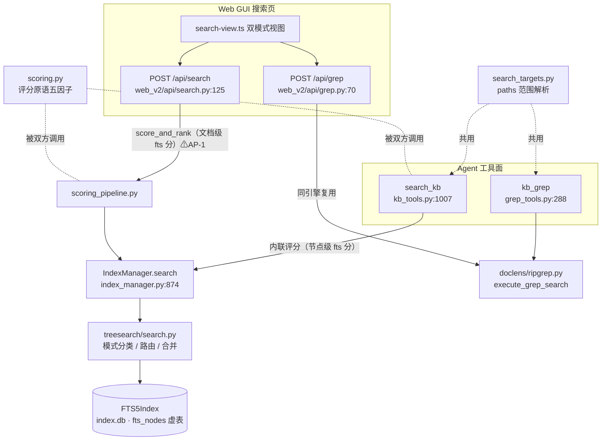
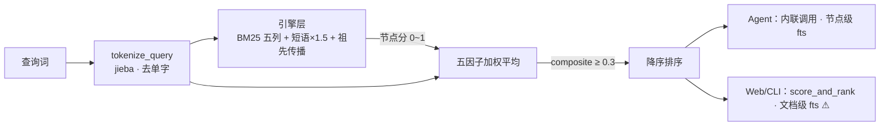
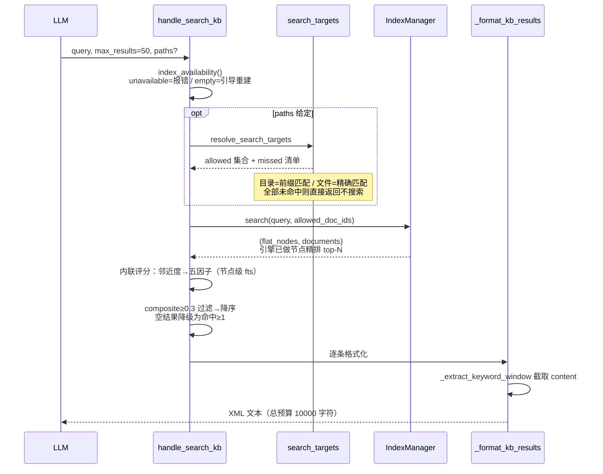
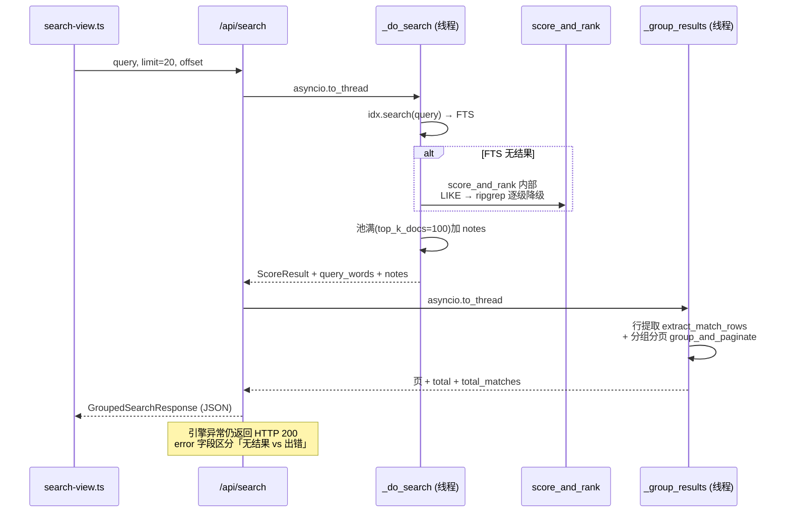

# kb_search / kb_grep 搜索与评分链路 深析

> ⚠ 构建产物：由 repo-wiki 技能（分册模式）全量重生成，勿手改。
> 生成日期：2026-10-22｜模式：feature 轨｜feature 主题词：kb_search、kb_grep 的搜索和评分业务逻辑、流程（含 tool 与 web gui）

## 范围界定

本分册分析知识库搜索的两条消费链路——AI 工具面（`search_kb` / `kb_grep`）与 Web GUI 搜索页——从各自入口向下穿过评分层、宿主门面，直达 FTS5 引擎。两轨共享同一索引底座，但在「评分编排」处分叉（见第 6 章），这是本分册的主线。

**含**（20 个源文件）：

| 层 | 文件 |
|---|---|
| Agent 工具层 | `doclens/kb_tools.py`、`doclens/grep_tools.py`、`doclens/search_targets.py`、`doclens/agent_prompt.py` |
| 评分层 | `doclens/scoring.py`、`doclens/scoring_pipeline.py` |
| 宿主门面 | `doclens/index_manager.py` |
| 引擎层 | `treesearch/search.py`、`treesearch/fts.py`（查询侧） |
| Web API 层 | `doclens/web_v2/api/{search,grep,_grouping}.py`、`doclens/web_v2/references.py`、`doclens/web_v2/models/search.py` |
| Web 前端 | `frontend/src/api/{search,grep}.ts`、`frontend/src/views/search-view.ts`、`frontend/src/components/{search-results,file-card,search-presets-section}.ts` |

**不含**：索引写入与文件监控（见 `repo_wiki/search-kb.md` 第 5 层）、read_document/manage_kb 深读（同分册已覆盖）、ripgrep 执行器内部（`doclens/ripgrep.py`，仅作为被调方）、chat SSE 链路与 refs_curator（references.py 仅涉及其数据源角色）、MCP 暴露面。

**发现依据**（feature 轨）：全仓 grep `kb_search|kb_grep|search_kb` 命中 20+ 文件，去重测试/构建产物后按 import 链圈定上述五层；前端沿 `search-view.ts → api/{search,grep}.ts → /api/{search,grep}` 对齐；经用户确认，并追加要求「比较 Web API 与 Agent 工具层的异同」（第 6 章为此设立）。

## 全景分层

两条入口最终汇入同一个 SQLite FTS5 索引，但评分编排是两套：Agent 工具在 `kb_tools.py` 里内联评分，Web/CLI/TUI 走 `scoring_pipeline.py` 的 `score_and_rank`。两套编排调用同一组评分原语（`scoring.py`），却在「FTS 分取数口径」上已经分叉（详见第 6 章）。


*图 1：双入口全景。Agent 的 search_kb 与 Web /api/search 在评分编排处分叉；kb_grep 与 /api/grep 则完全同引擎。虚线为共享/复用关系。*

一句话总括：**kb_grep 两轨同源，search 两轨同底座但评分分叉**。

## 评分体系（三层递进）

搜索结果为什么排这个顺序？答案分三层：引擎层先算「节点与查询有多相关」，宿主层再算「这条结果综合看值多少分」，两层分数语义不同、不可直接比较。

### 第一层：引擎节点分（treesearch）

引擎对每个文档树节点（标题、摘要、正文、代码块、front matter 五个索引列）打分，取值先归一到 0~1：

| 机制 | 做法 | 位置 |
|---|---|---|
| BM25 检索 | `bm25(fts_nodes, w_title, w_summary, w_body, w_code, w_fm)` 五列权重走配置；bm25 返回负值，取负转正 | fts.py:1106 起 |
| CJK 分词 | 检测到中文才用 jieba；纯英文交给 FTS5 内置 unicode61 分词器 | fts.py:342 |
| 匹配表达式 | 多词自然语言查询以 **OR** 连接（非 AND）；显式 fts_expression 保留 AND/OR/NOT/NEAR | fts.py:1083 |
| 短语加成 | 多词查询额外探测一次整短语匹配，命中节点分数 ×1.5 后重排（探测上限 50 条，硬编码） | fts.py:1140 |
| 祖先传播 | 按文档归一化（最大分→1.0）后，父节点加 0.6×子节点最大分，再归一化——命中密集的章节标题因此浮上来 | fts.py:1671 |
| 精确匹配腿 | GrepFilter：有源文件且 rg 可用时，命中行数经二分映射到节点区间后归一化；否则退纯 Python 扫描，命中即 1.0 | search.py:205/265 |

文档排序取每个文档的**最大节点分**降序。节点去重同 id 保留高分；最终 `flat_nodes` 按（分数降序，node_id 升序）全局排序——node_id 作平分时的确定性决胜。

### 第二层：宿主五因子综合分（doclens/scoring.py）

引擎分只回答「相关不相关」，宿主层再把命中质量折算成一个 0~1 的综合分供排序过滤。公式是加权平均：

```
composite = Σ(权重i × 因子i) / Σ权重i    （权重合计 10.0）
```

| 因子 | 含义 | 权重 |
|---|---|---|
| keyword_match_ratio | 命中词数 ÷ 查询总词数 | 4.0 |
| file_name_match | 文件名命中词数 ÷ 总词数 | 2.0 |
| title_match | 节点标题命中词数 ÷ 总词数 | 2.0 |
| fts_score | 引擎分（sigmoid 归一；引擎分为 0 时取 0.5） | 1.0 |
| proximity_match | 邻近度档位 ÷ 2 | 1.0 |

邻近度（`calc_proximity_score`，scoring.py:16）是个粗粒度档位：取每个命中词**首次出现位置**，若全部词都命中且首现位置的最大跨度不超过 50 字符（配置 `max_span`），记 2 分（最紧密）；部分命中或跨度超标记 1 分；无命中记 0 分。

两个易踩的语义：

- **阈值**：`min_score_threshold` 默认 0.3。源码注释（scoring.py:12）警告 3 个词命中 2 个综合分就只有约 0.5——把阈值调到 0.5 以上会把大量有效结果砍光。
- **分词**：`tokenize_query`（scoring.py:4）用 jieba 分词并**剔除单字词**——查「量子计算」按两词计；分词为空时调用方各自退化为按空白切分。

### 第三层：入口各自的口径（分叉点）

同一个五因子公式，两个入口传入的 fts_score 口径不同：

| 入口 | fts_score 来源 | 后果 |
|---|---|---|
| Agent `search_kb` | **节点自身**引擎分（`n.get("score")`，kb_tools.py:1095） | 同文档不同节点有区分度，节点排序正常 |
| Web/CLI `score_and_rank` | **文档级**最高分（`doc_fts_best.get(doc_id)`，scoring_pipeline.py:103） | 同文档全部节点拿同一个 fts 分，节点间排序退化为标题/邻近度因子 |

这是 `antipatterns/kb-search-scoring.md` AP-1 记录的「评分三轨制」分叉：kb_tools 在 2026-10-19 修成节点级，管线版保留了旧缺陷，且 kb_tools 至今未改回调 `score_and_rank`（编排仍是两份）。


*图 2：评分管线。分叉发生在最右一步——同一公式、不同 fts 分取数口径。*

## Agent 工具链流程

Agent 侧的搜索工具给谁用？给 LLM。所以它的全部设计围绕「把结果压成模型读得懂的紧凑文本」：XML 风格标签、词单位窗口截取、总字符预算。

### search_kb：从工具调用到文本返回


*图 3：search_kb 主流程。候选池大小由 `top_k_docs`（默认 100 个文档）决定，`max_results` 只控制最终显示条数。*

几个对理解行为关键的细节：

1. **索引可用性三态**（kb_tools.py:1027）：库坏了（unavailable）要明说「不能据此认为未收录」，空库（empty）引导调 manage_kb 重建——「出错 ≠ 没搜到」是这条链路的既定纪律（AP-45）。
2. **无内建降级**：FTS 查空就是空，`search_kb` 不会自动转 ripgrep。补搜靠 AI 看到「未找到」文案后自行改用 `kb_grep`（技能层约定，非代码内建）。
3. **截取窗口是词单位**：`_extract_keyword_window`（kb_tools.py:284）先滑动找「命中词密度最高」的锚点，再取锚点前 200 词、后 600 词（配置 `search_context_before/after`）；800 字符是保险丝上限。窗口跳过文档开头时补回前 200 字符并以「…（中部略）」标注。
4. **输出是 XML 不是 markdown**：`<result index score="N%" matches="m/n">` 内含 `<meta>`（文档名、路径、章节层级、命中词形）与 `<content>`。`score` 以百分比展示综合分。chat 链路的引用卡片（references.py:43）正是靠正则从这些 `<path>` 标签里抽路径的。
5. **总预算**：全部结果合计 10000 字符（`max_total_chars`），超限即截断并提示「用 max_results 参数取更多」。

### kb_grep：正则搜库

`kb_grep`（grep_tools.py:288）与 `search_kb` 共用 paths 解析（search_targets.py），但引擎换为 `execute_grep_search`（doclens/ripgrep.py）——直接对源文件跑 ripgrep，因此能覆盖**未索引**的文本文件和二进制文档的解析文本。它也做三重护栏：结果条数上限 500（`MAX_RESULTS_CAP`）、总输出 8000 字符（比 search_kb 的 10000 更紧）、引擎附注（如 rg 超时）以 `[注意]` 前缀显式告知「结果可能不完整」。

摘要生成是两级策略（`_format_agent_output`，grep_tools.py:148）：优先「正则引导」——把词项当正则编译，在首个命中处开窗（命中体最长 2000 字符，防贪婪正则吃掉全文）；正则编译失败才退到「行锚点」——按行命中词数挑最多 3 个锚点行，各带前后 1 行上下文，硬截 200 字符。输出同样是 XML，但无 meta 块，path 直接附行号（`path:line`）。

### paths 范围限定（两工具共用）

`resolve_search_targets`（search_targets.py:44）把 paths 参数解析成允许搜索的文档集合：目录条目按「目录名 + 路径分隔符」前缀匹配，文件条目精确相等，Windows 大小写差异经 normcase 抹平；绝对路径与 `..` 穿越被拒绝。拼写错误的目标进 missed 清单，在输出头部以 ⚠️ 提示；全部未命中则不执行搜索直接返回。解析出的集合透传到引擎路由 SQL（`doc_id IN (...)`），范围外文档根本不进候选池。

## Web GUI 搜索流程

Web 搜索页给谁用？给人。设计围绕「逐行命中、按文件分组、可翻页、可点击定位」：后端做行级提取与分组，前端渲染高亮卡片，评分只用于排序、刻意不展示。

### POST /api/search（关键词模式）


*图 4：/api/search 主流程。与 CLI/TUI 行为一致：FTS → LIKE → ripgrep 三重降级发生在 score_and_rank 内部（scoring_pipeline.py:141），而非 IndexManager.search。*

降级三源各有固定分值口径：FTS 源用综合分（composite）；LIKE 源固定 0.5；ripgrep 源固定 0.0（search.py:90/100，对齐 CLI）。行提取后按文件聚合，组间按最高分降序、路径命中组殿后，组内按行号升序；每文件最多下发 50 行（`MATCHES_PER_FILE_CAP`，total_matches 记真实总数、truncated 置位），单行超长以首命中为中心截到 200 字符。

两个容易误解的语义：

- **分页单位是文件不是行**：`limit` 是每页文件组数（默认 20，上限 100），`offset` 按文件翻页。
- **评分不展示**：`FileGroup.best_score` 随响应下发，但模型注释明说「排序依据，不再展示给用户」——前端 file-card 只渲染路径、命中数徽标、行号与 `<mark>` 高亮。

### POST /api/grep（正则模式）

前端切换到 grep 模式后走 `/api/grep`（grep.py:70），与 Agent 的 `kb_grep` **同一引擎**（`execute_grep_search`）：Agent 侧消费该引擎返回的 matched_words 做摘要，Web 侧丢弃它、自建正则匹配器做行级高亮提取，最后复用 `/api/search` 的同一套分组分页函数，产出完全同构的 JSON（`source="grep"`）。分页做了下推优化：取数量按 `offset + limit` 与引擎上限取大，翻页不会在第 50 条被默认值截断。文件分是「词项命中率」（命中词数 ÷ 总词数），不是综合分；路径命中的文件归为 `kind="path"` 单行卡组。

### 前端视图与调优入口

搜索视图（search-view.ts）是双模式单输入框：keyword/grep 切换持久化在 localStorage，历史条目携带模式重放时自动切引擎。桌面端点击命中行会把（路径， 行号， 高亮词）传给预览面板定位。搜索预设面板挂在**设置页**而非搜索页——它管理 `max_results`、阈值、上下文字符数与六个评分权重，经 `/api/presets` 写入 global `.env` 热生效。也就是说：**Web 调的参数和 Agent 工具读的参数是同一份**，改权重两边同时生效。

## Web API 与 Agent 工具层异同对比

同与不同都源于一件事：两边服务的「读者」不同——LLM 需要紧凑、自包含、带上下文窗口的文本；人类需要结构化、可翻页、可点击的 JSON。下表逐维度对照：

| 维度 | Agent 工具层（search_kb / kb_grep） | Web API 层（/api/search、/api/grep） |
|---|---|---|
| 响应形态 | XML 风格纯文本（`<result><meta><content>`） | pydantic JSON（GroupedSearchResponse） |
| 评分编排 | search_kb 内联（kb_tools.py:1088） | score_and_rank（scoring_pipeline.py:20） |
| fts 分口径 | 节点级（已修复） | 文档级（⚠ AP-1 旧缺陷仍在） |
| 降级策略 | 无内建降级（靠 AI 改用 kb_grep） | 三重降级：FTS→LIKE→ripgrep（score_and_rank 内部） |
| grep 引擎 | execute_grep_search | **同一函数**（完全同源） |
| 截断策略 | 词单位窗口（前 200 后 600 词，800 字符保险丝） | 行级：单行 ≤200 字符，每文件 ≤50 行 |
| 总量控制 | 总字符预算 10000 / 8000 | 候选池 top_k_docs=100（池满加 notes 明示） |
| 分页语义 | max_results=结果条数（kb_grep 上限 500） | limit=每页**文件组**数，offset 翻页；grep 侧取量下推 offset+limit |
| 分组 | 无（平铺 result 列表） | 按文件分组 + 组内行号排序 + path 组殿后 |
| 排序依据 | composite 降序（阈值 0.3 过滤） | best_score 降序；like/rg 降级源固定 0.5/0.0 |
| 评分去向 | 以 `score="N%"` 写进文本给 LLM 看 | 仅排序，前端不展示 |
| 命中词 | `<matched>` 列词形 | query_words 回传前端做 `<mark>` 高亮 |
| 错误通道 | 文案区分（不可用/空库/未找到三种话术） | HTTP 200 + error/notes 字段，前端 toast |
| 线程模型 | 工具内同步执行 | 重活全部 asyncio.to_thread（防 SSE chat 冻结，AP-6） |
| paths 限定 | 支持（search_targets 解析） | 两端点均**无**此参数 |
| 配置面 | 读 global .env | 读同一份 .env（设置页预设面板可写） |

归纳成三句话：

1. **同源的部分**：grep 全链路、评分原语（scoring.py）、索引底座、配置参数——改这些两边同时变。
2. **分叉的部分**：评分编排与 fts 分口径（AP-1 未合）——同一查询在 AI 侧与搜索页可能给出**不同名次**，且随时间继续漂移。
3. **互补的部分**：Web 有降级与分组分页、Agent 有窗口截取与 XML 引用协议；`references.py` 依赖 Agent 侧的 `<path>` 标签做引用卡片，这意味着 Agent 输出格式是 chat 链路的**事实契约**，改动需同步 references 的正则。

## 配置与调优面

两轨共享的运行参数集中在 global `~/.cortex/.env`（`CORTEX_*` 命名空间），Web 设置页预设面板是唯一 GUI 写入口：

| 参数 | 默认 | 作用 |
|---|---|---|
| `CORTEX_SEARCH_MAX_RESULTS` | 50 | Agent 结果条数 |
| `CORTEX_MIN_SCORE_THRESHOLD` | 0.3 | 综合分过滤阈值 |
| `CORTEX_TOP_K_DOCS` | 100 | 引擎候选池（两轨同受） |
| `CORTEX_SEARCH_CONTEXT_BEFORE/AFTER` | 200 / 600 | Agent 窗口（词单位） |
| `CORTEX_MAX_CONTEXT_CHARS_PER_RESULT` | 800 | 窗口字符保险丝 |
| `CORTEX_MAX_TOTAL_CHARS` | 10000 | Agent 总输出预算 |
| `CORTEX_GREP_MATCH_MAX_CHARS` | 2000 | kb_grep 正则命中体上限 |
| 评分权重 ×6 | 4.0/2.0/2.0/1.0/1.0 | 五因子权重 |

引擎层硬编码（非配置）：短语加成 ×1.5、批量评分上限 5000、短语探测上限 50、祖先传播系数 0.6。

## 冲突与已知问题

- ⚠ 端点动词：两个搜索端点均为 **POST**（search.py:124、grep.py:69 的 `@router.post`；前端亦 POST）。本分册工作清单初稿曾误写 GET，已核实修正。
- ⚠ `SearchRequest.mode` 字段（keyword/phrase）在 /api/search 端点中**只校验、不消费**——搜索行为不随 mode 变化（models/search.py:11 定义，search.py 全文无引用）。属预留或死参数，排障时勿据此推断行为。
- ⚠ 与「IndexManager.search 内建 ripgrep 降级」的说法不符：该方法（index_manager.py:874）无任何降级分支；三重降级住在 `score_and_rank` 里，因此**只有走管线的 Web/CLI/TUI 享受降级**，Agent 的 search_kb 不经过它。
- ⚠ `antipatterns/kb-search-scoring.md` AP-1（评分三轨分叉，pending）：本分册核实仍成立，见第 6 章。同台账 AP-2（N+1 回查）、AP-3（连接零锁）、AP-6（事件循环阻塞）已于 2026-10-22 修复，现状不再成立。
- `models/search.py` 尾部的 `SearchResponse`/`SearchResult` 为 2026-10-18 之前的遗留模型，已被 `GroupedSearchResponse` 取代，引用评分字段应以 `FileGroup.best_score` 为准。
- 引擎 `merge_strategy` 的 `interleave` 与 `per_doc` 两档行为完全相同（search.py:453/480），文档若称二者有别则不符。
