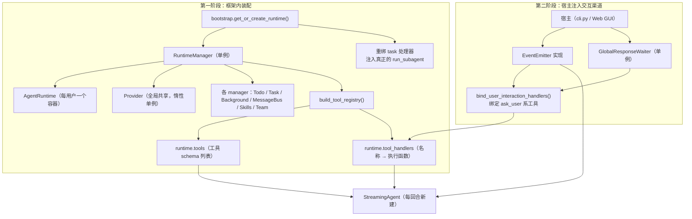
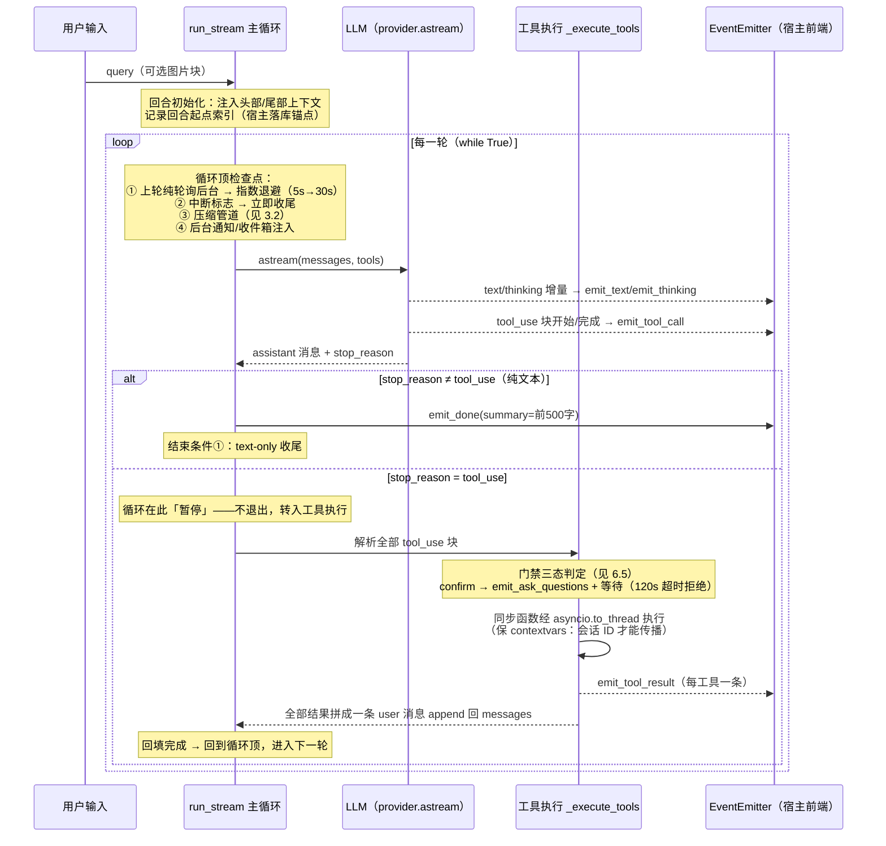
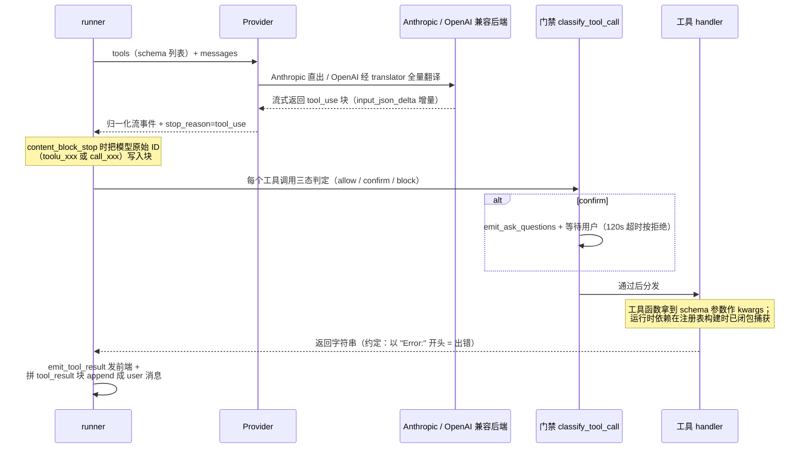
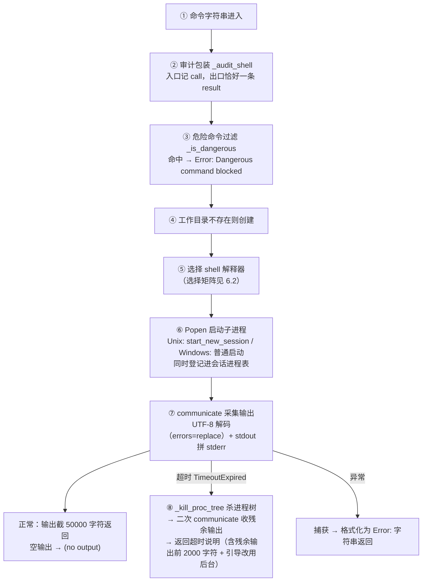
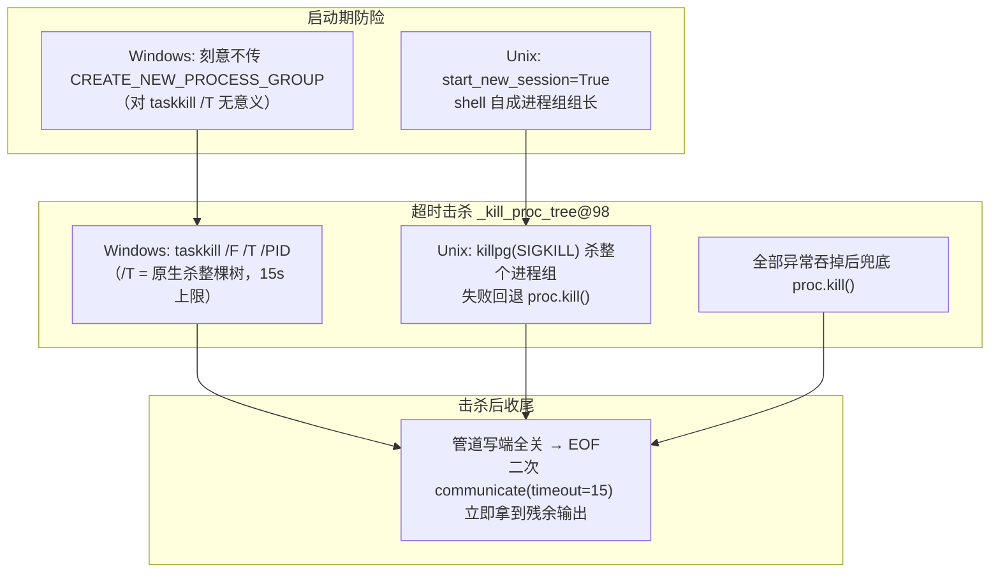

# planify 模块深析（harness loop 与 tool call chain）

> ⚠ 构建产物：由 repo-wiki 技能（分册模式）全量重生成，勿手改。
> 生成日期：2026-10-10｜模式：模块轨｜重点：harness loop、tool call chain、shell tool

## 1. 范围界定

本分册分析 `planify/` 子树（AI Agent 框架，被 doclens 宿主消费），围绕三条主线展开：

| 主线 | 涉及文件 |
|------|---------|
| harness loop（轮次循环） | `streaming/runner.py`、`streaming/types.py`、`streaming/emitter.py`、`streaming/waiter.py`、`subagent/runner.py`、`agent/runner.py`、`cli.py` |
| tool call chain（工具调用链） | `tools/registry.py`、`core/runtime.py`、`core/runtime_manager.py`、`core/llm/*`（provider / types / tool_translator / anthropic_provider / openai_compat_provider）、`bootstrap.py` |
| **shell tool（重点）** | `tools/basic.py`、`tools/guard.py`、`managers/background_manager.py`、`core/encoding.py` |

**不含**：提示词模板内容（`prompts.py`）、技能加载（`skills/`）、团队协作与任务板（`managers/` 其余）、消息总线（`messaging/`）、独立工具（天气 / webfetch / 农历）的实现细节——它们只在被三条主线触及时带过。同时排除 `planify/build/`、`__pycache__/`、`work-dir/`。

## 2. 全景与装配链路

planify 是一个分层的 agent 框架：底层是 LLM Provider 抽象（双后端），中层是工具注册表与运行时容器，上层是流式主循环（StreamingAgent）。宿主（doclens 的 CLI / TUI / Web GUI）负责装配并驱动它。

装配分**两个阶段**，这是理解代码结构的关键事实——注册表装配发生在框架内部，交互渠道装配由宿主完成：

图 2-1：两阶段装配。注册表先建（`bootstrap.py` → `core/runtime_manager.py:277`），emitter 与 waiter 后注入（`cli.py:396-410` 同型）。工具函数的运行时依赖（工作目录、各 manager、provider）在注册表构建时已闭包捕获，循环执行时只传 schema 参数。

## 3. Harness Loop：轮次循环

### 3.1 一次回合的完整时序

主循环在 `StreamingAgent.run_stream`（`streaming/runner.py:363`）。**一次用户输入 = 一个回合（turn）**；回合内是 `while True` 循环，每圈称为一轮（round）：调一次 LLM、（若有）执行一批工具、回填结果，直到某个结束条件成立。

图 3-1：回合时序。工具结果是回填进对话历史的 user 消息（与数据库回放块同形同序，保证 prompt 前缀缓存命中，`runner.py:1206-1210`）。

### 3.2 循环顶检查点

每一轮开始前，循环依次做四件事，各自解决一个问题：

| 检查点 | 解决什么问题 | 机制 |
|--------|-------------|------|
| 纯轮询退避 | 模型反复 `check_background` 空转烧 token | 上一轮全是后台轮询且仍在跑 → LLM 调用前指数退避 5s→30s，可被中断唤醒 |
| 中断检查 | 用户按 ESC / 点「停止」要立刻生效 | 检查中断标志，置位则直接 `emit_done(reason="stopped")` 收尾 |
| 压缩管道 | 长回合上下文爆炸 | 依据上一轮 LLM 返回的 token 用量估算：轻度吃紧（≥八成阈值）只清旧工具结果（microcompact），严重超限把整段历史压缩成摘要（auto_compact，`context/compact.py`）并重注入上下文 |
| 通知注入 | 后台任务完成、队友来信要送达 | 清空通知队列与收件箱，以 user/assistant 消息对注入 |

### 3.3 五种结束条件与轮次熔断

主循环的 `while True` **本身没有轮次上限**——上限由结束条件与三层熔断实现。这是文档全无记载的事实（见第 8 章 ⚠-4）。

**五种结束条件**：① 模型纯文本收尾（`stop_reason ≠ tool_use`）；② 对话式提问短路（工具结果带哨兵前缀，见 7.3）；③ 硬阈值强制终答（见下）；④ 用户中断；⑤ 任何异常 → 发错误事件收尾。

**三层熔断**（防止模型无限调工具不收尾）：

| 层 | 触发 | 处置 |
|----|------|------|
| 同参检测 | 连续 3 轮用完全相同的参数签名调工具 | 注入死循环提醒（`<system-reminder>` 消息对） |
| 软阈值 | 轮数超过 `max_tool_rounds`（宿主注入；默认 None = 不启用） | 注入收尾提醒，模型仍可继续调工具 |
| 硬阈值 | 轮数达到 `force_answer_rounds`（默认 None） | 以空工具列表再调一次 LLM，强制纯文本终答后结束 |

纯轮询轮（上一轮全是后台检查）不消耗轮次预算。

## 4. 三种 runner 对比

planify 有三个 agent 循环实现，服务不同场景：

| | `streaming/runner.py`（主力） | `subagent/runner.py`（一次性子代理） | `agent/runner.py`（旧 REPL） |
|---|---|---|---|
| 形态 | 异步 `while True` + 三层熔断 | 同步 for 循环，轮次预算上限（默认 30，宿主可配；预算三机制：同参早警→软提醒→截断标记，见下） | 同步 `while True`，**无任何上限/熔断** |
| LLM 调用 | `astream()` 流式 | `chat()` 非流式 + 429 指数退避重试 | `chat()` 非流式 |
| 事件发射 | 全套（文本/工具/提问/用量…） | 无（静默，仅日志） | 回调函数 |
| 上下文管理 | 压缩管道 + 退避 + 注入 | 无压缩 | 压缩（同步版）+ 手动触发 |
| 用户交互 | waiter 等待 / 对话式断回合 | 无渠道，门禁 fail-closed | 无 |
| 消费者 | CLI / TUI / Web 主力路径 | `task` 工具（并发子代理） | 仅旧入口 `main.py` |

三者共享 provider 抽象与工具格式，但循环形态独立演化：subagent 是「拿摘要就走的迷你循环」，旧 runner 是流式改造前的遗产。子代理的工具面 = 4 个基础工具（bash / read / write / edit）+ 宿主经 `extra_tools` 注入的扩展（doclens 注入 read_document / file_info 供读二进制文档；主注册表透传 grep / glob 检索工具；每次调用私有的 TodoWrite），shell 工具带 fail-closed 门禁包装（见 6.5）。子代理的轮次预算已参数化（`max_rounds`，默认 30，doclens 配置项 `PLANIFY_MAX_SUBAGENT_ROUNDS`），且与主循环同哲学：连续 3 轮同参调用注入死循环提醒、预算剩约六分之一时注入收尾提醒、跑满仍未收尾则摘要带 `[round-limit-reached]` 截断标记（主代理可据此续派或接手，不再把半截摘要当全量结论）。

## 5. Tool Call Chain：工具调用链

### 5.1 端到端时序

一次工具调用从「schema 随请求发出」到「结果回填历史」的完整链路：

图 5-1：工具调用链。错误识别**纯靠字符串前缀约定**（输出以 `Error:` 开头即 `is_error=True`），handler 永不抛异常——异常也被捕获格式化成 `"Error: …"` 字符串返回。

### 5.2 工具注册表

注册表是一个构建函数（`build_tool_registry`，`tools/registry.py:68`）返回一对结果：给 LLM 看的 schema 列表（裸 dict，Anthropic 风格）和给 runner 用的名称→函数映射。注册名单：

| 类别 | 工具 | 条件 |
|------|------|------|
| 基础 | `bash`、`powershell`、`read_file`、`write_file`、`edit_file` | powershell 仅 Windows |
| 检索 | `grep`、`glob` | 仅系统装有 ripgrep 时注册（缺失则模型降级用 bash） |
| 任务 | `TodoWrite`、`task`（子代理）、`load_skill`、文件任务板工具、团队协作工具、协议工具 | — |
| 后台 | `background_run`、`check_background` | — |
| 压缩 | `compress`（handler 只返回占位符，真正压缩在 runner 层拦截） | — |
| 交互 | `ask_user`、`user_confirm`；GUI 模式追加 `ask_user_question` | — |
| 扩展 | 外部注入工具、百度天气、webfetch | — |

三个横切机制：**外部注入**——宿主调 `register_external_tools()`（registry.py:32）注入自己的工具，同名时外部覆盖内置并告警（doclens 的知识库 / MCP 工具走此路，ADR-0014）；**白名单**——环境变量 `PLANIFY_ENABLED_TOOLS` 过滤，GUI 模式下 `ask_user_question` 被误删时强制保留（registry.py:449-454）；**门禁包装**——GUI 模式下对 shell 类工具包 fail-closed 包装（registry.py:466-474）。

### 5.3 Provider 双后端与 ID 直通

`LLMProvider` 协议（`core/llm/provider.py:11`）定义 chat / stream / achat / astream / count_tokens 五个方法。同步方法服务旧 REPL 与子代理；**StreamingAgent 主链路只走 `astream`**。两个后端的差异：

| | Anthropic 原生 | OpenAI 兼容 |
|---|---|---|
| 工具 schema | 直出，自动打 prompt caching 断点 | 翻译成 `{type:"function", function:{…}}` |
| 消息格式 | 原生 tool_use / tool_result 块 | tool_use→`tool_calls`；tool_result→独立 `role=tool` 消息（保序） |
| prompt caching | 最后一条 user 消息尾块打 ephemeral 断点（返回拷贝，不改历史） | 无 |
| thinking 块 | 归一化时丢弃（防 repr 泄漏） | — |
| token 计数 | 真 API 计数 | 字符数÷4 粗估 |

**ID 直通**是翻译层的核心设计：runner 把模型生成的原始工具调用 ID（Anthropic 的 `toolu_xxx` 或 OpenAI 的 `call_xxx`）原样写入块，translator 原样回传，不做任何映射。`tool_translator.py:77-112` 的大段注释记录了历史教训——早期走 mapper 回查映射，因 mapper 每次调用重建导致映射丢失，工具结果被后端丢弃、模型无限重试同一工具。遗留的 `ToolCallMapper` 类已旁路，仅为兼容外部 import 保留（⚠ 见第 8 章）。

### 5.4 dict↔dataclass 双轨边界

归一化类型（`core/llm/types.py`，全 frozen dataclass：TextBlock / ToolUseBlock / ToolResultBlock / Tool）只在 **provider 边界**使用；注册表层工具是裸 dict，runner 回填历史时也直接手写 dict。`Tool` dataclass 在每轮 LLM 调用前由 runner 从 dict 转换（`runner.py:878-886`）。

## 6. Shell Tool 深析（重点）

### 6.1 执行管线：一条命令的八步旅程

bash 与 powershell 工具共用同一条管线（bash 入口 `run_bash`@`tools/basic.py:460`，实现 `_run_bash_impl`@346，最终都落到 `run_shell_with_tree_kill`@150）。一条命令字符串从进入工具到返回输出，依次经过：

图 6-1：shell 执行管线。工具层**永不抛异常**，所有路径（成功/拦截/超时/异常）都返回字符串——与 5.1 的前缀判错约定配套。

门禁层不在 handler 内部：管道层先做三态判定（未授权根本进不了 handler），handler 内只剩危险命令过滤这道无条件的最后防线。纵深关系见 6.5。

### 6.2 Shell 选择矩阵

系统上往往有多个可用解释器，选择逻辑按平台与优先级降级：

| 工具 | 平台 | 候选顺序 | 兜底行为 |
|------|------|---------|---------|
| `bash` | Windows | Git Bash（Program Files 三处 + 用户目录固定路径逐个探测）→ `shutil.which`（**排除 System32 下的 WSL bash.exe**，它会把命令跑进 Linux 子系统） | 找不到任何 bash → 整体降级调用 powershell 工具执行 |
| `bash` | Unix | `sh -c` 直接可用 | — |
| `powershell` | 非 Windows | 直接报错（工具本身仅 Windows 注册） | — |
| `powershell` | Windows | pwsh 7（which + 固定路径）→ powershell 5.1（which + System32）→ cmd（COMSPEC 环境变量） | — |

选定解释器后统一组 argv（`_build_shell_argv`@280），并**前置注入 UTF-8 编码指令**：

| 解释器 | 注入的前置命令 |
|--------|---------------|
| pwsh / powershell | `[Console]::OutputEncoding=UTF8` + `$PSStyle.OutputRendering='PlainText'`，配合 `-NoProfile -NonInteractive -Command` |
| cmd | `chcp 65001>nul &`（切到 UTF-8 代码页），配合 `/c` |
| bash / sh | 无需注入，`-c` 直跑 |

### 6.3 进程树击杀：为什么必须杀树

这是 shell 工具最重要的可靠性设计，直接源自一次真实事故：2026-10-05，一条命令拉起 playwright，playwright 又拉起浏览器孙进程；命令本身超时后被杀，但孙进程仍持有输出管道的写端，`communicate()` 读不到 EOF，工具线程**阻塞了 38 分钟**。`subprocess.run(timeout=)` 只杀直接子进程，救不了这种「树根死了、树枝还抓着管道」的局面。

解法分三层：

图 6-2：进程树击杀三层设计。启动期的会话安排（Unix）与击杀手段一一对应；杀树后残余输出不丢，拼进超时返回信息。

**会话级停止**是配套机制：每个启动的子进程都登记进会话进程表（`_register_session_proc`@82，锁保护的 dict，按会话 ID 分组）。宿主中断钩子调 `kill_session_shell_procs(session_id)`（`basic.py:129`）立刻杀掉该会话全部进程树——用户点「停止」时，正在跑的工具线程即刻返回，不必等超时。

### 6.4 危险命令过滤（第一层护栏）

`_is_dangerous`（`basic.py:206`）对所有 shell 通道（前台 bash / powershell / 后台）无条件生效：

- **子串匹配**：`rm -rf /`、`> /dev/`；
- **整词匹配**（分号 / `&` / `|` 替换成空格后分词，避免 `dd` 误伤 `yyyy-MM-dd` 这类日期参数）：`sudo`、`shutdown`、`reboot`、`mkfs`、`dd`。

命中即返回 `Error: Dangerous command blocked`，命令不执行。

### 6.5 三层安全护栏全景

shell 通道的完整防线是纵深防御（ADR-0021 明确定位：**不是沙箱**，可被变量拼接、`cd` 后相对路径等手段绕过——设计目标是拦住无意识越界与低成本绕过）：

| 层 | 位置 | 拦什么 | 机制 |
|----|------|--------|------|
| ① 危险命令黑名单 | handler 内（basic.py:206） | 不可恢复的灾难命令 | 见 6.4，无条件 |
| ② 外部访问门禁 | 管道层（guard.py）+ 子代理包装 | 工作目录以外的读写 | 三态判定 + 会话授权账本 + fail-closed（ADR-0021） |
| ③ 提示词层自审 | 宿主 system prompt | 脚本内容穿透（外部路径藏在 .py/.js 内联代码里） | 要求模型执行脚本前自审内容；规则段与门禁模式同源联动（ADR-0021 §8） |

**门禁三态**：环境变量 `PLANIFY_OUTSIDE_WORKDIR` = `ask`（默认，弹确认）/ `allow`（放行）/ `block`（全拦，且优先于会话授权——严格模式绝对拦截）。保存即热生效。

**shell 命令判定**（`_shell_verdict`@guard.py:435）：对命令文本做引号感知分词（防带空格路径被腰斩、授权范围塌缩到盘根），挑出路径形态的 token——Windows 盘符、UNC 路径（`\\server\…`）、Unix 绝对路径、`~`、`%VAR%`、`$env:NAME`（Git Bash 的 `/c/…` 挂载写法也会归一成 `C:\…`）——排除 `/dev/null`、`NUL` 后展开成绝对路径，落在工作目录之外的即触发确认。**读写作判定**（`is_write_command`@294）用写信号词表（POSIX + cmd + PowerShell cmdlet 全名，别名不收；或剥掉 `2>/dev/null` 后仍含 `>` / `>>` 重定向）整条判定，**不确定偏写**（保守端）。bash 与 powershell 走同一套判定逻辑，差异只在路径语法展开。

**会话授权账本**（`_GrantLedger`@179）：确认通过后记账——目录级（含子树）、读/写两本账、写授权蕴含读授权；作用域是聊天会话（主代理 / 子代理 / teammate 共享，子代理免重复确认）；会话结束作废，不做永久白名单。授权锚点取「已存在目录本身 / 文件的父目录」（`_grant_dir`@161）。

**fail-closed**：子代理与 teammate 没有交互渠道（无法弹确认），或确认超时（120 秒，`GUARD_TIMEOUT_SECONDS`@guard.py:66）——一律按拒绝处置，错误信息提示模型「子代理无交互渠道，请由主代理确认后重试」，让任务带回主循环。确认弹窗复用 ask 协议但带 `guard: true` 标志位，模型自调的提问工具带不上这个字段，**无法仿冒门禁卡片骗授权**。

结构化工具（read / write / edit）走精确路径判定（`_structured_verdict`@411），三态语义相同；旧链路（非 GUI）保留 `safe_path`（basic.py:297）硬拒绝——路径拼接后必须仍在工作目录内，否则抛错。

### 6.6 后台命令机制

`BackgroundManager`（`managers/background_manager.py`）让长命令不占住回合：发起即返回任务 ID，模型用 `check_background` 轮询。

- **线程模型**：危险命令预检（与前台同清单，不过账本直接拒）→ 任务入状态字典 → 守护线程执行。发起线程的会话 ID 显式捕获传入（contextvar 不跨线程继承），执行线程内恢复——保证进程登记落到正确会话键，宿主「停止」能杀到后台进程树。
- **执行语义与前台完全一致**（2026-10-09 起）：同一套解释器选择、同一条树杀管线、同一套审计。
- **超时语义**：不传 / 非法 / 非正的超时值回落到前台同款默认（`PLANIFY_SHELL_TIMEOUT` 同源，两通道预算一致），上限 3600 秒。超时任务转**error 终态**（非静默消失），返回信息引导改命令（自行退出 / 拆步 / 轮询文件）而非干等。
- **失联自愈**：`check`（@232）发现任务仍标记 running 但已超「预算 + 45 秒宽限」（`_EXEC_GRACE_SECONDS`@62，防执行线程意外丢失造成无界等待）即转 error。
- **纯轮询契约**：running 态的 `check` 返回带 `[running]` 前缀（`RUNNING_PREFIX`@51）——runner 靠这个前缀识别「纯轮询轮」，不计入轮次预算（呼应 3.2 的退避机制）。
- **通知**：完成时往通知队列放 `{task_id, status, result 截 500 字符}`；主循环在循环顶 drain 清空（`drain`@295）注入对话。

### 6.7 Windows 编码处理

`core/encoding.py` 解决的是**宿主进程自身**的中文编码问题：中文 Windows 控制台默认 GBK 代码页，Python 的标准输入输出会遇到中文乱码或编码异常。手段：导入时置 `PYTHONUTF8=1`；初始化函数把控制台代码页切成 65001（ctypes 直调，失败回退 `chcp`），并重配置 stdio 为 UTF-8（出错用替换字符兜底）；`safe_print` / `safe_input` 处理残余的编码异常，GBK 终端的输入会被转换成 UTF-8。

**子进程**输出的编码不归这个模块管——shell 工具侧靠 6.2 的前置注入（`[Console]::OutputEncoding=UTF8` / `chcp 65001`）强制子进程按 UTF-8 输出，加上读取时 `decode("utf-8", errors="replace")` 兜底。整条链路没有 GBK 探测逻辑：全部按 UTF-8 解码，解不动就替换。

## 7. 事件与用户交互面

### 7.1 事件类型

runner 与宿主之间靠事件协议解耦（`streaming/types.py:22`）：

| 事件 | 载荷要点 | 消费场景 |
|------|---------|---------|
| text | 增量内容 + is_end 标志 | 正文流式渲染 |
| thinking | 思考增量 | 思考过程展示 |
| tool_call | 工具名 + 参数增量 + is_complete | 工具卡片（流内两次：开始与完成） |
| tool_result | 工具调用 ID + 输出 + is_error | 结果渲染 |
| ask_user / ask_questions | 提问载荷（questions 版带 guard 标志位） | 交互卡片 |
| done | summary + 可选 reason（如 waiting_user） | 回合收尾 |
| error | 错误信息 + code | 错误提示 |
| usage | token 用量 | 用量统计 |
| notice | 通知文本 | 宿主转 toast |
| heartbeat | — | SSE 保活 |

EventEmitter 协议只要求实现一个 `emit` 方法，便捷方法（emit_text 等）的默认实现在协议上，三个实现类（SSE / CLI / TUI，`streaming/emitter.py`）各接各的前端。

### 7.2 waiter：回合内等待用户

`GlobalResponseWaiter`（`streaming/waiter.py`，单例）实现「工具执行中暂停问用户」：提问工具创建请求 → 发 ask 事件 → 工具协程内等待响应（asyncio.Future，跨线程用 `call_soon_threadsafe` 唤醒，默认 300 秒超时）。等待期间循环阻塞在工具执行环节；CLI 实现在事件线程同步读终端输入，Web 由 HTTP 回答端点提交。宿主「停止」按钮调 `interrupt_session` 唤醒该会话全部等待中的请求。

### 7.3 ask 双模式：阻塞等待 vs 断回合

`PLANIFY_ASK_MODE`（ADR-0033）决定提问形态：

- **interactive（默认）**：如上，回合内阻塞等待，作答后同回合恢复。移动端不可用——浏览器杀后台即丢答题卡。
- **chat**：提问以普通正文消息发出，工具返回带哨兵前缀（`[waiting-user-reply]`）的说明串，runner 检测到哨兵**确定性断回合**（不赌模型自觉收尾）；答案 = 用户的下一条消息，同会话全上下文自然续接。无 pending 状态机。

门禁确认不受此模式影响，始终走交互式 + 超时 fail-closed——无人值守时外部访问被拒是安全默认（ADR-0033 边界条款）。

## 8. 文档冲突与缺口

以下按「代码即真相」原则核实过的文档不符项与缺口：

| # | 位置 | 冲突内容 |
|---|------|---------|
| ⚠-1 | `streaming/types.py:371` | 配置字段 `truncate_tool_output=5000` 是**死配置**：声明工具输出截断长度，但 `_execute_tools` 明确注释「不截断：LLM 上下文与前端 SSE 都需要完整输出」（runner.py:1188），该值从未被读取。同类的 `tool_execution_timeout` / `user_response_timeout` 在 planify 内也无消费点（实际超时来自 guard 的 120s 与提问工具的 300s 硬编码） |
| ⚠-2 | ADR-0021 正文 vs `guard.py:66` | ⚠ 与 ADR-0021 正文所述不符：正文写确认超时 300s，代码实为 `GUARD_TIMEOUT_SECONDS=120`。ADR 后记（2026-10-03）已自我勘误声明以代码为准，但正文未改，读文档须看后记 |
| ⚠-3 | `core/llm/tool_translator.py` | `ToolCallMapper` 已旁路成「僵尸代码」：round-trip 不再经它，保留仅为兼容外部 import；模块 docstring 与 CLAUDE.md 均未记录此弃用状态 |
| ⚠-4 | README / CLAUDE.md | 两处文档均未记载「主循环默认无轮次上限」——`max_tool_rounds` / `force_answer_rounds` 默认 None（不启用），宿主不注入时 run_stream 理论可无限循环，仅剩同参检测与中断兜底。文档只写「Tool loop iterates autonomously」，无此风险面记载 |
| ⚠-5 | CLAUDE.md:267 | CLAUDE.md 称 provider 协议是「chat/stream/count_tokens」，遗漏主链路实际使用的 `achat` / `astream`（StreamingAgent 只走 astream） |
| ⚠-6 | `planify/streaming_spec.md` | 该 spec 通篇引用不存在的旧路径（`backend/app/planify/...`），是流式改造前的历史方案文档，与现状严重脱节，读者慎引 |
| 缺口 | docs/ 体系 | shell 超时 / 进程树击杀（2026-10-05 事故）/ 后台统一语义（2026-10-09）无任何专项文档，设计动机只存在于源码 docstring——本分册 6.3 / 6.6 目前是唯一成文来源 |
