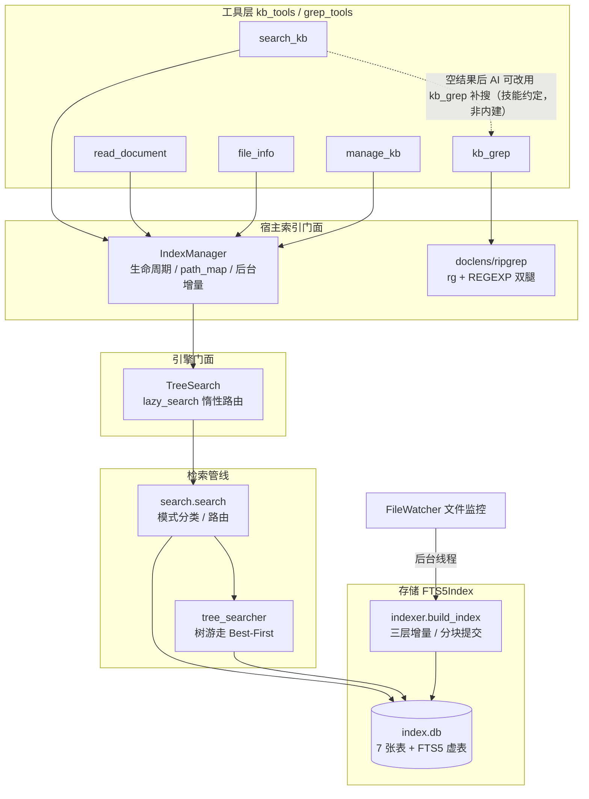
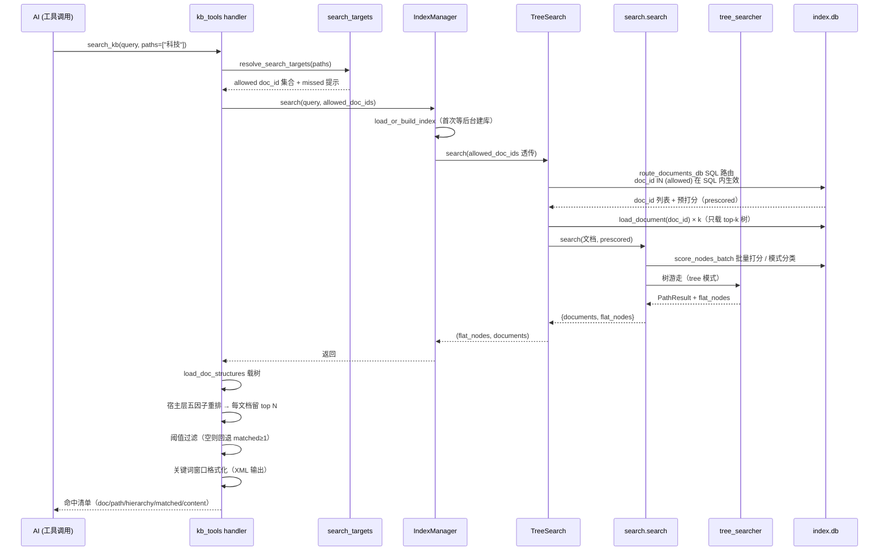
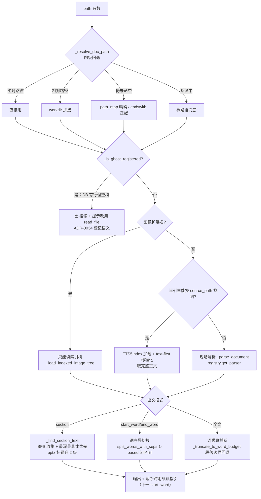
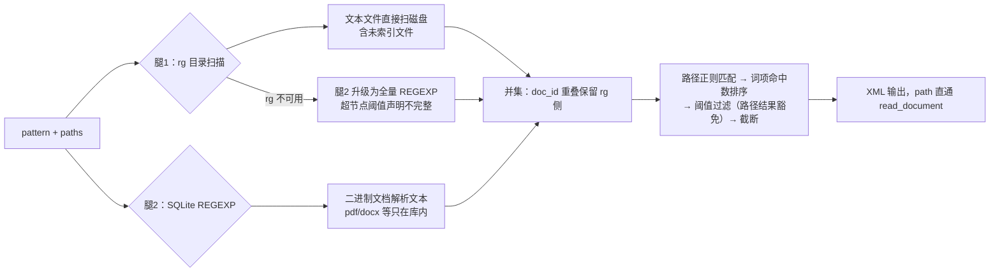
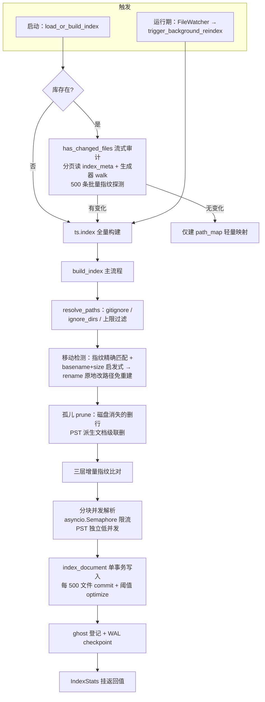
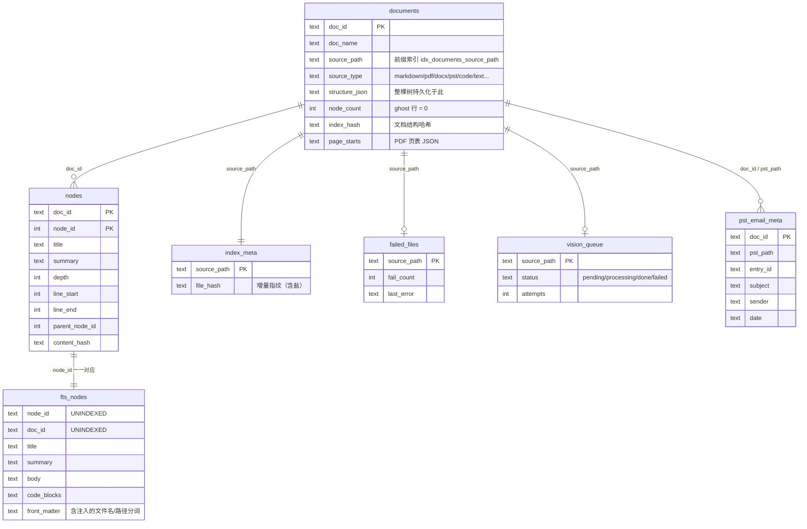

# search_kb 工具 深析

> ⚠ 构建产物：由 repo-wiki 技能（分册模式）全量重生成，勿手改。
> 生成日期：2026-10-19｜模式：feature 轨｜feature 主题词：search_kb

## 范围界定

本分册分析 doclens 知识库检索工具链的完整纵深：从 AI 工具调用面（search_kb / read_document / file_info / manage_kb / kb_grep）向下穿透宿主索引门面（IndexManager）、引擎门面（TreeSearch），直达 FTS5 存储与索引构建（fts.py / indexer.py）。

**含**（17 个源文件）：

| 层 | 文件 |
|---|---|
| 工具核心 | `doclens/kb_tools.py`、`doclens/grep_tools.py`、`doclens/search_targets.py`、`doclens/word_window.py`、`doclens/scoring.py` |
| 宿主索引层 | `doclens/index_manager.py`、`doclens/ripgrep.py`、`treesearch/treesearch.py`、`treesearch/tree.py`、`treesearch/tokenizer.py`、`treesearch/config.py`、`treesearch/parsers/registry.py` |
| 引擎内部 | `treesearch/fts.py`、`treesearch/indexer.py`、`treesearch/search.py`、`treesearch/tree_searcher.py` |

**不含**：各格式 parser 内部（pdf/docx/excel…，仅消费其 registry 分派结果）、Web 端引文策展（refs_curator / references.py）与前端工具轨迹、MCP 服务器暴露面（mcp_server.py）、Web API 搜索端点。

**发现依据**（feature 轨）：全仓 grep `search_kb` 命中 30 个文件，去重文档/测试/前端后圈定工具核心层；沿 kb_tools → IndexManager → TreeSearch → FTS5 的 import 链向下扩展出宿主索引层与引擎内部两组（经用户确认「A组 + treesearch相关部分」）。

## 全景分层

整条链路分五层，每层只依赖下一层。AI 调用的工具在顶层注册，查询最终落到单个 SQLite 文件（FTS5 全文索引）上；索引的写入则由文件监控触发的后台线程独立完成。

*图 1：五层调用链。实线为查询路径，虚线为空结果降级路径；写入路径独立于查询路径。*

## 工具面

### 五个工具的参数契约

`build_kb_tools`（kb_tools.py:194）装配前四个工具并返回 schema 与 handler 映射；kb_grep 由 `build_grep_tools`（grep_tools.py:72）独立装配。AI 在对话中看到的工具参数如下：

| 工具 | 参数 | 语义 |
|---|---|---|
| `search_kb` | `query`（必填）、`max_results`（默认取配置）、`paths`（可选） | 全文检索，返回结构化命中；paths 限定搜索范围 |
| `read_document` | `path`（必填）、`section` / `start_word` / `end_word`（可选） | 深读文档；section 优先于词区间，都缺省则全文按词预算截断 |
| `file_info` | `path`（必填） | 文件概况：大小、词数、章节清单——read_document 前的侦察 |
| `manage_kb` | `action`（reindex / stats）、`force`（默认 false） | 索引管理；force 会删库重建 |
| `kb_grep` | `pattern`（必填）、`paths`、`max_results`（上限 500） | 正则搜库；覆盖未索引文本文件与二进制文档解析文本 |

`paths` 参数由 `resolve_search_targets`（search_targets.py:44）统一解析：目录条目按前缀匹配、文件条目精确匹配，解析为允许搜索的路径键集合，超出的条目会以 missed 提示返回给 AI。这个模块被 search_kb 与 kb_grep 共用（术语「限定范围问答」）。

### search_kb_v2（已删除，2026-10-19）

曾存在一套 v2 实现（结构化查询 and/or/phrase/not、每文档单节点、双重 rg 降级），状态为「半挂载」——实现完整但未进 build_kb_tools 工具面（AI 不可见），仅 CLI 子命令可达。因废弃已整体删除（schema + `_handle_search_kb_v2` + `_handle_not_query`/`_extract_keywords`/`_build_fts5_query` 三个专属辅助 + `_format_ripgrep_results` + `cortex search_v2` 子命令）。现役工具面只有 v1 一套。

### KB 门禁（已删除，2026-10-19）

曾存在技能门禁机制（skill_gate.py）：AI 调 KB 工具前必须先 load_skill("knowledge-base")，未加载则工具弹回提示——用 contextvar 记录技能加载状态（planify 的 SkillAccessState），handler 被 `gate_skill` 包装。2026-08-17 起因技能工具箱场景的额外弹回轮次被 `and False` 硬短路关闭，引文规范改由 refs_curator 机器校验兜底；2026-10-19 判废整体删除（skill_gate.py 移除，build_kb_tools/build_grep_tools 不再包装 handler，skill_state 形参保留占位）。检索策略的注入现依赖 agent_prompt 的 system prompt 规则。

## search_kb 查询链路

一次 `search_kb(query="量子 计算", paths=["科技"])` 调用的完整路径如下。设计主线是「惰性搜索」（ADR-0019，术语见 CONTEXT.md:78）：内存中永远只有 top-k 文档的树结构，全量路由在数据库 SQL 上完成——这是百万级语料不 OOM 的根基。

*图 2：search_kb 主路径。paths 范围限定在路由阶段 SQL 内生效（范围外文档不进候选池），检索后过滤与候选量放大兜底已退役。*

几个关键点的 why：

1. **paths 范围限定前置到路由 SQL**（2026-10-19 改造）：早期实现在 FTS 检索**之后**应用层过滤，靠放大候选量（max(200, 4×max_results)）兜底「先截后滤丢结果」——范围外命中密集时仍会挤掉范围内结果。现由 `resolve_search_targets` 解析出 allowed doc_id 集合，经 IndexManager/TreeSearch 透传进 `route_documents_db`，在 `score_nodes_batch` 的 SQL `doc_id IN (...)` 内生效：范围外文档不进候选池，兜底逻辑退役（空集合语义 = 无结果，与 None=不过滤区分，见 fts.py score_nodes_batch 空集早退）。
2. **DB 路由**（术语见 CONTEXT.md:79）：多文档搜索「选哪些文档」在索引库一条 SQL 完成（FTS5 MATCH 得分排序），不依赖内存文档列表。路由出的预打分经 fts_prescored 回流给后续管线，避免重走倒排表。
3. **空结果**：v1 无自动 ripgrep 降级，返回「未找到 + 建议换角度/用 kb_grep 补搜」的文案——降级决策交给 AI 层（knowledge_base 技能约定 6 轮预算内自行补搜）。

## 两层打分体系

打分分布在两层，职责刻意分开：引擎层决定「哪些节点值得返回」（检索召回质量 + 候选裁剪），宿主层决定「结果怎么排序呈现」（用户/AI 视角的相关性）。两层是流水关系不是重复劳动：引擎先精排裁剪，宿主只在幸存候选上重排。

**引擎层**（treesearch 内）：

- BM25 列权：title ×5、summary ×2、body ×10、code_blocks ×1、front_matter ×2（fts.py:35 默认值，运行时从 config 注入）——标题命中的节点天然比正文命中排前。
- 祖先传播：节点得分归一化后，父节点继承 `ancestor_decay × max(子节点)`（默认 0.6）再归一化（fts.py:1469）——命中密集的子树会把父章节顶上来，保证返回的是「章节」而非碎片。
- 树游走：TreeSearcher 三阶段（tree_searcher.py:169）——锚点选取（FTS top-3 候选 + 深度/标题命中/短语加权评估，同路径祖先签名去重）→ Best-First 堆式游走（扩展子/父/兄弟节点，四重剪枝：扩展数上限 / 早停分 / 边界最低分 / 最大跳数）→ 路径聚合（root-to-leaf 路径分 = 叶分 + 路径相关性 − 长度惩罚）。最终 flat_nodes 重排分 = 0.3×游走分 + 0.7×FTS 分。

**宿主层**（doclens/scoring.py，五因子加权综合分）：

| 因子 | 含义 |
|---|---|
| keyword_match_ratio | 查询词在节点内的命中率 |
| file_name_match | 文件名与查询的匹配度 |
| fts_score | 节点自身的引擎 BM25 分（sigmoid 归一） |
| title_match | 节点标题命中 |
| proximity_match | 查询词邻近度（同节点/相邻 0/1/2 档） |

权重与阈值（min_score_threshold）运行时从 IndexManager 配置读取（对应「搜索预设」可调参数面），非模块常量。

**搜索参数的单一通道**（2026-10-19 收敛，消除「配置脑裂」）：max_nodes_per_doc / top_k_docs 等搜索参数由 `_ts_config()`（index_manager.py）集中构造、经 `set_config()` 注入引擎，引擎侧 `get_config()` 回退链取值——doclens 的值是引擎侧唯一真相（引擎类自带的默认值 5/3 仅供独立使用 treesearch 的场景，treesearch/config.py 有注释声明此分界）。此前的双通道形态（`_ts_config()` 白名单故意不含这两个参数、`IndexManager.search` 每次调用直传）已退役；随之一并查明：`IndexManager.search` 的 `max_results` 形参从未被引擎消费（被 `search(**kwargs)` 静默吞掉）——结果量裁剪全部发生在调用方（宿主层阈值过滤与 top-N），形参保留仅为签名兼容。

**两层的接合方式**（2026-10-19 融合改造）：引擎管线返回的 `docs[].nodes` 本身就是每文档 top-N 的精排候选（带节点级 score 与 text），宿主层直接在其上算五因子综合分——matched/proximity 用子串匹配在已缩小的候选集上补算，fts_score 因子取节点自身引擎分（旧实现误取文档级 max 分，节点间无区分度）。旧形态（宿主层对结果文档的**全量**节点做 Python 子串重扫、另起一套排名）已退役：实测 300 节点文档语料下全程耗时从 ~1060ms 降至 ~37ms（28×），两套排名信号互相打架的问题同时消除。

## read_document 深读链路

read_document 解决「拿到 path 后读哪段、读多少」的问题。三种出文模式按优先级：section 定位 > 词区间切片 > 全文词预算截断。

*图 3：read_document 深读链路。索引优先（省一次解析）、现场解析兜底（新文件未入索引也可读）。*

- **词序号切片**（术语见 CONTEXT.md:83）是 read_document 专属寻址体系：中日韩文字每字算一词、其余按空白切分，1-based 闭区间。它是为中文长段落（整段一行）设计的细粒度寻址；词定义的单一真相源 `split_words_with_seps` 在 planify（doclens 有意跨层导入，见 ARCHITECTURE-planify-boundary.md）。
- **ghost 拒读**：白名单外文本文件只「登记」不索引（documents 表有行、node_count=0、不进 FTS）——文件名可搜但全文检索不命中；read_document 遇到这类文件直接拒绝并提示改用通用 read_file（术语「登记」见 CONTEXT.md:143）。

## kb_grep 与降级链路

kb_grep（grep_tools.py）是正则搜库的直通工具，也是 search_kb 空结果后的补搜通道（AI 层手动发起）。它的底层 `execute_grep_search`（doclens/ripgrep.py:641）跑**双腿并集**：

*图 4：kb_grep 双腿机制。两条腿覆盖互补的文件形态；引擎 notes（超时/二进制超限）显式附注不静默。*

设计动机：纯文本文件在磁盘上，rg（ripgrep 二进制，PATH 上 `shutil.which` 定位）扫得又快又准；但 PDF/Word 的可搜文本只存在于索引库的解析结果里，rg 扫不到——所以第二腿直接对库跑 REGEXP。两侧结果按文档去重合并（重叠时保留 rg 侧，更新鲜）。

片段截取用「正则先导」策略：优先以正则命中位置为锚取词窗口（`_regex_led_snippet`@grep_tools.py:250），正则非法或无命中时退回关键词行锚点。总输出预算 8000 字符、结果上限 500 条。

## 索引写路径

查询链路只读库；写库由两条触发路径维护，共享同一套增量机制。

*图 5：索引构建。分块提交（术语「分块索引」CONTEXT.md:75）使内存峰值 = 单块；三层指纹使重跑只补变化文件。*

**三层增量**（重跑时逐层短路）：

| 层 | 载体 | 判定 |
|---|---|---|
| 文件指纹 | index_meta.file_hash（含盐：PST 格式盐、schema 版本盐、ghost 白名单盐） | 哈希未变整文件跳过 |
| 文档结构哈希 | documents.index_hash | 树结构未变零写入 |
| 节点 content_hash diff | nodes 表逐节点比对 | 只增删改变化节点（structure_json 仍整体重写） |

连续失败 ≥3 次（max_index_fail_count）且哈希未变的文件自动跳过，防坏文件拖死每轮增量。

## 数据模型

全部数据在单个 SQLite 文件（WAL 模式），宿主约定路径 `{知识库根}/.cortex/index.db`（开发形态；发行版 `.doclens/`，见 index_manager.py:47 定界）。

*图 6：七表关系。fts_nodes 是 FTS5 虚表（`tokenize='unicode61 remove_diacritics 2'`），无 FTS5 环境时降级为同列普通表 + LIKE。*

**中文处理的双层分工**：FTS5 的 tokenize 参数只配 unicode61（对中文等于逐字符切），jieba 分词发生在**写入前的 Python 侧**（`_tokenize_for_fts`@fts.py:169）——检测到 CJK 才预分词、以空格分隔写入列，纯英文内容交给 unicode61。查询侧 tokenizer 同源（jieba/bigram/char 按 config 切 CJK + 英文小写/词干/停用词），保证建索引与查询的分词口径一致。

**BM25 列权**：title=5 / summary=2 / body=10 / code_blocks=1 / front_matter=2（默认值 fts.py:35，config 的 fts_*_weight 覆盖）。文件名与 source_path 分词后注入 front_matter，使路径本身可搜。

## 文档冲突清单

以代码为真相，本分册生成过程中核对出的文档失真汇总：

| # | 冲突 | 文档侧 | 代码侧 |
|---|---|---|---|
| 1 | 索引库归属路径 | CLAUDE.md:100 称 treesearch 产物在 `.treesearch/`（index.db） | 宿主索引在 `{search_path}/.cortex/index.db`（index_manager.py:47）；`.treesearch/` 路径在代码中未出现，引擎默认 `./index.db` 由宿主覆盖 |
| 2 | ~~KB 门禁开关语义~~（已解决） | 原：CONTEXT.md 称「开关式可恢复」 | 代码是 `and False` 硬短路——2026-10-19 门禁整体删除，CONTEXT.md 术语已同步销账 |
| 3 | ~~门禁工具集名~~（已解决） | 原：CONTEXT.md 写「search_kb/read_document/manage_kb/grep」，漏 file_info、误写 grep | 随门禁删除一并销账（KB_GATED_TOOLS 常量已不存在） |
| 4 | ~~search_kb_v2 缺席~~（已解决） | 原：文档未提及 v2；代码存在半挂载实现 | 2026-10-19 v2 判废整体删除，工具面只余 v1，文档与代码一致 |
| 5 | search_with_aggregation 语义 | fts.py docstring 称「SQL aggregation」 | 实现为 FTS 查询 top-200 后 Python 字典聚合（fts.py:1327 起），SQL 只负责检索 |
| 6 | db_schema.md source_type 取值 | docs/db_schema.md:133 写「md/pdf/docx/pst 等」 | 实际值 markdown/pdf/docx/pst/code/text…（registry.py:17），无 "md" |
| 7 | v1 降级归属 | knowledge_base SKILL.md 检索策略易被读作 search_kb 内建降级 | v1 空结果仅返回建议文案，降级是 AI 层技能约定（v2 曾有的内建 rg 降级随 v2 删除） |
| 8 | treesearch 指纹 docstring | treesearch.py:117 docstring 称 `(mtime_ns, size)` 指纹 | 实现调 `file_hash_with_salts`（内容哈希，受 fingerprint_mode 控制）——content 模式下 touch 不触发重索引 |

另有一处低风险引用漂移：db_schema.md:92 引 fts.py:296-420，实际建表段在 fts.py:340-472。
