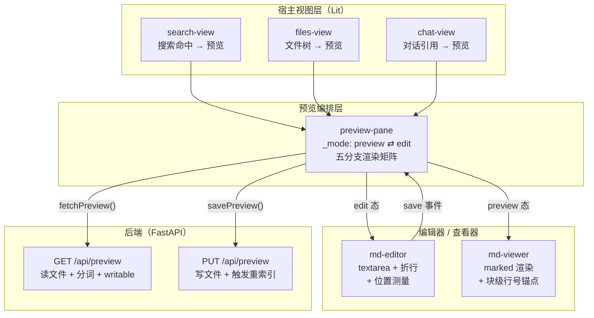
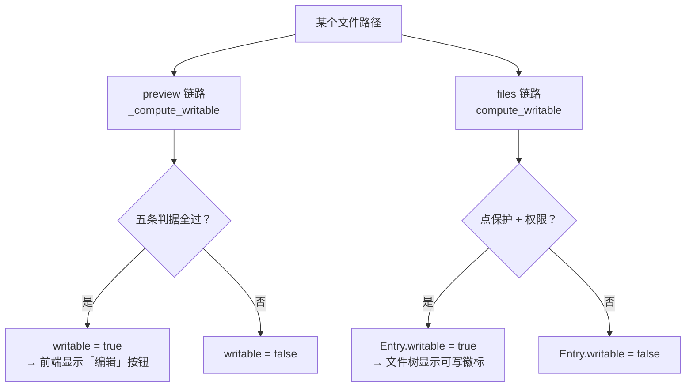
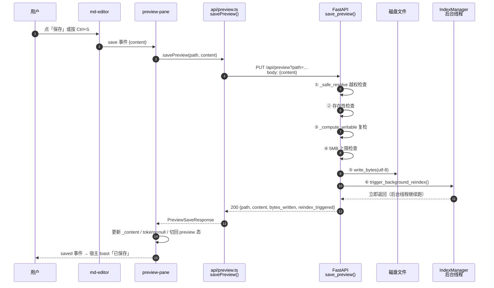
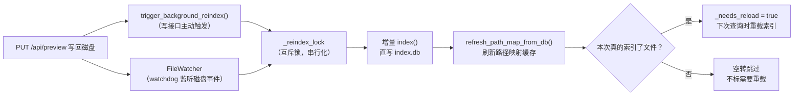
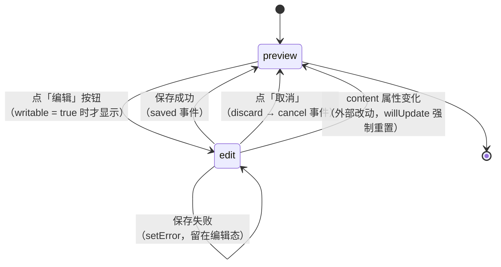
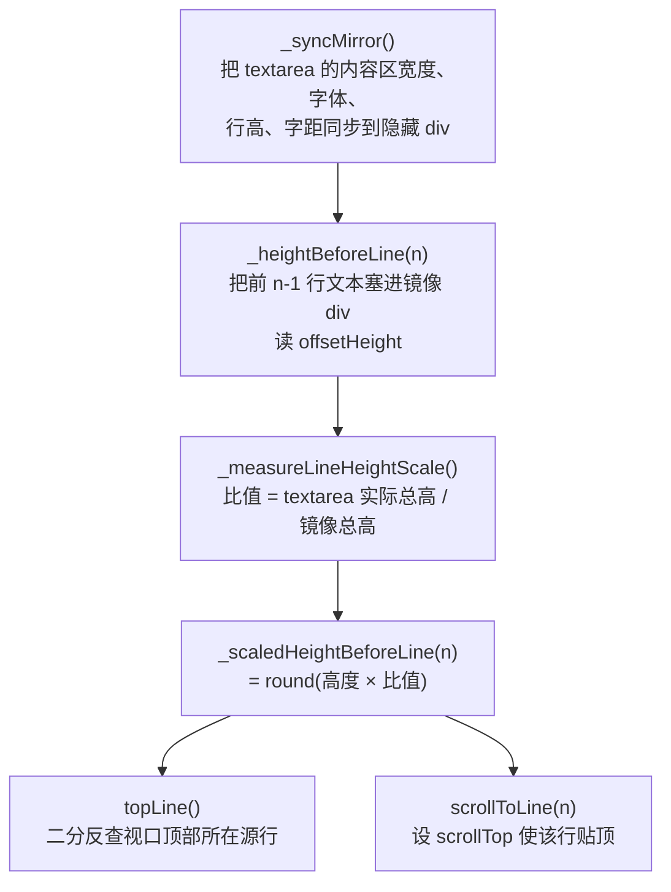
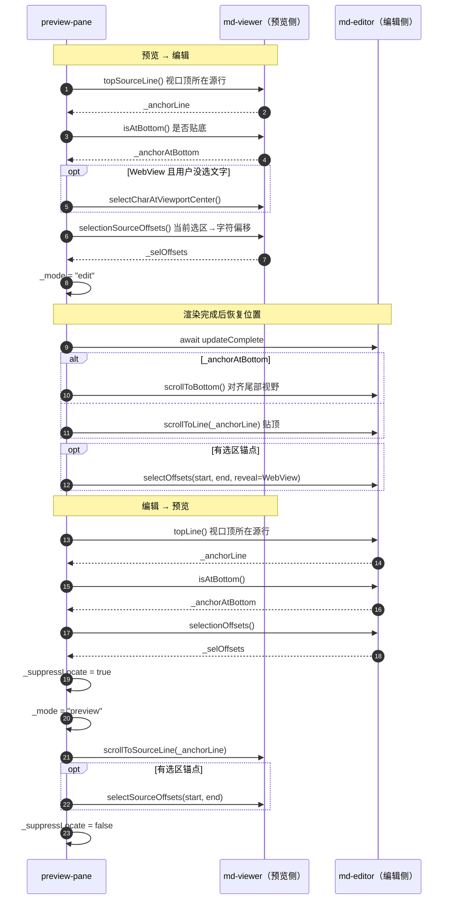
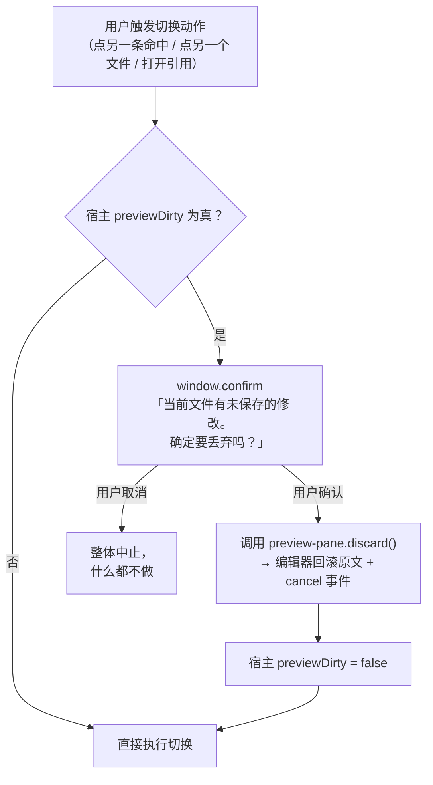
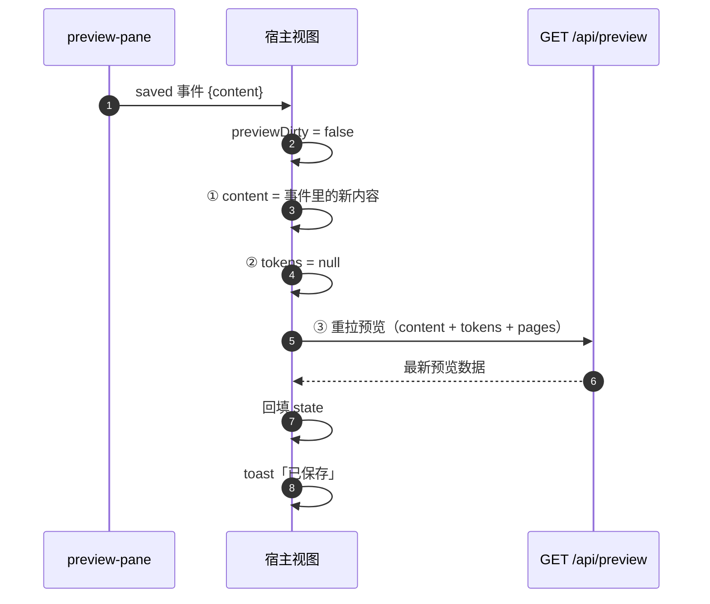

# 文本文件编辑功能 深析

> ⚠ 构建产物：由 repo-wiki 技能（分册模式）全量重生成，勿手改。
> 生成日期：2026-10-20｜模式：feature 轨｜feature 主题词：文本文件（md、txt、代码）编辑功能

## 范围界定

本分册讲的是 **Web UI 里把一个纯文本文件打开、修改、存回磁盘** 这条完整链路。用户在搜索结果、文件管理树或 AI 对话里点开一个 `.md`、`.txt`、`.py` 文件，预览栏顶部出现一个「编辑」按钮；点下去变成一个可输入的文本框；改完点「保存」，内容落回磁盘原文件，索引随后自动刷新。

### 含（30 个源文件 + 14 份决策文档）

路径省略前缀：后端为 `doclens/web_v2/`，前端为 `doclens/web_v2/frontend/src/`，Python 测试为仓库根 `tests/`。

| 域 | 文件 |
|---|---|
| 后端写回 | `api/preview.py`、`models/preview.py`、`path_safety.py`、`syntax_tokens.py`、`api/errors.py`、`api/files.py`、`models/files.py`、`deps.py`、`doclens/index_manager.py`、`doclens/config.py` |
| 前端编辑核心 | `components/md-editor.ts`、`components/md-viewer.ts`、`components/preview-pane.ts`、`api/preview.ts`、`api/client.ts`、`api/files.ts`、`utils/scroll-jump.ts` |
| 三个宿主视图 | `views/search-view.ts`、`views/files-view.ts`、`views/chat-view.ts`、`state/types.ts`、`components/file-list.ts`、`components/file-row.ts` |
| 测试 | `tests/test_web_preview_formats.py`、`test_preview_binary_guard.py`、`test_pdf_native_preview_api.py`；`frontend/tests/{md-editor,preview-pane,search-view-edit,api-preview}.spec.ts` |
| 决策文档 | `CONTEXT.md`、ADR-0020 / 0021 / 0027 / 0029 / 0031 / 0032 / 0034 / 0036 / 0043（应用主题包）/ 0043（工作目录热切换）、`README.md`、`README.zh-CN.md`、`CLAUDE.md` |

### 不含

- **AI agent 侧的写文件通道**——`planify/tools/basic.py` 里的 `write_file` / `edit_file` 工具、ADR-0021 外部访问门禁、ADR-0027 改前备份钩子。这些是**另一条独立的写路径**（AI 通过工具改文件），与本分册的「人在浏览器里编辑预览文件」不共用代码路径、不共用门禁、不共用备份。两者唯一的交集是 ADR-0027 那句：预览编辑器的写回会被对话回退的下一轮快照捕获——本分册第 10 章会引这一句作为语义边界。
- **只读的富文档预览**——`pdf-viewer.ts`（PDF 原生渲染）、`diff-viewer.ts`（git 未提交改动的 Unified Diff）、`image-viewer.ts`。它们与编辑功能共享「预览栏」这个外壳，但自身不可编辑。
- **二进制文档的合成预览**——docx / xlsx / pptx / csv / epub 等从索引库合成 Markdown 的那条链路（`_synthesize_binary_preview`），它在结构上与编辑功能同属 preview 端点，但永远不可写，本分册只在判定闸门一章带过。
- **PST 邮件预览**、日记片段编辑（`/api/diary/fragments` 的 PUT 是另一套独立的片段级编辑）、MCP 工具、模型预设编辑。

### 发现依据（feature 轨）

以主题词「文本文件 / md / txt / 代码 / 编辑 / 写回 / writable / md-editor / savePreview」grep 全仓，命中后按依赖方向收拢成上表四组。排除 `node_modules`、`static/assets`（Vite 构建产物）、`__pycache__`、锁文件。

**分册文件名** `text-file-editing.md` 取自主题词 slug。feature 轨的文件集合会随代码演进漂移——下次重新生成分册时，应按主题词重新发现文件，而不是沿用本清单。

---

## 1. 全景：一条写回链路的四层结构

编辑功能横跨四层，每层只做一件事：



**这张图要读出的三件事**：

1. **编辑能力长在预览栏上，不是一个独立页面**。用户在三个不同视图里都能编辑文件，但三者都把编辑入口挂在同一个 `preview-pane` 组件上——进入编辑、位置保持、保存、错误提示的逻辑只写了一遍。
2. **编辑器本身不碰网络**。`md-editor` 是一个纯 UI 组件：不调 API、不弹确认框，只通过 `save` / `cancel` / `dirty-change` 三个事件向父组件汇报。真正发请求的是 `preview-pane`。
3. **写回只有一个终点**。不管从哪个视图进来、编辑的是 Markdown 还是代码文件，最后都收敛到同一个 `PUT /api/preview`。

---

## 2. 可编辑性判定：两套闸门并存

「这个文件能不能编辑」这个问题，代码里有**两套彼此独立的判定**，服务两组不同的端点。

### 2.1 预览写回闸门（编辑功能用这一套）

`doclens/web_v2/api/preview.py:62` 的 `_compute_writable(full, search_path)` 是**编辑写回的唯一权威**。它被用在两处：GET 响应里的 `writable` 字段（`preview.py:382`），以及 PUT 写盘前的复检（`preview.py:544`）。两端共用同一个函数，是为了防止「GET 说可写、PUT 说不许写」这种自相矛盾。

它有五条判据，任意一条不满足就返回「不可写」：

| 判据 | 判定内容 | 为什么存在 |
|---|---|---|
| 存在性 | 文件必须存在且是普通文件 | 目录、消失的文件没有内容可写回 |
| 二进制扩展名 | 后缀在 `BINARY_PREVIEW_EXTS` 里就不可写 | 这些格式的预览是从索引库合成的 Markdown，写回会直接破坏原二进制 |
| PST 物理文件 | `.pst` 不可写 | 一个 PST 动辄几 GB，预览是合成的邮件目录页 |
| 数据目录 | 位于 `.cortex` / `.doclens` 内部就不可写 | 数据目录装的是 `index.db` 之类的运行状态，用户改它等于改坏索引 |
| 操作系统权限 | `os.access(full, os.W_OK)` | 只读文件、他人拥有的文件 |

### 2.2 文件管理闸门（文件树用另一套）

`doclens/web_v2/path_safety.py:87` 的 `compute_writable(full, base)` 服务于 `GET /api/files/list` 与 `GET /api/files/attrs` 的 `Entry.writable` 字段（`api/files.py:122`、`:282`）——也就是文件树上那个「可写 / 不可写」徽标。

它的判据完全是另一回事：

| 判据 | 判定内容 |
|---|---|
| 点文件保护 | 路径任一组件以 `.` 开头就不可写（`is_protected`，`path_safety.py:38`） |
| 存在性 | 必须存在 |
| 权限 | 文件看 `W_OK`；目录看 `W_OK` **且** `X_OK`（要能进去） |
| 类型 | 目录也算「可写」 |

### 2.3 两套判定会对同一个路径给出相反答案

这是本分册最重要的发现：



**分歧实例**：一个位于点目录里的文本文件，比如 `.notes/a.md`。

- 走**文件管理**链路：`is_protected` 命中 → `Entry.writable = false`，文件树上显示为不可写。
- 走**预览写回**链路：`_compute_writable` **不检查点文件保护** → 只要操作系统权限允许，`writable = true`，前端照样显示「编辑」按钮，而且 PUT 真的能写成功。

也就是说，文件树告诉用户「这个文件不可写」，但用户在预览里点「编辑」仍然可以改并保存。**这不是 bug，而是一套正交的分工**：文件管理的「点文件保护」是防止用户在 UI 里误建误改隐藏目录；预览写回的判据是「这个文件的物理内容能不能被安全地整体覆盖」。

⚠ **覆盖空白**：仓库中没有任何 ADR 或 CONTEXT.md 词条记载这两套判定的并存，更没有记载它们会对同一路径给出相反答案这一事实。分册读者若只看文件树上的徽标，会得到与实际行为不符的预期。

**顺带的一处不一致**：两套链路各有一份 `_safe_resolve` / `safe_resolve`（`preview.py:91` 与 `path_safety.py:25`），实现几乎相同，但 path_safety 那份多一条 255 字符的路径长度检查（超出报 `INVALID_PATH`）。预览链路没有这条检查——超长路径在预览侧不会被拦下，而是走到操作系统层失败。

---

## 3. 后端写回：PUT /api/preview 的六道闸门

### 3.1 请求到落盘的完整时序



### 3.2 六道闸门逐条

**① 路径越权检查**（`preview.py:91` 的 `_safe_resolve`）
把请求里的相对路径拼到工作目录（`IndexManager.search_path`）下面，解析后若不在工作目录内，抛 404 `FILE_NOT_FOUND`（提示语是「路径越权」）。这层防护**完全独立于 AI 工具层的门禁**（ADR-0021）——预览写回不经过 planify，所以门禁的 `ask`/`allow`/`block` 三态配置对它不生效。

**这里有一个值得注意的设计选择**：PUT 只用 `_safe_resolve` 直接拼路径，**不走** GET 用的 `_resolve_path`（`preview.py:102`）。后者会在直拼失败时用索引库的 `path_map` 按文件名反查——那是为「AI 只给了个文件名、没有目录前缀」的读场景准备的。写操作故意不反查：反查是模糊匹配（`endswith`），可能命中同名文件；而写回的前提就是文件确实在那个路径上。

**② 存在性检查**（`preview.py:542`）
文件不存在或不是普通文件 → 404 `FILE_NOT_FOUND`。

**③ 可写性复检**（`preview.py:544`）
再次调用 `_compute_writable`。GET 时的判定可能已经过时（用户在这期间把文件改成只读了），所以写盘前重判一次，不过 → 403 `NOT_WRITABLE`。

**④ 体积上限**（`preview.py:530`、`:548`）
内容按 UTF-8 编码后超过 5 MB → 413 `CONTENT_TOO_LARGE`。这是防御性上限，防止一次误操作把超大文本塞进内存和磁盘。

**⑤ 落盘**（`preview.py:552`）
`full.write_bytes(encoded)`——**全量覆盖写，没有原子写、没有临时文件、没有备份**。操作系统报 `OSError` → 500 `WRITE_FAILED`。断电或进程被杀在写入中途，文件可能变成半截内容。

**⑥ 触发增量重索引**（`preview.py:558`）
`idx.trigger_background_reindex()` 立即返回，索引刷新在后台线程里跑。这一步失败**只记一条 warning 日志，不影响保存成功的判定**——文件已经写进磁盘了，索引滞后可以事后补。

**返回值的一处口径不一**：`PreviewSaveResponse.reindex_triggered` 被**硬编码为 `True`**（`preview.py:567`），即使第 ⑥ 步真的抛了异常也是如此。而文件管理链路的同名字段走 `api/files.py:167` 的 `_trigger_reindex`，返回的是**真实 bool**。同名同义字段，两种口径。

### 3.3 错误契约

所有业务错误都走 `doclens/web_v2/api/errors.py` 的 `CortexAPIError`，由 FastAPI 的全局异常处理器转成 `{"code": ..., "detail": ...}` 的 JSON。前端不需要逐个错误码分支处理——`preview-pane` 只是把 `code + message` 原样拼进编辑器顶部的红条。

| 错误码 | HTTP | 触发场景 |
|---|---|---|
| `FILE_NOT_FOUND` | 404 | 路径越权 / 文件不存在 |
| `NOT_WRITABLE` | 403 | 可写性复检未过 |
| `CONTENT_TOO_LARGE` | 413 | 内容超过 5 MB |
| `WRITE_FAILED` | 500 | 落盘时系统报错 |
| `BINARY_NOT_PREVIEWABLE` | 415 | GET 时嗅探出二进制（读路径才有） |
| `INTERNAL_ERROR` | 500 | 读取失败等未分类异常 |

---

## 4. 保存之后：索引一致性与高亮恢复

保存是一个「写文件」动作，但它连带牵动三件后续事情。

### 4.1 索引刷新：一次写入，两条路径

写回后磁盘上的文件内容变了，索引必须跟着更新。代码里有两条路径会做这件事：



**不会重复劳动的原因**：`IndexManager.trigger_background_reindex`（`doclens/index_manager.py:587`）起的后台线程要抢 `_reindex_lock` 互斥锁，两条路径因此串行化。第二轮如果是空转（本轮没有任何文件被索引、也没有被剪枝），`_index_touched` 为假，就**不会**置 `_needs_reload`（`index_manager.py:692-697`）——避免白白触发下一轮的 50 万文件审计。

**索引落到哪**：工作目录下的数据目录里（开发版 `.cortex`、发行版 `.doclens`），文件名 `index.db`，是 SQLite + FTS5。PUT 保存不直接改这个库，靠增量重索引消化。

### 4.2 语法高亮为什么必须重拉

保存之后，如果内容有语法（比如改了一段 Python），预览里的着色就过期了。前端的处理分两步，**顺序不能反**：

1. **先把 tokens 清空**（`preview-pane.ts:1499`）。原因是：如果新内容恰好和旧内容行数相同（常见于改几个字），旧的分词数组行数也对得上，渲染出来就会是「旧文本套新行号」的陈旧高亮。直接清空破坏对齐，先用无高亮渲染新内容，是安全的一步。
2. **由宿主视图重拉 tokens**（`search-view.ts:624`、`chat-view.ts:1651` 的 `_reloadPreviewTokens`）。前端组件**不自己拉**——`tokens` 是宿主传进来的受控属性，组件自己写会被宿主的旧 state 覆盖回来，源码注释把这条的根因写得很直白：「保存后一秒变回旧内容」。

三处宿主视图的保存回填路径**不完全一致**，这值得记一笔：

| 视图 | 保存后动作 | 防竞态 |
|---|---|---|
| `search-view` | 回填 content → tokens 置 null → `_reloadPreviewTokens()` 只重拉 content + tokens | 有：记住发起时的 path，回来时比对 `previewPath === path` 才回填 |
| `chat-view` | 与 search-view 同款 | 有：同样的 path 比对 |
| `files-view` | 回填 content → tokens 置 null → `_reloadPreview()` **全量重拉** | **无**：重拉结果直接覆盖当前预览，用户在保存期间切了文件就会被旧文件的数据盖掉 |

`files-view` 那条注释说明了为什么必须由宿主回填 content：「SSE `reindexed` 随后触发重渲染，届时 state 已是新值不再回跳」——宿主的 state 是唯一真相源。

### 4.3 外部改动也会撞上编辑态

文件管理视图监听 `cortex:files-changed` 事件（`files-view.ts:630`），外部改了当前预览的文件就重拉预览。源码注释写着「编辑态不打扰——用户正在改，外部改动等退出编辑后再看」；但重拉会把 `content` 属性换掉，而 `preview-pane` 的 `willUpdate` 在 `content` 变化时会把 `_mode` 重置回 `preview`（`preview-pane.ts:891-905`）。这意味着**用户在编辑器里正打着字，外部改动一来，编辑器会被强制切回预览态，未保存的内容丢失**。

注释表达的意图（编辑态不被打扰）与实际行为（编辑态被打断）不一致——这是当前实现的真实行为，分册记录在此以备排查。

---

## 5. preview-pane：模式状态机与五分支渲染矩阵

`preview-pane` 是整个功能的编排中心。它有 2300 多行，最大的职责是**按文件形态决定渲染成什么样，以及能不能编辑**。

### 5.1 两种模式



模式状态是一个普通字段 `_mode`（`preview-pane.ts:734`），值只有 `"preview"` 和 `"edit"` 两种。

### 5.2 五分支渲染矩阵

编辑能力**按渲染路径划定，不按文件类型设闸**——这是代码里的原话（`preview-pane.ts:826` 的注释）。判据是 `language` 字段：

| 分支 | 判据 | 渲染组件 | 能否编辑 |
|---|---|---|---|
| Markdown | `language === "markdown"` | `md-viewer` | **能** |
| PDF | `language === "pdf"` | `pdf-viewer`（原始字节） | 不能（`writable` 硬编码 false） |
| 图像 | `language === "image"` | `image-viewer` | 不能（`writable` 硬编码 false） |
| HTML | `language === "html"` | `<iframe srcdoc>`（`sandbox="allow-scripts"`） | 不能（前端不给编辑按钮） |
| 行号视图 | 以上都不是 | 逐行 `<div>` + 行号列 | **能** |

前端的 `editable` 判据就一行（`preview-pane.ts:2134`）：

```
editable = language === "markdown" || _isLineView
```

其中 `_isLineView`（`preview-pane.ts:827`）就是「既不是 markdown、也不是 pdf/image/html」。于是**行号视图是兜底分支**——代码文件、`.txt`、`.log`、`.yaml`、`.sh`、以及后缀完全未知的文本文件，全落进这一支，**全部可以编辑**。

### 5.3 后端的语言判定

后端 `_LANGUAGE_MAP`（`preview.py:82`）只覆盖 15 个后缀：

| 后缀 | language |
|---|---|
| `.md` | `markdown` |
| `.txt` | `text` |
| `.py` `.js` `.ts` `.tsx` `.html` `.css` `.json` `.go` `.rs` `.java` `.c` `.cpp` | 对应语言名 |

其余后缀一律 `text`。**关键结论**：`_LANGUAGE_MAP` 只决定「有没有专属渲染视图」，**不决定可编辑性**。真正的闸门是后端下发的 `writable` 字段。一个 `.yaml` 文件拿到 `language="text"` → 落进行号视图 → `editable = true` → 可以编辑。

### 5.4 编辑按钮出现在哪里

「编辑」按钮在三个地方出现，条件都是 `writable === true`：

- Markdown 分支的桌面 header（`preview-pane.ts:2164`）
- 行号视图分支的桌面 header（`preview-pane.ts:2278`）
- 移动端的下拉菜单项（`preview-pane.ts:1393`）

进入编辑态后，preview-pane **只渲染 `md-editor` 自己的工具条**，不再叠加预览 header——避免双 bar。代价是：编辑态下下载、目录、工具箱、复制路径这些预览专属操作暂时不可达，保存或取消后恢复。

---

## 6. md-editor：折行渲染与行号测量内核

`md-editor` 是一个 650 行的纯 UI 组件。它的技术难点不在输入，而在**「在折行的文本框里，怎么知道用户正在看第几行」**。

### 6.1 为什么需要镜像 div

编辑器的文本框是 `pre-wrap` 自动折行的（2026-08-01 的决策，组件顶部注释有记录）。折行意味着**「一个源行」不再对应「一个固定高度的行」**——一行 500 个字符的文本会折成十几屏。

早期的编辑器有行号列，折行后行号必然错位，于是行号列被移除，位置锚点改用**隐藏的镜像 div** 测量。

### 6.2 测量链路



**三个关键设计**：

**① 行高校准（`_measureLineHeightScale`，`md-editor.ts:284`）**
在 WebView（移动端 App 内嵌浏览器）里，浏览器内核对 `textarea`（表单控件，独立渲染路径）的行高会做取整/规范化，而普通 `div` 保留小数行高。两者每行差零点几像素，**随行数线性累积**——千行文档滚到某行会漂几十行。桌面 Chromium 两者一致，比值恒为 1，行为不变。

比值钳制在 `[0.5, 1.5]` 区间。测得的比值缓存在 `_scaleCache`，文本变化时失效。

**② 整数取整（`_scaledHeightBeforeLine`，`md-editor.ts:316`）**
`scrollTop` 只能存整数。小数换算值赋给 `scrollTop` 会被内核舍入，破坏 `scrollToLine` 和 `topLine` 的**互逆性**（滚到行 n，反查却得到 n-1）。所以两处统一在此取整。

**③ 二分反查（`topLine`，`md-editor.ts:323`）**
折行下行高不固定，不能用「scrollTop ÷ 行高」除法。改为二分：找最大的 n 使得「前 n-1 行的视觉高度 ≤ 当前 scrollTop」。

### 6.3 格式化工具条

Markdown 分支下，工具条在编辑器上方提供十三个按钮。它们由四类**原语**组合而成：

| 原语 | 方法 | 行为 |
|---|---|---|
| 行级前缀 | `_linePrefixAction`（`:411`） | 选区覆盖的每一行加/删前缀（引用 `> ` 用它） |
| 标题循环 | `_toggleHeading`（`:428`） | H1→H2→…→H6→无标题，循环升级 |
| 行内包裹 | `_wrapAction`（`:449`） | 包裹/解包（粗体 `**`、斜体 `*`、行内代码 `` ` ``、链接）。无选区时插入占位符并全选 |
| 块插入 | `_blockInsert`（`:466`） | 插入完整块（代码围栏、表格、分割线），前后自动补空行隔离 |
| 列表动作 | `_listAction`（`:487`） | 行首加标记 + 新增一行 + 光标切到新行行首。幂等（已有同类标记不重复添加） |
| 有序续号 | `_nextOrderedNumber`（`:511`） | 光标行之前的同级序号 + 1 |

所有原语最终都调 `_applyEdit`（`:397`）写回 textarea、同步内部文本、置脏、恢复焦点与选区。

**格式化工具条零测试覆盖**——十三个按钮的行为没有任何单测。

### 6.4 脏状态与事件

`md-editor` 用一个简单的比较式判断脏状态：当前文本是否还等于传入的原始内容（`_updateDirty`，`:561`）。

| 事件 | 何时发出 | detail 形状 |
|---|---|---|
| `dirty-change` | 脏状态**发生变化**时（true↔false） | `{ dirty: boolean }` |
| `save` | 点「保存」按钮或按 Ctrl+S，**且当前是脏的** | `{ content: string }` |
| `cancel` | 点「取消」或父组件调用 `discard()` | `{}` |

两个公共方法供父组件调用：`discard()`（强制重置回原始内容并发出 `cancel`）、`setError(msg)`（显示错误条，下一次输入自动清除）。

---

## 7. 位置与选区往返：预览 ⇄ 编辑

从预览切到编辑、再切回来，用户期待的是「还在原来的地方」。这套机制涉及四个状态字段和两个组件的方法配对，是本功能里最精细的一段代码。

### 7.1 锚点的三种货币

| 货币 | 字段 | 精度 | 用途 |
|---|---|---|---|
| 源行号 | `_anchorLine` | 行级 | 滚动位置锚点（两侧共用同一种货币） |
| 底部标记 | `_anchorAtBottom` | 布尔 | 锚点语义是「贴底」：目标行下方内容不足一屏时，贴顶物理上不可能，改为对齐文档尾部视野 |
| 字符偏移 | `_selOffsets` | 字符级 | 文本选区锚点 |

另有两个开关字段：`_suppressLocate`（切回预览时抑制 md-viewer 的命中行定位，避免与锚点恢复打架）、`_skipRestoreOnce`（外部新文档到达时跳过一次锚点恢复）。

### 7.2 往返时序



### 7.3 两侧的方法配对

| 预览侧（md-viewer） | 编辑侧（md-editor） | 配对语义 |
|---|---|---|
| `topSourceLine()`（`:914`） | `topLine()`（`:323`） | 视口顶所在的源行号 |
| `scrollToSourceLine(line)`（`:937`） | `scrollToLine(n)`（`:341`） | 让指定源行贴顶 |
| `selectionSourceOffsets()`（`:1019`） | `selectionOffsets()`（`:369`） | 当前选区 → 源文本字符偏移 |
| `selectSourceOffsets(start, end)`（`:1101`） | `selectOffsets(start, end, reveal)`（`:356`） | 字符偏移 → 选中 |
| `isAtBottom()`（`:1132`） | `isAtBottom()`（`:378`） | 是否贴底 |
| `scrollToBottom()`（`:1138`） | `scrollToBottom()`（`:386`） | 滚到底部 |

### 7.4 三个精妙处理

**① 块级行号反推（md-viewer）**
`marked` v18 的 token 对象没有行号字段。`md-viewer` 靠在 preprocess 钩子里缓存源文本、在 renderer 里用 `token.raw` 在源文本中的顺序位置反推起始行号（`md-viewer.ts:42-63`）。行号起点表用二分查找，避免了早期「逐块数换行」的平方复杂度。

**② 选区按比例映射（md-viewer 的 `selectionSourceOffsets`）**
Markdown 渲染后，`**粗体**` 的星号、链接的 URL 都不出现在渲染文本里。直接在渲染文本里选，会得到与源文本错位的偏移。解决办法是**块内按「渲染文本长度 : 源文本长度」的比例映射**，把选区折算回源文本坐标。

**③ WebView 的中央字锚点**
WebView 内核里，用户没选文字时，`focus` + `setSelectionRange` 的原生 reveal 行为可能不可靠。`md-viewer` 提供 `selectCharAtViewportCenter()`（`:1063`）——在视野中央的块文本中部造一个单字符选区，让浏览器自己的坐标计算把位置滚进视野，**免疫镜像测量的累积偏差**。这是纯浏览器能力，比自己算更准。

### 7.5 取消编辑时的选区失配

点「取消」会回滚文本到原始内容。回滚后**字符偏移已经失配**（用户删过字，偏移全变了），所以 `preview-pane` 的取消处理明确**放弃选区保持**，只保留行号锚点尽力恢复视野（`preview-pane.ts:1470`）。

---

## 8. 宿主视图：脏状态守卫与保存回填

三个宿主视图（搜索、文件管理、对话）在「用户有未保存修改时切换文件」这件事上，遵守同一套纪律，但实现细节有差别。

### 8.1 脏状态守卫



三个视图的守卫入口：

| 视图 | 守卫方法 | 覆盖的切换动作 |
|---|---|---|
| `search-view` | `_safeAction`（`:605`） | 点搜索命中、PST 邮件、返回结果列表 |
| `files-view` | `_previewPathWithDirtyCheck`（`:1236`） | 点文件行、文件名搜索结果、新建文件后打开、退出「改动」模式、diff 预览跳转 |
| `chat-view` | `_safeAction`（`:1630`） | 点对话里的路径引用、打开预览 |

**守卫不是全覆盖的**：`files-view` 的重命名、移动、删除操作**不检查脏状态**。重命名当前正在预览的文件时，只改 `_previewPath` 的前缀并重拉预览（`files-view.ts:1022-1028`）——如果这时编辑器里有未保存内容，重拉会把 `content` 换掉，`willUpdate` 随即把编辑态重置回预览态，未保存内容丢失。

同理，删除操作在「当前预览的文件被删」时直接清预览状态、**不做确认**（`files-view.ts:1076-1084`）——文件已经不存在了，确认也没有意义。

### 8.2 保存回填三步



**第 ① 步为什么必须由宿主写**：组件内部已经更新了自己的 `_content`，但 `content` 是宿主传进来的**受控属性**。宿主 state 不更新，Lit 下一次重渲染就会把旧值传回来覆盖掉——这就是源码注释里「保存后一秒变回旧内容」的根因。

**第 ② 步为什么先置 null**：见第 4.2 节——旧 tokens 与新内容行数相同的时候会造成陈旧高亮。

**第 ③ 步为什么必须重拉**：tokens 由后端 Pygments 分词产生（ADR-0032），前端没有分词能力，只能重新请求。

`search-view` 和 `chat-view` 的重拉加了**竞态防护**：记住发起时的 path，回来时比对「当前 path 是否还是它」，不是就丢弃结果——用户在保存请求在途时可能已经切到别的文件了。`files-view` 的 `_reloadPreview()` 没有这层防护。

### 8.3 三个视图的挂载差异

| 视图 | 桌面 | 移动端 | 特有属性 |
|---|---|---|---|
| `search-view` | 右侧栏 | 全屏 detail 遮罩 | 命中行范围预览（行 ±10/+20）、`lineMap` 前驱近似换算 |
| `files-view` | 中间栏 | 全屏遮罩 | `rememberScroll`（滚动记忆）、`enableReparse`（重新解析） |
| `chat-view` | 右侧栏（`previewOpen` 开关控制显隐） | 全屏遮罩 | 引用点击打开预览、`@path-in-text` 路径识别 |

`files-view` 的移动端移动预览会切到「改动模式」——此时中间栏显示的是 git 未提交改动的 Unified Diff（`diff-viewer`），那是一个**只读的对比视图**，与编辑功能无关。

---

## 9. 对外接口与事件契约

### 9.1 后端端点

| 方法 | 路径 | 请求 | 响应 | 编辑功能相关错误码 |
|---|---|---|---|---|
| GET | `/api/preview` | query: `path`、可选 `start_line`/`end_line` | `PreviewResponse`（content / tokens / pages / line_map / page_starts / writable） | `FILE_NOT_FOUND`、`BINARY_NOT_PREVIEWABLE`(415) |
| PUT | `/api/preview` | query: `path`；body `{content}` | `{path, content, bytes_written, reindex_triggered}` | `FILE_NOT_FOUND`、`NOT_WRITABLE`(403)、`CONTENT_TOO_LARGE`(413)、`WRITE_FAILED`(500) |

### 9.2 前端事件契约

`preview-pane` → 宿主：

| 事件 | detail | 何时发出 |
|---|---|---|
| `dirty-change` | `{ dirty: boolean }` | 编辑器脏状态变化 |
| `saved` | `{ content: string }` | 保存成功 |
| `save-failed` | `{ message: string }` | 保存失败（消息已含错误码） |
| `download-success` / `download-failed` | `{name}` / `{message}` | 下载相关 |
| `path-copied` | `{ ok: boolean }` | 复制路径结果 |
| `reparse` | `{ path: string }` | 点「重新解析」 |

`md-editor` → `preview-pane`：`dirty-change` / `save` / `cancel`（见第 6.4 节）。

### 9.3 组件 prop 契约

`preview-pane` 的关键 prop：

| prop | 类型 | 语义 |
|---|---|---|
| `path` | string | 相对工作目录的路径 |
| `language` | string | 后端判定的语言（决定渲染分支与可编辑性） |
| `content` | string | 文件文本（受控） |
| `tokens` | `string[][][] \| null` | 服务端语法分词结果（受控，null = 无高亮） |
| `writable` | boolean | 后端下发的可写性（决定是否显示「编辑」按钮） |
| `line` | number \| null | 命中行（用于定位，受 `suppressLocate` 抑制） |
| `pages` / `pageStarts` | `PageMarker[] \| null` / `number[] \| null` | 分页标记（pptx/xlsx/epub）、PDF 页表 |
| `mobile` / `noHeader` | boolean | 移动端 / 隐藏 header |
| `rememberScroll` | boolean | 滚动记忆（files-view 传 true） |

---

## 10. 与 AI 写通道的语义边界

Web UI 预览编辑和 AI agent 写文件是两条互不相干的写路径。它们在**代码、门禁、备份**三个层面完全独立，但在**回退语义**上有一处交叉。

| 维度 | Web UI 预览编辑 | AI agent 工具写文件 |
|---|---|---|
| 端点 | `PUT /api/preview` | planify 工具层（`write_file` / `edit_file`） |
| 越权防护 | `_safe_resolve`（锁死在工作目录内） | ADR-0021 外部访问门禁（三态 ask/allow/block） |
| 改前备份 | **无** | 有（ADR-0027 写工具执行前的 hook 拷贝） |
| 原子写 | 无（全量覆盖 `write_bytes`） | 工具层自行实现 |
| 索引刷新 | 写接口主动触发增量重索引 | 由 FileWatcher 捕获 |
| 编辑者 | 人类，在浏览器里 | 模型，通过工具调用 |

**唯一的交叉点是 ADR-0027 的这句话**（`docs/adr/0027-rewind-as-fact.md`）：

> 「用户在 agent 之外自己改的文件（**预览编辑器**、外部应用）同样被下一轮快照捕获——回退会连用户自己的改动一起恢复到锚点时点（语义正确：恢复『工作区状态』而非『agent 改动』）。」

含义是：预览编辑器的写回**不产生改前备份**（备份钩子只挂在 planify 工具上），但会被对话回退的**下一轮快照**捕获。如果用户回退了一段对话，工作区会连同他在预览里手改的内容一起恢复。

---

## 11. 文档-代码冲突与覆盖空白

按「代码即真相」原则（`CONTEXT.md` 的「代码即真相」词条），以下逐条列出仓库文档与代码现状的差异。

### 11.1 明确的取代关系（不是活冲突，但需注明）

**代码主题的两态 vs 三态**
ADR-0036 写「两态 toggle（浅 ⇄ 深，默认 light）」；但该 ADR 文件头部 2026-10-14 的注记自认「『否决全应用双主题』条已被 ADR-0043 取代」，且 ADR-0043（应用主题包）末条落地三态：**跟随应用主题（默认）⇄ 强制浅 ⇄ 强制深**。代码 `frontend/src/utils/code-theme.ts` 已是三态，`CONTEXT.md` 的「代码主题」词条也已是三态。

→ 结论：现行口径 = ADR-0043 末条的三态；ADR-0036 仍有效的只有「只作用于行号视图」「GitHub dark 色板基准」「排除 md fenced 块与 diff」三条。

### 11.2 归属侧不符

**「行数失配弃高亮」的实现位置**
ADR-0032 §决策 6 把「tokens 行数与 content 行数失配时整体放弃高亮」写在**前端渲染**条目下；代码实现在**后端**响应组装处（`preview.py:371`：`len(tokens) != len(content.split("\n"))` 时置 `tokens=None`）。规则语义两侧一致，但归属侧文档与代码不符，引用时应指向 `preview.py`。

### 11.3 覆盖空白（文档完全未记载，代码存在）

| 事实 | 代码位置 | 空白性质 |
|---|---|---|
| 整个「预览编辑写回」机制 | `preview.py:533` 的 PUT 端点 | README / README.zh-CN / CLAUDE.md / CONTEXT.md / 全部 ADR 中**零记载**。CONTEXT.md 无「预览编辑 / 编辑器 / 写回」词条，也无对应 ADR |
| `_compute_writable` 的五条判据 | `preview.py:62-80` | 仅存在于代码注释。数据目录排除规则尤其只在这里 |
| GET 与 PUT 共用同一可写性判定 | `preview.py:65` 注释 | 代码独有事实 |
| PDF / 二进制合成 / PST 预览不可写 | `preview.py:296`、`:484`、`:523` | ADR-0031 未提 writable；这几处的语义仅代码注释自述 |
| README 功能表缺「编辑」 | `README.md`、`:151` | 文件管理一行只列「上传 / 改名 / 移动 / 预览」，编辑写回是与改名同级的一等 mutation 却未列 |
| 两套可写性判定会对同一路径给出相反答案 | `preview.py:62` vs `path_safety.py:87` | 无任何文档记载此分歧 |
| 「保存后 tokens 置 null + 宿主重拉」的受控契约 | `preview-pane.ts:1499-1503`、`search-view.ts:614` | ADR-0032 只规定服务端分词与失配弃高亮，未记载前端消费侧约定 |
| `reindex_triggered` 字段两种口径 | `preview.py:567`（硬编码 true）vs `api/files.py:167`（真实 bool） | 同名字段语义不一致，无文档记载 |
| 外部文件改动会强制打断编辑态 | `preview-pane.ts:891-905` 的 `willUpdate` | 无文档记载 |

### 11.4 一致、无需标注的部分

`CONTEXT.md` 的「服务端分词」「登记（ghost）」「代码主题」「应用主题」「手动旋转」五条词条与代码逐项吻合，可放心引用。

其中「手动旋转」词条（`CONTEXT.md:72`）是理解 `writable` 语义的权威出处：

> 「与图像预览 `writable=False`（**文本写回闸门**）并存不冲突——旋转是独立 mutation 通道。」

`writable` 回答的只是「这个文件能否进入**文本编辑器**并经 PUT 写回」，**不是**「这个文件能否被任何手段改写」。图像旋转走独立端点 `POST /api/preview/rotate`，绕开 `writable` 判定。ADR-0029 的 Consequences 里有一句同义的英文表述。

---

## 12. 测试覆盖与缺口

### 12.1 已有覆盖

| 测试文件 | 覆盖内容 |
|---|---|
| `frontend/tests/md-editor.spec.ts` | textarea 初始渲染、无行号列回归、dirty-change 事件、save（按钮 / Ctrl+S / 非脏不发）、cancel、discard、setError、WebView 行高校准（比值放大、topLine↔scrollToLine 互逆、短文档不校准）、selectOffsets 落地与钳制、selectionOffsets、reveal 两态 |
| `frontend/tests/preview-pane.spec.ts` | 五分支渲染、编辑按钮显隐（writable × 语言）、进入编辑 / 取消回预览、dirty 转发、content 变化强制回预览、discard()、**锚点一致性（双向 topSourceLine ↔ scrollToLine）**、选区保持三场景、noHeader、下载按钮、pages 透传、html 分支 sandbox、移动端 header、关键词高亮、滚动记忆全套、字号步进器 |
| `frontend/tests/search-view-edit.spec.ts` | focus 态 editable 传递、previewDirty 阻断命中切换 + confirm 弹窗 |
| `frontend/tests/api-preview.spec.ts` | savePreview 请求形状、错误封装、PreviewSaveError 字段、isFullFilePreview、fetchPreview 三态 |
| `tests/test_web_preview_formats.py` | GET 各格式（md / pdf / docx / epub / xlsx / pptx / code / txt / html）、未索引二进制、未知二进制、文件不存在、搜索回退链、行定位链 |
| `tests/test_preview_binary_guard.py` | `_looks_binary` 判定（NUL 嗅探 / 纯文本 / 空文件 / 读取失败容错）、端点拒未知二进制 |
| `tests/test_pdf_native_preview_api.py` | PDF meta 端点、字节端点（inline / 404 / 400 / path_map 反查 / 越权）、upload-target 探测 |

### 12.2 缺口

**后端写回链路零测试**（最严重）：

- `PUT /api/preview` **没有任何直测**——`NOT_WRITABLE` 分支、5 MB 边界、`WRITE_FAILED`、成功后触发重索引、索引触发失败不阻断保存，全部未覆盖。
- `_compute_writable` 五条判据无单测，尤其是「数据目录内不可写」「`.pst` 不可写」两条。
- 两套可写性判定的分歧路径（点目录下的文本文件）无测试。
- 「未知后缀 → `text` → 前端可编辑」的组合链无端到端测试。

**前端缺口**：

- 格式化工具条十三个按钮**零测试**（标题循环、包裹 toggle、块插入空行隔离、有序列表续号、表格模板全部未测）。
- `preview-pane` 级的保存链路（保存成功清 tokens、保存失败 setError + 发 save-failed）无测试。
- `_suppressLocate` 与 md-viewer 命中行定位的交互、`_skipRestoreOnce`（新文档跳过恢复）未测。
- **行号视图进入编辑（代码文件编辑）无测试**——现有编辑用例全是 markdown 分支。
- md-viewer 分页模式的 `currentOffset` 重置回归（「先看 PDF 再看 md，定位失效」）无测试。
- WebView 中央字锚点 `selectCharAtViewportCenter` 无单测（纯 DOM 逻辑，本可测）。

---

## 附录 A：关键代码位置索引

| 概念 | 位置 |
|---|---|
| PUT 写回端点 | `doclens/web_v2/api/preview.py:533` |
| 可写性判定（预览链路） | `doclens/web_v2/api/preview.py:62` |
| 可写性判定（文件管理链路） | `doclens/web_v2/path_safety.py:87` |
| 路径越权解析（预览） | `doclens/web_v2/api/preview.py:91` |
| 路径安全共用模块 | `doclens/web_v2/path_safety.py:25` |
| 服务端语法分词 | `doclens/web_v2/syntax_tokens.py:71` |
| 后端语言映射 | `doclens/web_v2/api/preview.py:82` |
| 统一错误契约 | `doclens/web_v2/api/errors.py:12` |
| 增量重索引触发 | `doclens/index_manager.py:587` |
| 数据目录名 | `doclens/config.py:36` |
| 预览编排（模式状态机） | `doclens/web_v2/frontend/src/components/preview-pane.ts:734` |
| 可编辑判据 | `doclens/web_v2/frontend/src/components/preview-pane.ts:2134` |
| 行号视图判据 | `doclens/web_v2/frontend/src/components/preview-pane.ts:827` |
| 进入编辑 | `doclens/web_v2/frontend/src/components/preview-pane.ts:1440` |
| 保存处理 | `doclens/web_v2/frontend/src/components/preview-pane.ts:1489` |
| 编辑器行高校准 | `doclens/web_v2/frontend/src/components/md-editor.ts:284` |
| 编辑器格式化原语 | `doclens/web_v2/frontend/src/components/md-editor.ts:397-511` |
| 预览侧行号反推 | `doclens/web_v2/frontend/src/components/md-viewer.ts:42-63` |
| 预览侧顶部源行 | `doclens/web_v2/frontend/src/components/md-viewer.ts:914` |
| 预览侧选区映射 | `doclens/web_v2/frontend/src/components/md-viewer.ts:1019` |
| 保存客户端 | `doclens/web_v2/frontend/src/api/preview.ts:19` |
| 脏状态守卫（搜索） | `doclens/web_v2/frontend/src/views/search-view.ts:605` |
| 脏状态守卫（文件） | `doclens/web_v2/frontend/src/views/files-view.ts:1236` |
| 脏状态守卫（对话） | `doclens/web_v2/frontend/src/views/chat-view.ts:1630` |
| 保存回填（搜索 / 对话，带竞态防护） | `search-view.ts:614` / `chat-view.ts:1641` |
| 保存回填（文件，全量重拉无防护） | `doclens/web_v2/frontend/src/views/files-view.ts:1325` |

## 附录 B：相关决策文档索引

| 文档 | 与本分册的关系 |
|---|---|
| ADR-0021 外部访问门禁 | **无关（通道辨明）**——管 AI 工具层，不管预览写回 |
| ADR-0027 回退即事实 | **直接相关**——唯一明文提到「预览编辑器」的文档 |
| ADR-0029 预览期手动旋转 | **直接相关**——`writable` 语义的权威定义出处 |
| ADR-0031 原生 PDF 预览 | **直接相关**——PDF 为何不可编辑（虽未明说） |
| ADR-0032 服务端语法分词 | **直接相关**——分词契约与失配弃高亮规则 |
| ADR-0034 ghost 登记 | **直接相关**——未列入索引的文本文件仍可预览可编辑 |
| ADR-0036 / ADR-0043 主题 | **间接相关**——纯显示层 |
| ADR-0020 流式变更检测 | **间接相关**——写回后的索引新鲜度 |
| ADR-0043 工作目录热切换 | **间接相关**——切换窗口内写请求被 503 拦截 |
| CONTEXT.md「手动旋转」词条 | **权威引用**——`writable` = 文本写回闸门 |
| CONTEXT.md「代码即真相」词条 | 冲突裁决规则来源 |
| CONTEXT.md 2026-08-27 决议摘要 | 预览↔编辑切换锚点升级为行级精度的唯一记载 |
