<!-- slide: layout=title notes="各位领导好。今天我想用十五分钟，汇报一件我们已经做成的事——一套完全自主的 AI 编程助理。先说结论：它已经在我们团队的真实开发中跑起来了，今天不是来提方案的，是来展示成果的。在开始之前，请大家想三个问题：我们现在用的工具确实好用，但代码流向了哪里？会话记录能不能审计？如果明天它停服或者改价，我们怎么办？这三个问题，决定了我们能不能长期依赖一个工具。" -->

# 把方向盘拿回自己手里

### 自研 AI Coding Agent：本地优先，模型可插拔

部门技术汇报 · 2026-10

<!-- slide: layout=grid kicker="00 · 它是什么" takeaway="**对标 Claude Code 的自研编程代理，日常开发实测可替代**" notes="先花三十秒认识它。doclens 是一个个人编程助理，和 Claude Code 是同类产品，但形态完全不同——它是一个网页，不是黑色的终端窗口。这意味着不用记命令：测试、文档岗的同事打开浏览器就能用。它内置了代码仓库的文件管理，上传、重命名、看改动，全部图形化操作。它的前端从第一天就按手机适配来设计，桌面端有的功能手机上全都有。经过这段时间的真实使用，日常开发中的编码、调试、重构、写文档，它都能胜任。" -->

# doclens：给每个人的编程助理

| | |
|---|---|
| **网页界面** | 浏览器打开即用，不是黑色终端——多会话标签、贴图提问、diff 可视，PWA 可装桌面 |
| **内置文件管理** | 代码仓库在页面内可视管理：树状目录、上传/重命名/移动、未提交改动视图 |
| **生而手机友好** | 前端第一天按移动优先设计，桌面端功能手机全有：搜索/对话/预览/文件管理 |
| **实测可替代** | 编码、调试、重构、文档等日常开发场景实测覆盖；模型可插拔，可接内网 |

<!-- slide: layout=agenda kicker="01 · 路线" takeaway="**三步走：先追平，再差异，后对决**" notes="今天的汇报分三步。第一步，先证明它不是玩具：Claude Code 有的能力，它基本都有；第二步，讲它结构性做不到、而我们做到的事——数据主权、图形界面、记忆系统、模型自由、技能生态；第三步，两张表正面对比，它的强项我们也不回避。" -->

# 今天讲三件事

| | |
|---|---|
| **对等** | Claude Code 有的，我们也有——迁移零成本 |
| **差异** | 它结构性给不了的：数据主权 / 图形界面 / 记忆 / 模型自由 / 技能生态 |
| **对决** | 六维正面对比，它的强项我们也认 |

<!-- slide: layout=blank bg=bg kicker="02 · 实貌 1/7" bg=#1e2229 anim=none notes="接下来这一组都是我们产品的真实截图，不是设计稿。这一页是主界面：打开就是一个提问入口，下面是最近的工作会话——它像一个每天见面的助理，而不是一个冷冰冰的搜索引擎。" -->

<!-- block: x=13.75% y=5% w=72.5% h=85% fit=cover style=laptop anim=enter.fly-in direction=up trigger=after delay=0.3 -->

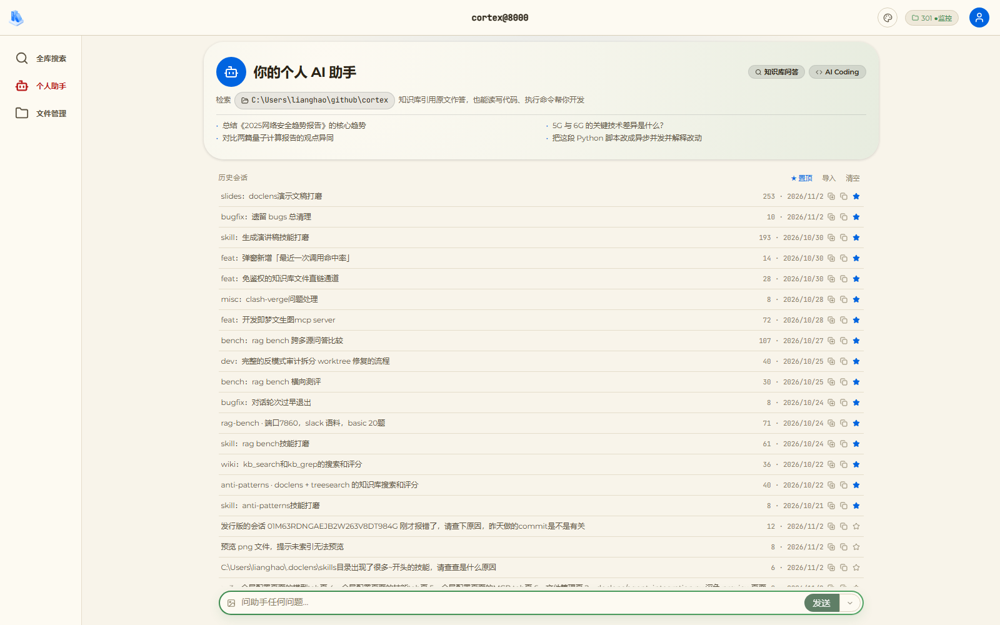

<!-- block: x=12% y=93% w=76% h=6% bg=bg anim=enter.fly-in direction=left trigger=after delay=1.0 banner=frag -->

**个人助手主界面**——中间提问入口，下方最近会话，打开即用

<!-- slide: layout=blank bg=bg kicker="02 · 实貌 2/7" bg=#1e2229 anim=none notes="文件管理页。整个代码仓库在浏览器里就能看：左边是目录树，右边点开任何一个文件，源码直接预览。您现在看到的，是我们项目真实的配置文件。日常的文件操作，不用切回终端。" -->

<!-- block: x=13.75% y=5% w=72.5% h=85% fit=cover style=laptop anim=enter.fly-in direction=up trigger=after delay=0.3 -->

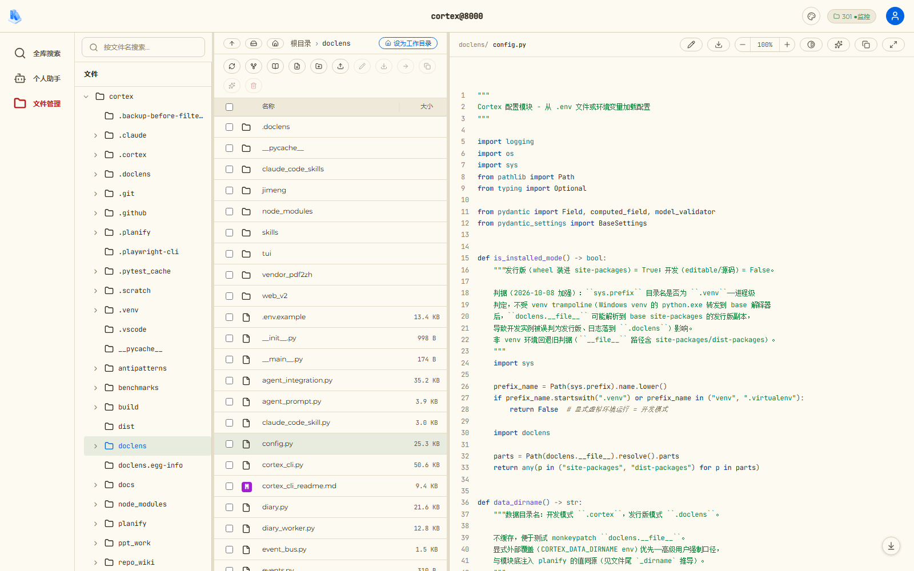

<!-- block: x=12% y=93% w=76% h=6% bg=bg anim=enter.fly-in direction=left trigger=after delay=1.0 banner=frag -->

**代码仓库可视管理**——树状目录、未提交改动、点击即预览源码

<!-- slide: layout=blank bg=bg kicker="02 · 实貌 3/7" bg=#1e2229 anim=none notes="这一页是 AI 编码的实况。屏幕上是一个真实任务——我们在开发一个文生图服务。可以看到 AI 的每一轮回答下面，它调用了什么工具、读了哪些文件，全部以可展开的记录呈现。AI 每一步做了什么，全程可见，不是黑箱。" -->

<!-- block: x=13.75% y=5% w=72.5% h=85% fit=cover style=laptop anim=enter.fly-in direction=up trigger=after delay=0.3 -->

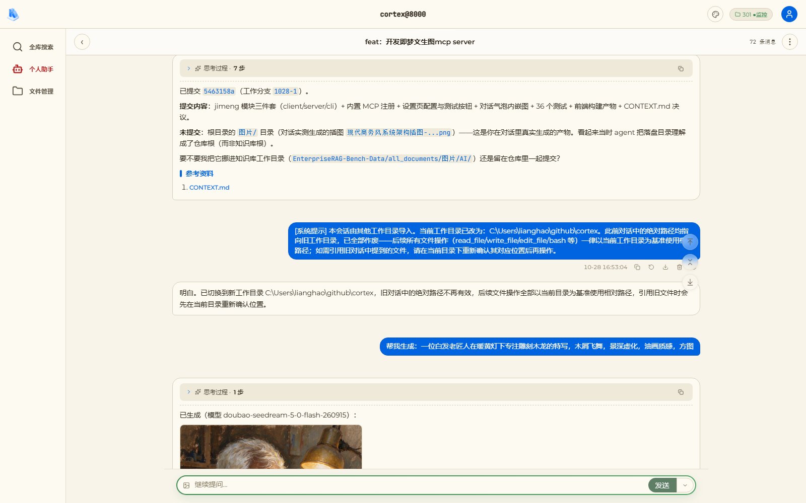

<!-- block: x=12% y=93% w=76% h=6% bg=bg anim=enter.fly-in direction=left trigger=after delay=1.0 banner=frag -->

**AI 编码实战**——真实任务：开发即梦文生图 MCP server，全程可追溯

<!-- slide: layout=blank bg=#1e2229 kicker="02 · 实貌 4/7" anim=none notes="手机实拍一：左边是助手首页，右边是真实开发会话——同一个应用，手机上完整可用。" -->

<!-- block: x=21% y=5% w=23% h=85% fit=cover style=device anim=enter.fly-in direction=up trigger=after delay=0.6 -->

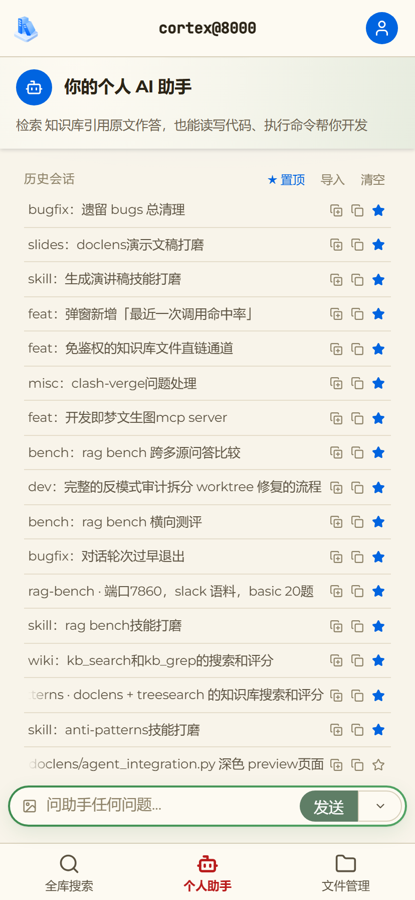

<!-- block: x=56% y=5% w=23% h=85% fit=cover style=device anim=enter.fly-in direction=up trigger=after delay=1.0 -->

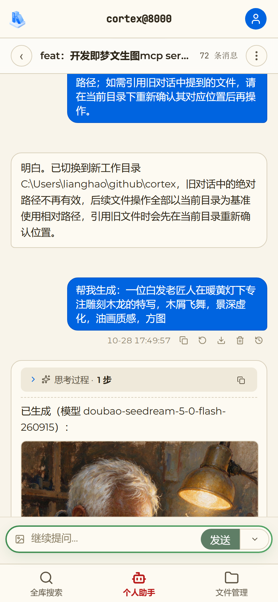

<!-- block: x=8% y=43% w=12% h=7% bg=dark align=center anim=enter.fade trigger=after delay=1.4 -->

助手首页

<!-- block: x=80% y=43% w=12% h=7% bg=dark align=center anim=enter.fade trigger=after delay=1.5 -->

会话聚焦

<!-- block: x=12% y=88% w=76% h=7% bg=bg anim=enter.fly-in direction=left trigger=after delay=1.6 banner=frag -->

**手机端完整可用**

<!-- slide: layout=blank bg=#1e2229 kicker="02 · 实貌 5/7" anim=none notes="手机实拍二：左边是会话信息对话框——上下文占用、缓存命中率一目了然；右边是模型配置，随时切换。" -->

<!-- block: x=21% y=5% w=23% h=85% fit=cover style=device anim=enter.fly-in direction=up trigger=after delay=0.6 -->

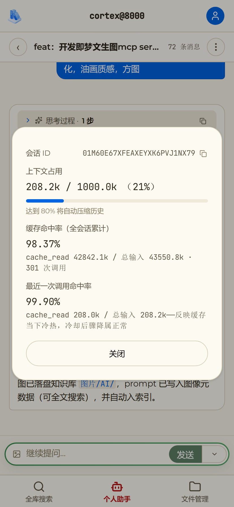

<!-- block: x=56% y=5% w=23% h=85% fit=cover style=device anim=enter.fly-in direction=up trigger=after delay=1.0 -->

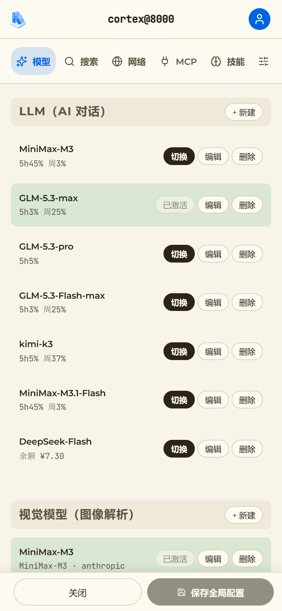

<!-- block: x=8% y=43% w=12% h=7% bg=dark align=center anim=enter.fade trigger=after delay=1.4 -->

会话信息

<!-- block: x=80% y=43% w=12% h=7% bg=dark align=center anim=enter.fade trigger=after delay=1.5 -->

模型配置

<!-- block: x=12% y=88% w=76% h=7% bg=bg anim=enter.fly-in direction=left trigger=after delay=1.6 banner=frag -->

**每一步都可量化**

<!-- slide: layout=blank bg=#1e2229 kicker="02 · 实貌 6/7" anim=none notes="手机实拍三：技能管理与 MCP 服务器配置——生态能力在手机上同样开放。" -->

<!-- block: x=21% y=5% w=23% h=85% fit=cover style=device anim=enter.fly-in direction=up trigger=after delay=0.6 -->

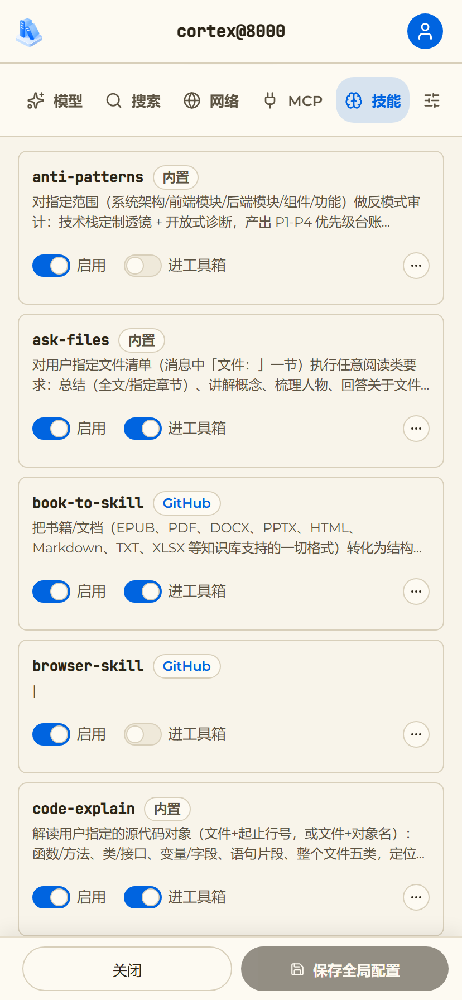

<!-- block: x=56% y=5% w=23% h=85% fit=cover style=device anim=enter.fly-in direction=up trigger=after delay=1.0 -->

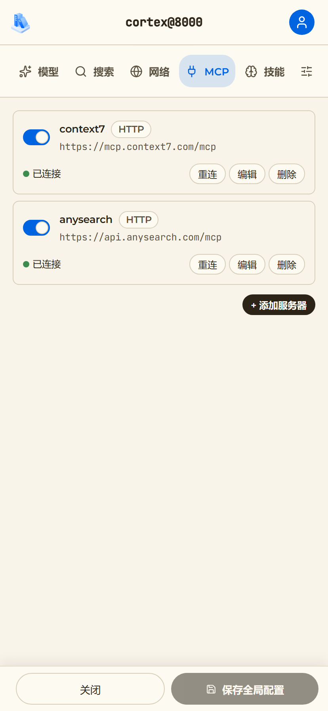

<!-- block: x=8% y=43% w=12% h=7% bg=dark align=center anim=enter.fade trigger=after delay=1.4 -->

技能管理

<!-- block: x=80% y=43% w=12% h=7% bg=dark align=center anim=enter.fade trigger=after delay=1.5 -->

MCP 连接

<!-- block: x=12% y=88% w=76% h=7% bg=bg anim=enter.fly-in direction=left trigger=after delay=1.6 banner=frag -->

**生态随身携带**

<!-- slide: layout=blank bg=#1e2229 kicker="02 · 实貌 7/7" anim=none notes="手机实拍四：文件管理与深色代码预览——移动优先是第一天的架构决策。" -->

<!-- block: x=21% y=5% w=23% h=85% fit=cover style=device anim=enter.fly-in direction=up trigger=after delay=0.6 -->

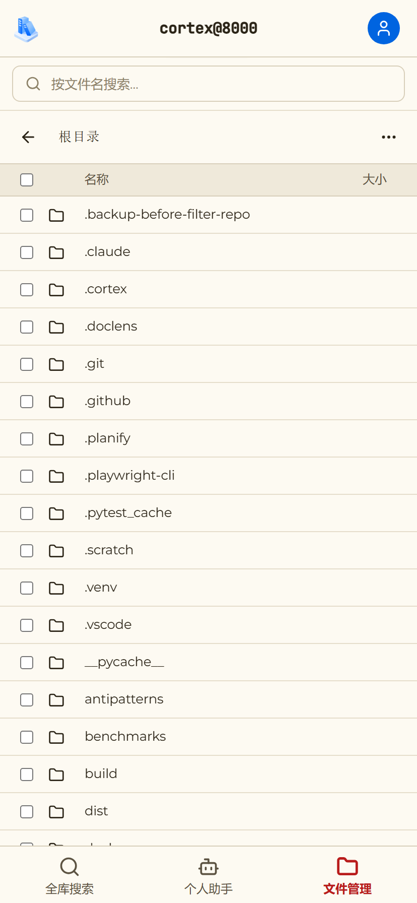

<!-- block: x=56% y=5% w=23% h=85% fit=cover style=device anim=enter.fly-in direction=up trigger=after delay=1.0 -->

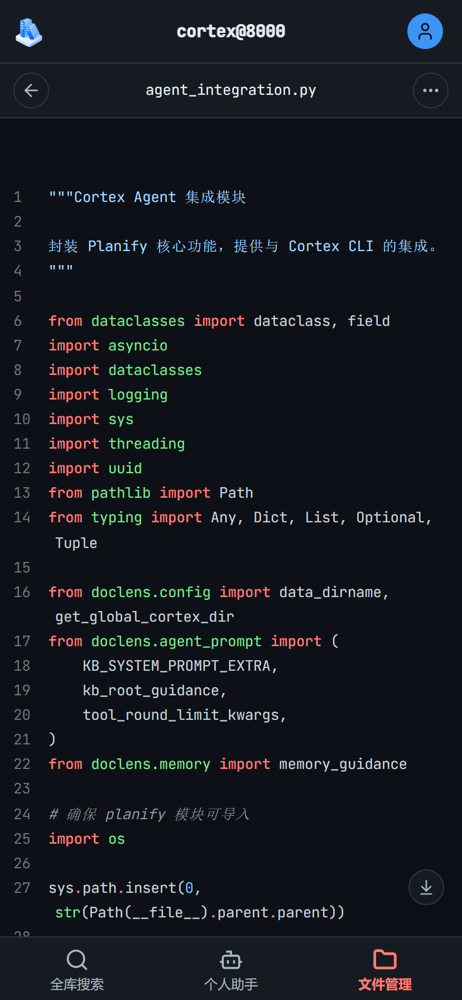

<!-- block: x=8% y=43% w=12% h=7% bg=dark align=center anim=enter.fade trigger=after delay=1.4 -->

文件管理

<!-- block: x=80% y=43% w=12% h=7% bg=dark align=center anim=enter.fade trigger=after delay=1.5 -->

深色预览

<!-- block: x=12% y=88% w=76% h=7% bg=bg anim=enter.fly-in direction=left trigger=after delay=1.6 banner=frag -->

**文档随行阅读**

<!-- slide: layout=blank kicker="03 · 方案" takeaway="**四层全自有，唯一外联是可替换的模型接口**" notes="先回到开场的三个问题。我们现有的工作方式里，代码是流向云端大模型的——方便，但数据流向、审计、供应风险，这三个问题没有人能替我们回答。我们的答案是这张分层图：从上到下四层——界面、宿主、AI 框架、索引引擎——每一层都是我们自己写的，名字和职责都叫得出来、改得动。索引、会话、记忆全部落在本地磁盘。底下这条线就是内网边界：唯一穿过它的，是右下角这个可替换的模型接口——可以指向内网，可以换国产，也可以用 Anthropic。动画顺序：四层从上到下逐层落下，边界线最后划出，模型接口行最后飞入。" -->

<!-- block: x=5.6% y=12% w=88.8% h=9% -->

# 四层全自有，唯一外联可换模型

<!-- block: x=6% y=22% w=88% h=8.5% bg=bg anim=enter.fly-in direction=left trigger=after delay=0.3 -->

**Web 界面**——浏览器即用 · PWA 可装桌面与手机（Lit + Vite）

<!-- block: x=9% y=31.5% w=82% h=8.5% bg=bg anim=enter.fly-in direction=left trigger=after delay=0.55 -->

**宿主层**——会话 / 备份 / 文件管理 / 权限门禁（FastAPI + SSE）

<!-- block: x=12% y=41% w=76% h=8.5% bg=bg anim=enter.fly-in direction=left trigger=after delay=0.8 -->

**AI 框架**——agent 主循环 / 上下文压缩 / 技能（自研 planify）

<!-- block: x=15% y=50.5% w=70% h=8.5% bg=bg anim=enter.fly-in direction=left trigger=after delay=1.05 -->

**索引引擎**——全文检索 / 结构感知（自研 treesearch · SQLite FTS5）

<!-- block: x=6% y=60.5% w=88% h=2% bg=accent anim=enter.wipe trigger=after delay=1.4 -->

　

<!-- block: x=6% y=63.5% w=88% h=9.5% bg=dark anim=enter.fly-in direction=up trigger=after delay=1.7 -->

**模型接口**——唯一外联点 · 可替换：内网 / 国产 / Anthropic 任选

<!-- block: x=6% y=74.5% w=88% h=15% anim=enter.fade trigger=after delay=2.0 -->

索引、会话、记忆全部落在本地磁盘——这条线以内，数据不出内网。

<!-- slide: layout=blank kicker="04 · 差异" takeaway="**它结构性给不了的，我们天生就有**" anim=none notes="对等之外，这面墙是真正的不同——十二项，每一项都是 Claude Code 结构上给不了的。头两张连着讲：全端可用——同一个应用，电脑和手机功能一个不少；工作接力——办公室干到一半的任务，出门路上掏出手机打开同一个会话接着干，上下文一点不丢。这是终端工具做不到的移动场景。后面：数据不出内网、逐调用留痕，闭源云服务做不到；自动备份、全保真导出、AI 自动记忆，是产品形态的差距；模型随插随换、技能反向互通、源码全自有、知识资产化、零许可费用——自己的代码才做得出的自由。语气讲事实，不贬对方。" -->

<!-- block: x=5.6% y=12% w=88.8% h=9% -->

# 比它更强的十二项

<!-- block: x=3.5% y=23% w=22.5% h=22% bg=bg align=center anim=enter.zoom trigger=after delay=0.30 -->

<i data-icon="globe"/> **全端可用**
电脑手机同一应用

<!-- block: x=27% y=23% w=22.5% h=22% bg=bg align=center anim=enter.zoom trigger=after delay=0.42 -->

<i data-icon="refresh"/> **工作接力**
半途换机接着干

<!-- block: x=50.5% y=23% w=22.5% h=22% bg=bg align=center anim=enter.zoom trigger=after delay=0.54 -->

<i data-icon="lock"/> **数据不出内网**
代码留在本地

<!-- block: x=74% y=23% w=22.5% h=22% bg=bg align=center anim=enter.zoom trigger=after delay=0.66 -->

<i data-icon="eye"/> **逐调用留痕**
审计**随时抽查**

<!-- block: x=3.5% y=48% w=22.5% h=22% bg=bg align=center anim=enter.zoom trigger=after delay=0.78 -->

<i data-icon="database"/> **整库自动备份**
环形十份兜底

<!-- block: x=27% y=48% w=22.5% h=22% bg=bg align=center anim=enter.zoom trigger=after delay=0.90 -->

<i data-icon="package"/> **会话全保真导出**
迁移带走资产

<!-- block: x=50.5% y=48% w=22.5% h=22% bg=bg align=center anim=enter.zoom trigger=after delay=1.02 -->

<i data-icon="lightbulb"/> **AI 自动记忆**
越用越懂团队

<!-- block: x=74% y=48% w=22.5% h=22% bg=bg align=center anim=enter.zoom trigger=after delay=1.14 -->

<i data-icon="zap"/> **模型随插随换**
内网国产都行

<!-- block: x=3.5% y=73% w=22.5% h=22% bg=bg align=center anim=enter.zoom trigger=after delay=1.26 -->

<i data-icon="repeat"/> **技能反向互通**
也能给 CC 用

<!-- block: x=27% y=73% w=22.5% h=22% bg=bg align=center anim=enter.zoom trigger=after delay=1.38 -->

<i data-icon="code"/> **源码全自有**
需求变了自己改

<!-- block: x=50.5% y=73% w=22.5% h=22% bg=bg align=center anim=enter.zoom trigger=after delay=1.50 -->

<i data-icon="file-text"/> **知识资产化**
写文档即技能

<!-- block: x=74% y=73% w=22.5% h=22% bg=bg align=center anim=enter.zoom trigger=after delay=1.62 -->

<i data-icon="code"/> **内置代码工作台**
高亮编辑看变更

<!-- slide: layout=blank bg=bg kicker="04 · 差异 01/5" anim=none notes="第一项差异，两句话：全端可用——同一个应用，电脑和手机功能一个不少；工作接力——办公室干到一半的任务，出门路上掏出手机打开同一个会话接着干，上下文一点不丢。左边这幅画就是这个场景。" -->

<!-- block: x=5.6% y=12% w=38% h=9% -->

# 全端可用，接力不停

<!-- block: x=6% y=24.5% w=34% h=49% color=text anim=enter.fade trigger=after delay=0.6 -->

- 同一个应用，电脑手机功能一个不少
- 办公室干到一半，路上掏出手机接着干
- **上下文一点不丢**，断网也续跑落库

<!-- block: x=44% y=8% w=50% h=84% bg=bg anim=enter.fly-in direction=right trigger=after delay=1.2 -->

<!-- slide: layout=blank bg=bg kicker="04 · 差异 02/5" anim=none notes="讲主权：唯一外联点是可替换的模型接口，其余一切本地。" -->

<!-- block: x=5.6% y=12% w=38% h=9% -->

# 数据不出内网

<!-- block: x=6% y=24.5% w=34% h=49% color=text anim=enter.fade trigger=after delay=0.6 -->

- 索引、会话、记忆**全部落在本地磁盘**
- 模型接口指向内网，代码**全程不出网**
- 唯一外联点可替换，内网国产任选

<!-- block: x=44% y=8% w=50% h=84% bg=bg anim=enter.fly-in direction=right trigger=after delay=1.2 -->

<!-- slide: layout=blank bg=bg kicker="04 · 差异 03/5" anim=none notes="对比 CLAUDE.md 手工维护：我们是自动策展。" -->

<!-- block: x=5.6% y=12% w=38% h=9% -->

# AI 自动记忆

<!-- block: x=6% y=24.5% w=34% h=49% color=text anim=enter.fade trigger=after delay=0.6 -->

- AI 自己维护长期记忆，非手写配置
- 偏好、工作方式、决策**自动记录去重**
- 过时自动归档，每条人可审计

<!-- block: x=44% y=8% w=50% h=84% bg=bg anim=enter.fly-in direction=right trigger=after delay=1.2 -->

<!-- slide: layout=blank bg=bg kicker="04 · 差异 04/5" anim=none notes="模型这一层，选择权全在我们手里。对话模型原生支持 Anthropic 和 OpenAI 两大协议——智谱、DeepSeek、MiniMax、通义千问填个地址就能用；LLM Route、OneAPI 这类聚合网关完全兼容，内网服务同样即插即用，切换不改代码。再往上一层：视觉模型独立配置——您在前几页看到的贴图提问、手机截图，背后都是它在看图；文生图和语音合成也是直连的——今天这份汇报里的插画和旁白，就是我们自己的系统生成的。工具链完整，不用东拼西凑。" -->

<!-- block: x=5.6% y=12% w=38% h=9% -->

# 模型随插随换

<!-- block: x=6% y=24.5% w=34% h=49% color=text anim=enter.fade trigger=after delay=0.6 -->

- **Anthropic 与 OpenAI 双协议**：智谱、DeepSeek、MiniMax、千问即配即用
- LLM Route / OneAPI / 内网服务，**填地址即接入**
- 独立**视觉模型**：贴图提问、截图判向
- 直连**文生图与语音合成**：素材开口即得

<!-- block: x=44% y=8% w=50% h=84% bg=bg anim=enter.fly-in direction=right trigger=after delay=1.2 -->

<!-- slide: layout=blank bg=bg kicker="04 · 差异 05/5" anim=none notes="最后一项：代码工作台。终端工具看代码要另开编辑器、看变更要敲 git 命令；我们内建 VSCode 风格的代码页——AI 写完当场看改验，不用切换工具。" -->

<!-- block: x=5.6% y=12% w=38% h=9% -->

# 内置代码工作台

<!-- block: x=6% y=24.5% w=34% h=49% color=text anim=enter.fade trigger=after delay=0.6 -->

- VSCode 风格：**语法高亮**浏览与编辑
- 并排查看**变更差异**，翻阅项目文档
- AI 写完**当场看、当场改、当场验**

<!-- block: x=44% y=8% w=50% h=84% bg=bg anim=enter.fly-in direction=right trigger=after delay=1.2 -->

<!-- slide: layout=blank kicker="05 · 对等" takeaway="**先追平，再谈不同——迁移成本接近零**" anim=none source="功能项基于本仓源码逐项核对" notes="有人会问：自研的，会不会是个玩具？这面能力墙十二项一次回答——Claude Code 用户最熟悉的能力，从对话改代码、贴图提问、改错回退，到子代理、技能、MCP 生态、权限确认、会话恢复，我们全都有。特别看第三行第一张：CLAUDE.md 兼容，团队沉淀的规范文件一个字不用改直接用。到这里只是追平，真正的不同在后面。" -->

<!-- block: x=5.6% y=12% w=88.8% h=9% -->

# Claude Code 有的，我们都有

<!-- block: x=3.5% y=23% w=22.5% h=22% bg=bg align=center anim=enter.zoom trigger=after delay=0.30 -->

<i data-icon="message"/> **对话即编程**
说需求就动手

<!-- block: x=27% y=23% w=22.5% h=22% bg=bg align=center anim=enter.zoom trigger=after delay=0.42 -->

<i data-icon="image"/> **贴图提问**
截图粘贴即问

<!-- block: x=50.5% y=23% w=22.5% h=22% bg=bg align=center anim=enter.zoom trigger=after delay=0.54 -->

<i data-icon="repeat"/> **改错随时退回**
零风险试错

<!-- block: x=74% y=23% w=22.5% h=22% bg=bg align=center anim=enter.zoom trigger=after delay=0.66 -->

<i data-icon="users"/> **子代理并行**
大任务拆小

<!-- block: x=3.5% y=48% w=22.5% h=22% bg=bg align=center anim=enter.zoom trigger=after delay=0.78 -->

<i data-icon="list"/> **任务清单跟踪**
步骤看得见

<!-- block: x=27% y=48% w=22.5% h=22% bg=bg align=center anim=enter.zoom trigger=after delay=0.90 -->

<i data-icon="zap"/> **斜杠命令**
一句话触发

<!-- block: x=50.5% y=48% w=22.5% h=22% bg=bg align=center anim=enter.zoom trigger=after delay=1.02 -->

<i data-icon="file-text"/> **CLAUDE.md 兼容**
存量直接用

<!-- block: x=74% y=48% w=22.5% h=22% bg=bg align=center anim=enter.zoom trigger=after delay=1.14 -->

<i data-icon="network"/> **MCP 生态**
工具即插即用

<!-- block: x=3.5% y=73% w=22.5% h=22% bg=bg align=center anim=enter.zoom trigger=after delay=1.26 -->

<i data-icon="shield"/> **危险操作确认**
不点头不动手

<!-- block: x=27% y=73% w=22.5% h=22% bg=bg align=center anim=enter.zoom trigger=after delay=1.38 -->

<i data-icon="layers"/> **超长对话压缩**
不丢关键

<!-- block: x=50.5% y=73% w=22.5% h=22% bg=bg align=center anim=enter.zoom trigger=after delay=1.50 -->

<i data-icon="refresh"/> **会话恢复**
接着上次聊

<!-- block: x=74% y=73% w=22.5% h=22% bg=bg align=center anim=enter.zoom trigger=after delay=1.62 -->

<i data-icon="timer"/> **后台任务**
跑完来报

<!-- slide: layout=image-right kicker="06 · 主权" takeaway="**代码不出内网，每一步都可审计**" anim=none notes="回到开场的三个问号，现在给答案。代码去了哪？全部留在本地磁盘，接内网模型就是完全闭环。谁能审计？每一次模型调用都有留痕，随时可以抽查；越界操作必须人工确认；登录密码不以明文传输。这些不是我们做得好不好，而是闭源产品在结构上就无法提供的。动画顺序：两段文字先从左飞入；讲到审计留痕时点击一下，堡垒图从右飞入。" -->

# 三个问号，三个对勾

<!-- block: anim=enter.fly-in direction=left trigger=after -->

**代码流去了哪？** 索引、会话、记忆全落本地磁盘，唯一外联是可替换的模型接口，接内网模型即完全闭环。

<!-- block: anim=enter.fly-in direction=left trigger=after -->

**谁能审计它？** 每次模型调用留痕可抽查，权限门禁三态越界必确认，登录走质询响应密码不上线。

<!-- block: fit=contain anim=enter.fly-in direction=right trigger=click -->

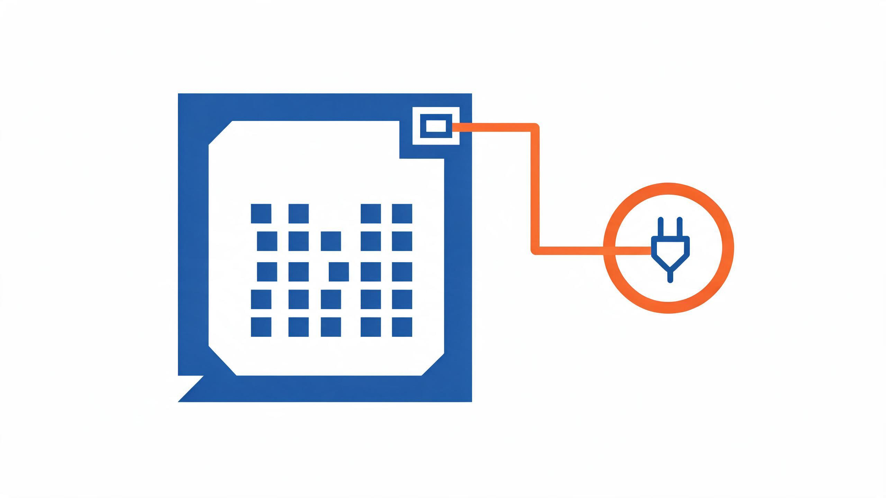

<!-- slide: layout=image-right kicker="07 · 沉淀" takeaway="**记忆自动积累，会话可备份可回退**" notes="这页讲两件长期价值。记忆：不是手写配置文件，是 AI 自己按纪律策展——写入、去重、退役都自动，人还能逐条审计。会话：整库备份环形十份、单会话全保真导出、每轮快照可回退。这套机制来自一次真实的数据损坏事故，是真刀真枪做出来的。" -->

# 越用越懂团队：记忆与会话资产

<!-- block: fit=contain style=rounded,shadow -->

- **记忆自动策展**：写入、去重、退役由 AI 按纪律执行
- **四分区**：用户偏好、工作方式、项目事实、外部指针
- **整库备份**：环形十份，损坏自动留证
- **全保真导出**：单会话 JSON，可跨实例迁移
- **回退**：每轮快照，改错能退回

<!-- slide: layout=image-left kicker="08 · 解锁" takeaway="**谁强用谁、谁合规用谁，选择权在自己手里**" notes="这页讲议价权。模型是消耗品不是信仰，双协议并存意味着可以随时换：便宜了换、合规要求变了换、内网有了新模型换。切换在界面上点几下就完成，不用改代码。视觉模型还能单独配，跟对话模型解耦。" -->

# 多模型后端：不被任何一家锁定

<!-- block: fit=contain -->
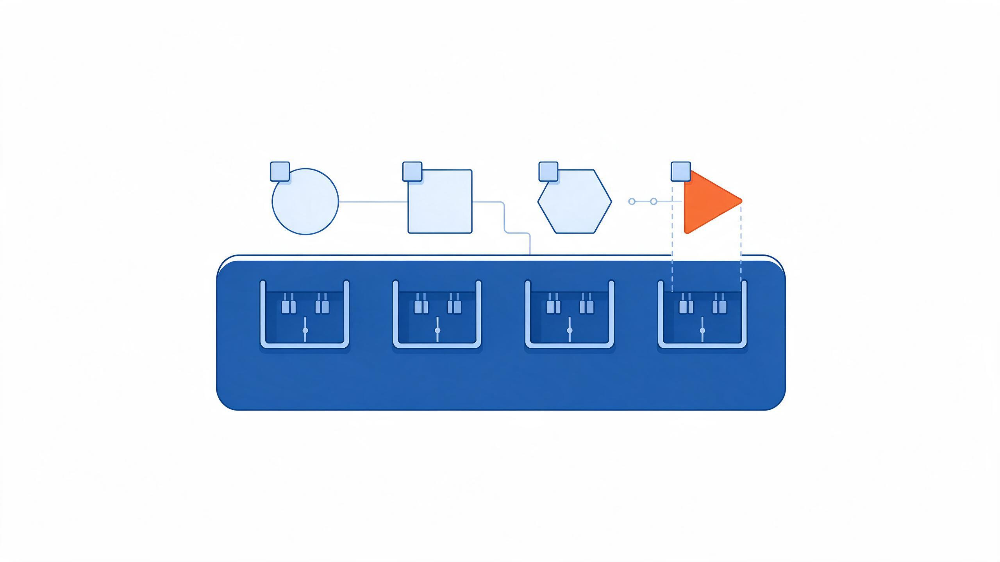

- 双协议并存：Anthropic 原生与 OpenAI 兼容
- 任意 base_url：DeepSeek、Qwen、内网都能接
- 界面内预设切换，保存即生效
- 视觉模型独立配置，与对话解耦
- 双后端差异已磨平：格式翻译、用量回收

<!-- slide: layout=two-col kicker="09 · 生态" takeaway="**生态直接继承，团队知识可资产化**" notes="上半场讲继承：技能格式与主流 agent 同构，社区技能贴个链接就能装进来，不用从零建生态。下半场讲沉淀：repo-wiki 能把任意项目的架构文档一键生成，deep-read 能把一本规范手册变成技能。写技能就是写 Markdown，测试、运维、文档岗都能贡献。" -->

# 技能生态：社区继承，知识资产化

**社区技能直接继承**

- 格式与主流 agent 同构，直接套用
- 贴 GitHub 链接即装，免 git 依赖
- 改完热重载，无需重启
- 自建技能可反向同步给对方用

---

**内置精选**

- **code-explain** 点名函数即结构化讲解
- **repo-wiki** 一键生成项目架构文档
- **anti-patterns** 反模式审计出修复台账
- **deep-read** 深读规范手册提炼成技能

<!-- slide: layout=title-content kicker="10 · 对标" takeaway="**不是全面超越，是补齐了它结构性缺的那几块**" source="功能项基于本仓源码核对；对方能力以官方文档为准" notes="全篇最重的一页，也是最需要诚实的。逐行讲，语气不要挑衅。重点在可审计性和源码归属两条：这是闭源产品结构上给不了的。最后主动承认：对方的生态规模和战场历练我们暂时不如——这一句不要藏，主动说了才立得住前面的所有主张。" -->

# 正面对比：六维对标

| 维度 | Claude Code | 本项目 |
|---|---|---|
| 交互形态 | 终端为主 | 全功能 Web UI + PWA |
| 数据流向 | 代码经境外云 | 全本地，可接内网模型 |
| 可审计性 | 闭源黑箱 | 白箱，逐调用留痕 |
| 源码与技术栈 | Node 闭源 | Python 全栈自有 |
| 可定制深度 | 配置与钩子 | 可改框架本身 |
| 技能生态 | 社区大、闭源加载 | 格式兼容，可继承可自建 |

<!-- slide: layout=timeline kicker="11 · 上手" takeaway="**十分钟能跑起来，不需要运维介入**" notes="讲引入成本。唯一依赖是 Python，没有 Docker、没有数据库服务要架。四条命令走完就到浏览器界面。模型在设置页里点鼠标配。这页的目的是让试试看这件事变得没有心理负担。" -->

# 十分钟上手

| 步骤 | 动作 | 说明 |
|---|---|---|
| ① | **pip install doclens** | 唯一依赖 Python 3.10+ |
| ② | **doclens index** | 首次全量，之后自动增量 |
| ③ | **doclens gui** | 浏览器自动打开，PWA 可装桌面 |
| ④ | 设置页配模型 | 选协议、填地址，保存即用 |

<!-- slide: layout=closing kicker="12 · 收尾" takeaway="**方向盘已经造出来了，什么时候握上它，由您决定**" notes="收尾不要提要求。把决定权交回去：工具已经造好、能上手、能验证。需要我做的是随时可以演示真机，其余交给领导判断。停在这里，留白。" -->

# 方向盘已经造出来了

- **能看**：随时可以演示真机界面
- **能验**：数据不出内网，每步留痕可审计
- **能接**：贴 GitHub 链接即可导入社区技能
- **能改**：Python 全栈自有，需求变了我们自己改

什么时候握上它，由您决定。
